# Continuous Delivery Pipelines — distilled

> **Source**: Dave Farley, *Continuous Delivery Pipelines: How to Build Better Software Faster*, Leanpub edition published 2021-04-23 (© 2020–2021 Continuous Delivery Ltd.) · extracted from `literature/extracted/engineering/continuous-delivery-pipelines-farley.txt` · distilled 2026-09-29 (spec v2)
> **Contributes**: Farley gives a source-level account of the Deployment Pipeline as the engineering boundary for releasability, from a small commit through a tested artifact to production and user feedback. The chapters join pipeline construction with TDD, build and release automation, acceptance and performance evaluation, data migration, infrastructure, compliance, and measurements. The case study shows how these mechanisms were adapted in one high-performance regulated system; it is an example, not a universal sizing prescription.

## Chapter map

- ch-1 — Introduction to Continuous Delivery: what “always releasable” means and why small feedback cycles support learning.
- ch-2 — What is a Deployment Pipeline?: which evaluations define releasability and how a candidate moves from commit toward production.
- ch-3 — How to Build a Deployment Pipeline: a walking-skeleton sequence for creating the smallest useful pipeline, then extending it.
- ch-4 — Test Driven Development: the red, green, refactor loop and how test-first work shapes design.
- ch-5 — Automate Nearly Everything: which repeatable development, testing, release, data, and infrastructure activities to automate.
- ch-6 — Version Control: which inputs must be versioned to reproduce a release candidate and its environment.
- ch-7 — The Development Environment: local capabilities and team conditions that shorten the path into the commit cycle.
- ch-8 — The Commit Cycle: fast technical feedback, small changes, CI behaviors, and release-candidate creation.
- ch-9 — The Artifact Repository: how to identify, retain, and promote the exact deployable bits.
- ch-10 — The Acceptance Stage: user-facing specifications, production-like evaluation, and layered test infrastructure.
- ch-11 — Manual Testing: where human exploration adds value alongside automated evaluation.
- ch-12 — Performance Testing: choosing scenarios, thresholds, and precision appropriate to user and system needs.
- ch-13 — Testing Non-Functional Requirements: evaluating resilience, scale, security, provenance, and compliance.
- ch-14 — Testing Data and Data Migration: versioning schemas and data changes, testing delta scripts, and choosing test data.
- ch-15 — Release Into Production: defining the pipeline boundary, choosing a release strategy, and learning from production.
- ch-16 — Infrastructure As Code: configuration-management choices and the repeatability practices they enable.
- ch-17 — Regulation and Compliance: generating auditable evidence continuously inside the delivery process.
- ch-18 — Measuring Success: using purpose, stability, throughput, and lead-time measures to improve the system.
- ch-19 — The LMAX Case Study: an example of a growing pipeline serving performance, scale, and regulatory needs.
- ch-20 — The Role of the Deployment Pipeline: what the pipeline organizes and where its scope ends.

## ch-1 — Introduction to Continuous Delivery {#ch-1}

Continuous Delivery (CD) is a way to keep software in a releasable state while making small, frequent changes. Its scope runs from an idea to useful software in users’ hands. Design, development, testing, release, and feedback proceed as a connected cycle rather than as isolated handoffs.

The author grounds the approach in short experiments. Small changes limit interacting errors, make a failed hypothesis cheaper to reverse, and bring test and customer feedback closer to the work that produced it. Version control helps control what changed; repeated tests and measurements make observations comparable. Automation supplies repeatability and leaves human attention for design and problem solving.

Figure 1.1 frames the path from an idea to a customer with a feedback return. The loop matters: release is an opportunity to learn whether the idea delivered value, not the end of the work.

Derived from image: chapter02-01 (Figure 1.1)
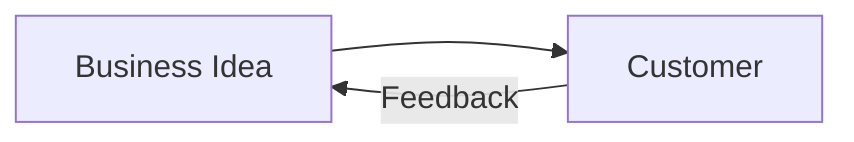

Figure 1.2 puts design, development, testing, and release on continuing tracks and shows theory, prediction, experiment, and observation as a recurring learning cycle. It is a model of overlapping work, not a one-time sequence of departmental handoffs.

Derived from image: chapter02-02 (Figure 1.2)
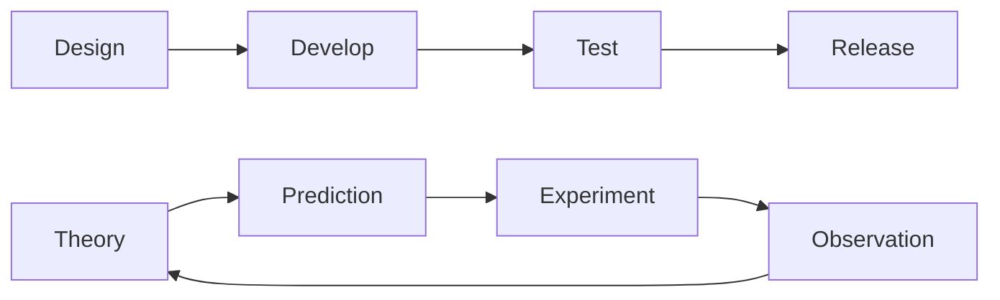

Figure 1.3 names feedback paths at several scales. An idea can be revisited after release; a specification can be revised after a build; and code can be adjusted in response to a unit test. The figure locates feedback at different distances from the initial idea.

Derived from image: chapter02-03 (Figure 1.3)
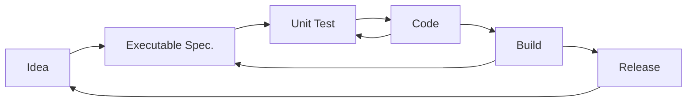

Farley calls CD an engineering discipline: treat expectations as claims that can be rejected by a failed test. A pass gives limited confidence under the checks performed; one failed required check is enough to reject that candidate. The book recommends starting by measuring the time from commit to a releasable outcome, then removing delays and waste incrementally.

Seven practices recur through the book: shorten cycle time, automate repeatable work, control variables, work in small steps, make evidence-based decisions, keep teams small and empowered, and use lean and agile principles. These are interacting habits, not an installable toolchain.

## ch-2 — What is a Deployment Pipeline? {#ch-2}

A **Deployment Pipeline** organizes and automates the work from commit to a releasable outcome. It is the only route to production in the model. The pipeline defines which tests, validations, approvals, and other checks are needed for a release candidate to be ready; green means the team has no remaining release work outside that route.

Its scope should match an independently deployable unit. Depending on the system, that can be a service or a whole system. A separate pipeline for every team or for each activity such as build, test, and deploy fragments the answer about releasability.

Figure 2.1 shows local development feeding a source repository and commit stage, a candidate in the artifact repository, acceptance evaluation, and a production environment. The artifact store is the link between stages.

Derived from image: chapter03-01 (Figure 2.1)
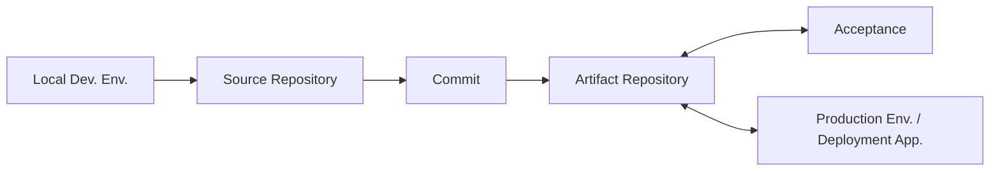

The pipeline is a falsification mechanism: it tries to find reasons a candidate is not fit for release. A successful commit stage creates a release candidate; later stages evaluate that candidate from the user’s perspective and against other requirements. Fast technical checks run first. Slower checks can proceed while the developer starts other work, provided that the author continues to follow the candidate through the remaining stages and handles failures.

The central tradeoff is between fast feedback and enough evidence to release safely. The sequence should provide an early signal quickly, then finish all necessary evaluations. A pipeline that passes only a build, or that leaves manual integration or sign-off work afterward, has not established the promised outcome.

The simplest pipeline has four named parts: Commit Stage; Artifact Repository; Acceptance Stage; and ability to deploy into production. It commonly includes fast technical tests, deeper acceptance checks, and other tests needed for performance, scale, resilience, security, compliance, or data migration. The right set varies by product.

## ch-3 — How to Build a Deployment Pipeline {#ch-3}

Begin with a small end-to-end use case and a **Walking Skeleton**, a minimal implementation that exercises the main parts of the system. The author recommends agreeing on the starting case and tools as a team. Build only enough pipeline to support that slice; defer additional sophistication until the next feature makes it necessary.

The initial construction sequence is:

1. Put the code and tests in version control.
2. Configure a commit stage to find and run the fast tests on every change.
3. Package the successful result as the actual deployable unit and assign it a unique ID.
4. Store that release candidate in an artifact repository.
5. Add an acceptance test, environment setup, deployment, health check, and test execution.
6. Record each result against the candidate ID.
7. Add a simple production-like deployment path using the same deployment mechanism as acceptance.

Derived from text: ch-3, “Getting Started”, “Create a Commit Stage”, “Create an Acceptance Stage”, and “Create a Simple Version of Production”
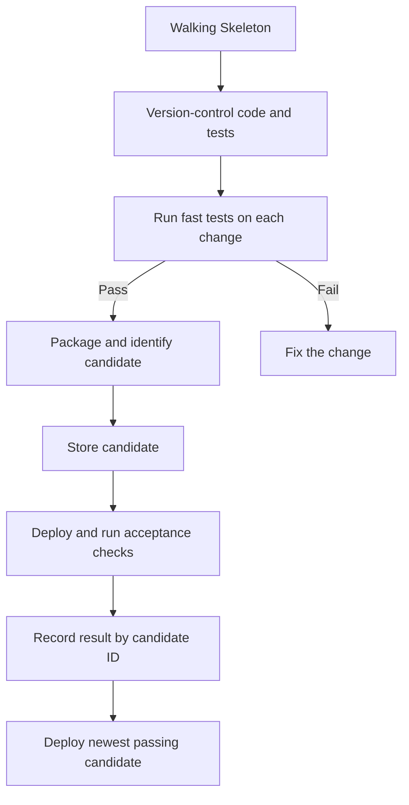

Acceptance work should avoid an accumulating queue of stale candidates. Farley describes a worker that looks for the newest candidate that has passed the commit checks when an acceptance run is ready. If there is none, it checks again later. This lets a slower stage catch up without spending effort on every superseded build; retain the result history even when old binaries are purged.

Derived from text: ch-3, “Create an Acceptance Stage”
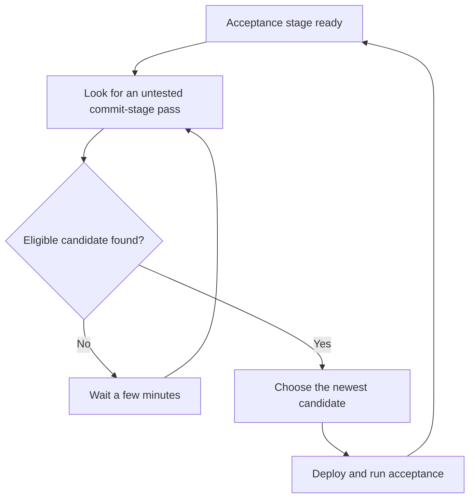

After the basic path works, add the next needed test or process, automate and version the pipeline itself, and measure whether the change improves the flow. The source gives an illustrative implementation sequence, not a required vendor stack or complete platform design.

## ch-4 — Test Driven Development {#ch-4}

**Test Driven Development (TDD)** is presented as a design and error-detection protocol as well as a way to produce tests. A test expresses intended behavior separately from the implementation; the assertion is where the two descriptions meet.

The cycle is Red, Green, Refactor. Write the smallest test for the next behavior, run it and observe the expected failure, make the smallest code change that passes, then improve the design while the test remains green. Add the next behavior through another cycle. A test that passes before the behavior exists, or fails for an unexpected reason, may be testing the wrong thing.

Derived from text: ch-4, “What is TDD?” and “Test First”
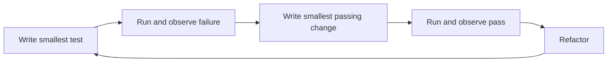

The aim is not a coverage number. Coverage may result from systematically driving changes with tests, but maximizing it as an independent target invites empty or low-value checks. Test-first work exposes the public interface before implementation and creates practical pressure for modular, loosely coupled, testable code.

Apply the testing discipline through the pipeline: fast technical tests at commit, user-facing acceptance tests later, and other checks where the product’s release criteria require them. Human exploration remains useful for usability, unusual cases, and open-ended discovery. When setup is unusually difficult, inspect the design and its seams before growing the test harness.

## ch-5 — Automate Nearly Everything {#ch-5}

Automate repeatable work that does not require human ingenuity. For tests, that includes configuring the environment, deploying the candidate, controlling test execution, and evaluating the behavior. Automation makes runs repeatable, records outcomes, supports parallel work, and shortens the time between change and evidence.

Builds should be deterministic for the same input. Use one deployment mechanism across development, test, and production so that a candidate exercises the path that will later carry it to users. Deployment should be a simple, repeatable action even when the underlying setup is complex.

The same principle applies to database migration, monitoring, reporting, dependency handling, infrastructure, release notes, and audit history. Version the process, gather test outcomes and lead-time measures automatically, and make a clear pass/fail result visible to the team. The book recommends eliminating human write access to production as a way to reduce configuration variation.

Human work remains appropriate where evaluation is exploratory or judgment-based. Automation can also support human decisions by assembling the relevant evidence and recording the decision, instead of turning every approval into an opaque handoff.

## ch-6 — Version Control {#ch-6}

The reproducibility target includes more than source code. Farley lists environment configuration, dependencies, infrastructure, databases, web servers, language and operating-system versions, network setup, and the pipeline itself as things that may affect the production result.

Every change to code, production configuration, and infrastructure should flow through version control and the deployment pipeline. For each candidate, record enough information to identify the inputs and checks: candidate ID, tests run, outcomes, environment, and relevant runtime versions. A well-controlled system can be recreated and treated as disposable.

The source recommends working on one shared trunk and exposing changes frequently. Branches delay visibility and can let incompatible work accumulate. If used, branches should be few and short lived; the suggested working target is integration at least daily, and more often when the team and pipeline can sustain it. Textual merge success does not prove that combined behavior is correct, so the resulting system still needs prompt evaluation.

This advice is about controlling variation and shortening integration feedback. It does not make a specific branch name or version-control product part of the mechanism.

## ch-7 — The Development Environment {#ch-7}

The local environment affects how much useful work can happen before a change reaches the shared commit cycle. Farley calls for suitable tools, reliable network and information access, a simple setup for new team members, and relationships that help people become effective, including pairing where useful.

Developers should be able to run the tests locally, deploy the whole system locally when practical, and modify local configuration to conduct experiments. These capabilities catch simple problems before they interrupt the shared pipeline and help developers explore changes with controlled inputs.

The chapter does not prescribe one workstation image or development container. The decision criterion is whether the team can set up and use an environment that makes experiments and tests accessible without hidden local state.

## ch-8 — The Commit Cycle {#ch-8}

The Commit Stage gives developers fast technical feedback and produces a release candidate when its checks pass. Typical steps are compilation, unit tests, static analysis, and packaging. Farley’s target is feedback within five minutes; he recommends keeping most commit checks local and avoiding network, disk, database, or full-application startup dependencies when those make the loop slow or variable.

Figure 8.3 situates the fast commit feedback in the wider deployment pipeline. The printed `<5 Minutes` is a rule of thumb, not a guarantee that every test belongs in this stage. The source's schematic places Manual Test inside the pipeline outline; chapter 11 clarifies that manual exploration is not a release gate and Figure 11.1 places it outside the loop.

Derived from image: chapter10-01, chapter10-03 (Figures 8.1 and 8.3)
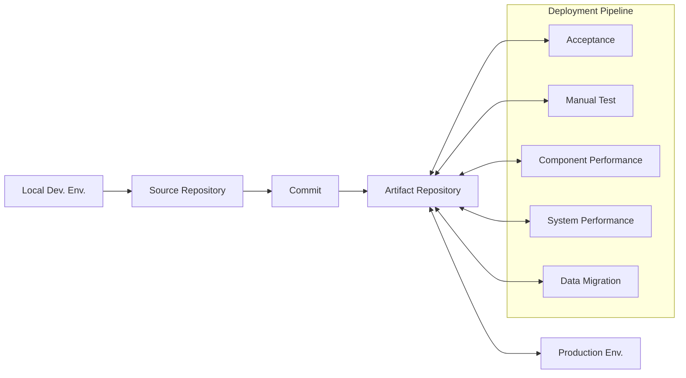

Most checks at this boundary are unit tests, alongside static and architectural checks that provide useful fast feedback. The quadrant model in Figure 8.2 separates tests that support programming from those that critique the product, and business-facing concerns from technical ones. Its point is that different test purposes belong in different positions; it does not imply that all test types should run in the same stage.

Work in small steps. Requirements should describe what a user needs, commits should be small enough to understand and reverse, and unfinished features can be built as multiple deployable increments. Aim to integrate at least daily. The author also describes much shorter intervals as an ideal to pursue when feedback and team habits allow it.

After a passing commit stage, continue with other useful work while tracking the candidate through later checks. When any required stage fails, restore the route to releasability: the change owner fixes the defect promptly or reverts it. The book’s ten-minute repair-or-revert target is a local rule of thumb. Keep failure ownership explicit; if it is unclear, the people whose changes may have caused the failure agree who will act.

In gated CI, changes enter the commit checks before being merged to the main VCS line. This can help teams establish the discipline, at the cost of extra infrastructure and possible post-check merge conflicts. Both gated and human CI depend on frequent integration and responsibility for a green shared system.

Create the candidate only after commit checks pass, in the exact format intended for production. The candidate is the unit that later stages test; rebuilding a separate version for each environment undermines the value of those results.

## ch-9 — The Artifact Repository {#ch-9}

The artifact repository is the durable home and version-control system for release candidates. It can be a commercial product or a modest store with naming rules, scripts, and an index, provided each candidate is identifiable and retrievable.

Store candidates in their eventual deployable form. Separate environment-specific configuration from the candidate and use the same artifact and deployment mechanisms in test and production. Assign a unique ID, preferably an ordered sequence number, so stages can select the newest candidate and attach tests, results, and metadata to it. A semantic version can remain a readable label in addition to that identity.

Acceptance may take longer than commit checks and many newer candidates may arrive while it runs. Continue the newest eligible candidate; older failed or superseded binary artifacts can be purged periodically, but keep the history and metadata useful for diagnosis. Preserve all candidates that reached production.

## ch-10 — The Acceptance Stage {#ch-10}

Acceptance evaluation changes viewpoint from developer expectations to what external users need the system to do. Tests run in life-like scenarios and a production-like environment through public interfaces. They describe behavior in terms of **what** the system should do, not the mechanics of its current implementation.

Figure 10.1 highlights the acceptance stage among the evaluations that use the stored candidate. The repository is the handoff point for that stage and for the additional release checks.

Derived from image: chapter12-01 (Figure 10.1)
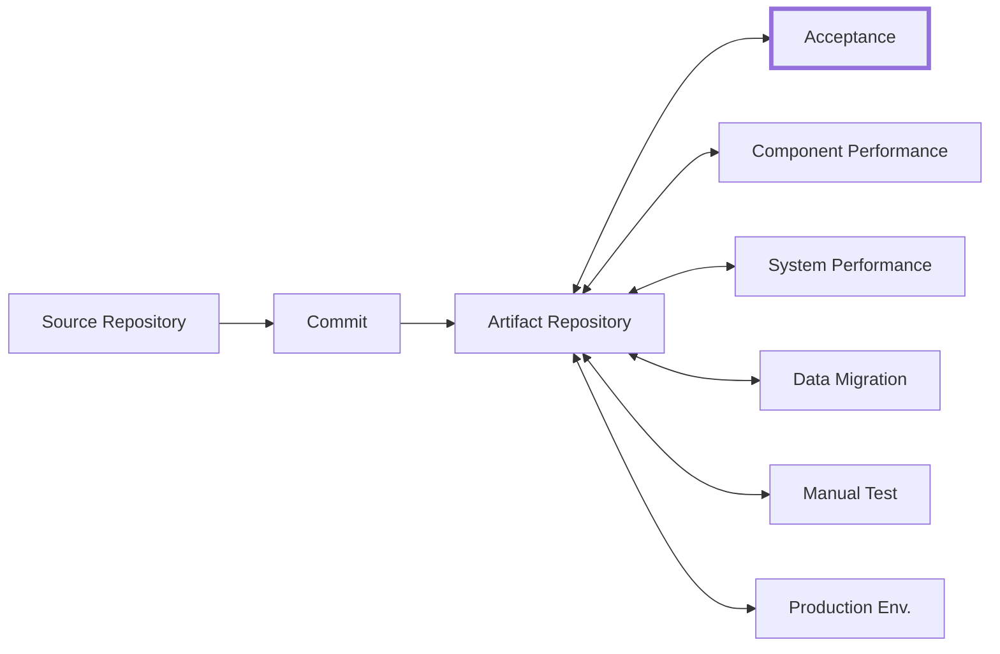

For each candidate, configure the environment, deploy it, verify that it is ready, then run acceptance tests. Start every run from a known clean point. Keep cases atomic and avoid shared mutable data so one test does not affect another. A smoke test or health check distinguishes a broken deployment from a product behavior failure.

Derived from text: ch-10, “Steps in Running Acceptance Tests”
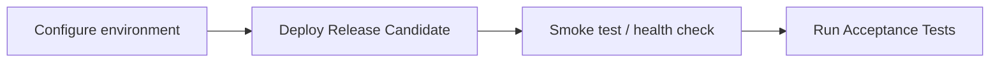

The proposed four-layer test architecture isolates the language of the expected behavior from the transport mechanics. Figure 10.2 shows repeated executable-specification cases above a DSL, protocol drivers and external stubs in the next layer, and the system under test below.

Derived from image: chapter12-02 (Figure 10.2)

| Position in figure | Elements shown |
|---|---|
| Top | Four `Test Case (Executable Specification)` boxes |
| Second layer | `Domain Specific Language` |
| Third layer | `Protocol Driver (e.g. UI)`, `Protocol Driver (e.g. API)`, two `External System Stub` shapes |
| Bottom | `System Under Test` |

Executable specifications state desired behavior in domain terms. A small domain-specific language offers reusable operations; protocol drivers translate those operations into interactions with the system; the system under test is the deployed application. Keep system knowledge in the protocol drivers and fake dependencies outside the system boundary. This allows a different implementation to satisfy the same useful behavioral specification.

Acceptance suites can be expensive. Add scenarios as product behavior grows, parallelize within the available resources, and use sampling where it still gives a meaningful release signal. Test coverage is a consequence of a good specification strategy, not the objective. The desired balance is both speed and sufficient evidence.

## ch-11 — Manual Testing {#ch-11}

Manual testing is most useful for open-ended exploration, usability judgments, and surprising cases that are hard to specify in advance. Repeating a fixed regression script is slow and inconsistent work for a person; automate that repeatable behavior instead.

Offer testers a self-service choice of candidate and environment after automated acceptance passes. Use the normal configuration, deployment, and health-check route, then let people examine the product from a human perspective. Manual exploration can inform developers while work proceeds; it need not wait as a final release gate.

Figure 11.1 puts the manual test environment alongside the deployment pipeline. The manual test environment and production environment sit outside the pipeline loop and connect to the artifact repository.

Derived from image: chapter13-01 (Figure 11.1)
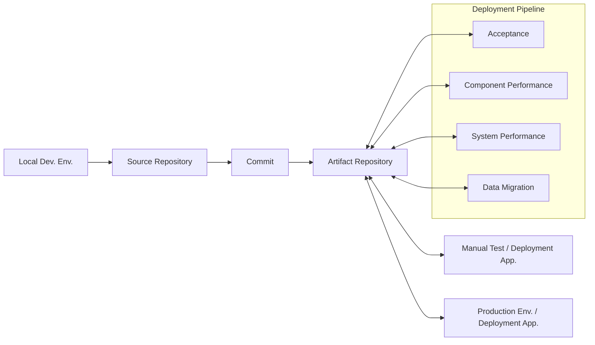

Use exploratory testing selectively. Software with a substantial user interface can benefit from human assessments of usability; some systems may gain enough assurance from automated tests alone. Manual tests are one-off observations rather than exhaustive, repeatable proof. In the chapter’s working model, manual exploration can occur in parallel with development and does not hold up the candidate as a final gate.

Derived from text: ch-11, “The Role of Manual Testing”
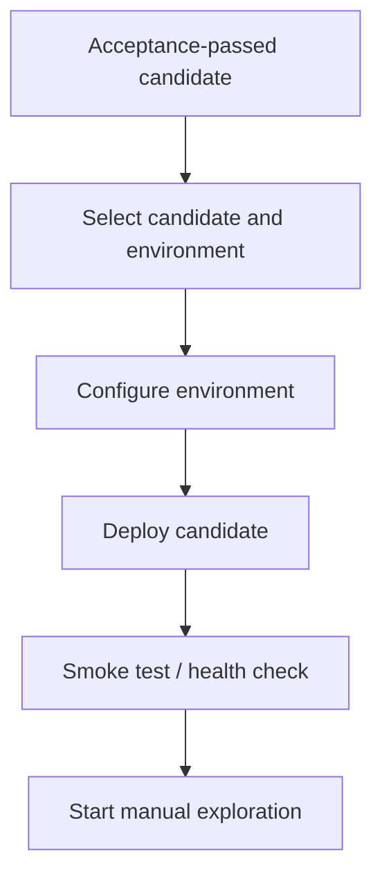

## ch-12 — Performance Testing {#ch-12}

Performance evaluation can cover perceived usability, throughput, latency, and behavior during extended use. Define the question and acceptable result before collecting large volumes of numbers. A pass/fail threshold makes a required performance property usable as pipeline evidence; trend charts help reveal movement toward that threshold.

Start with likely user scenarios and thresholds at the precision users experience. Test performance-critical components in isolation when tighter control gives more repeatable results. Complement that with system-level tests using recorded or realistically simulated traffic. Ramp load to explore a reasonable worst case when that is part of the product’s requirement.

For highly time-sensitive systems, measurements may need finer precision and more control over the environment. Compare simulations with production behavior and adjust the model if they differ. Across all performance tests, identify external influences, isolate or fake where reasonable, and consider dedicated hardware or network setup where it improves repeatability.

Derived from text: ch-12, “Component-Based Performance Testing”, “System-Level Performance Testing”, and “Control the Variables”
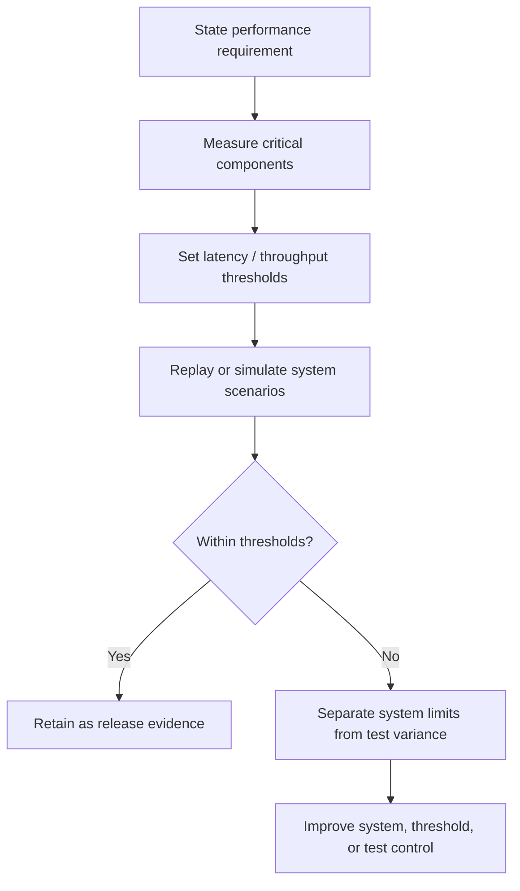

Soak tests lasting days or weeks usually cannot be a per-candidate release gate. Ask whether they find a necessary failure mode, whether a more precise shorter check can expose it sooner, and whether the test is compensating for a gap elsewhere. Keep periodic long-running evaluation when it provides useful evidence that the fast route cannot supply.

## ch-13 — Testing Non-Functional Requirements {#ch-13}

Treat scalability, resilience, fault tolerance, disaster recovery, security, and compliance as user-impacting behavior whenever they define releasability. Write requirements and automated checks that make those properties observable.

Scale tests can reuse the performance environment, increase representative load, and run periodically rather than on every commit. Resilience checks can deliberately fail selected components in a test, or use carefully controlled production experiments when the system and team can contain them. The book names chaos engineering as one production technique, not a universal requirement.

Represent known regulatory rules as tests and evidence-producing steps in the pipeline. Security checks likewise belong with the release evaluation rather than in a disconnected late gate. Use vetted dependency sources and automated dependency verification. Link commits to requirement or change identifiers so the record can show who changed what, which tests ran, and the outcomes.

Specialists should help define requirements and teach teams how to evaluate them. The author’s model gives the delivery team shared responsibility for results, rather than making specialists the sole gatekeepers.

## ch-14 — Testing Data and Data Migration {#ch-14}

Changes to data include changes to schema and changes to stored values. If a schema changes, data that uses the old form may also need to change. Put migration scripts under version control and test their behavior early with fake data and cases.

The usual path makes migration part of deployment in every environment. Keep a monotonically increasing schema version, a small delta script for each change, the application’s desired schema version, and the current version with the data. Commit the compatible application and schema expectation together. At deployment, compare versions and apply the necessary deltas in order. Where a migration cannot complete within deployment time, the book names lazy migration, lazy reading, and off-peak migration as alternatives, without specifying their implementation.

Derived from text: ch-14, “Data Migration Testing Stage” and “Delta Scripts”
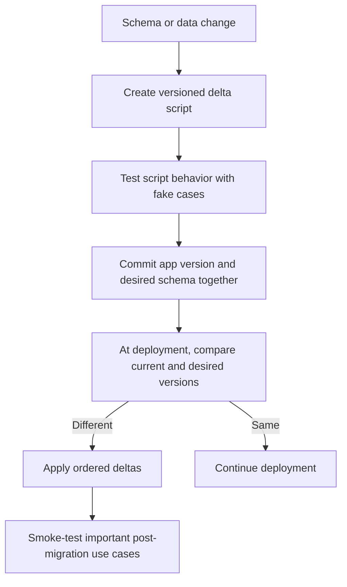

For more complex changes, rehearse on a representative anonymized production copy: clone, anonymize, copy to test, deploy the candidate, then check important use cases. Farley notes that this rehearsal can have limited value when lower-level migration tests are already robust.

Figure 14.1 classifies three kinds of test data. The question marks in the source mark choices that depend on the case.

Derived from image: chapter16-01 (Figure 14.1)

| Data category | Use production data | Generate within test scope | Use versioned test data |
|---|---:|---:|---:|
| Transactional | No | Yes | No |
| Reference | No | Yes | ? |
| Configuration | Yes | ? | Yes |

Use synthetic data for transactional behavior so the test can target the cases it needs. Synthetic reference data is the default, with versioned data sometimes useful. For configuration tests, production data can help evaluate real configuration changes; protect that data according to its context.

## ch-15 — Release Into Production {#ch-15}

Pipeline scope depends on the system. Add every step needed to establish release readiness, but add them incrementally. For the next feature, ask what is essential, what success looks like, which users have requirements, and which checks can be made measurable and repeatable. Automate routine work and make any necessary human choice easy to understand and record.

The source distinguishes continuous delivery from continuous deployment. In delivery, passing all pipeline checks makes release possible, while a business decision determines when to deploy. In deployment, that promotion happens automatically when checks pass. A pipeline can support either choice.

Figure 15.1 highlights production as a destination connected to the artifact repository. The artifact is deployed through a prepared deployment mechanism; production is the final environment in the depicted pipeline.

Derived from image: chapter17-01 (Figure 15.1)
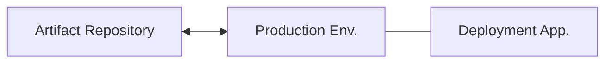

Choose the release timing with the product’s risk and customer impact in view. The book describes blue/green deployment, rolling transition, canary release, and A/B tests as possible strategies. They answer different rollout or comparison questions and are not interchangeable by default.

After deployment, continue to gather technical and functional feedback. Technical signals include resource use, queues, error records, and performance. Functional signals describe journeys, feature use, and business outcomes. A health check confirms the deployment is live; production feedback helps determine what the next change should be.

Derived from text: ch-15, “When to Release?”, “Release Strategies”, and “Feedback from Production”
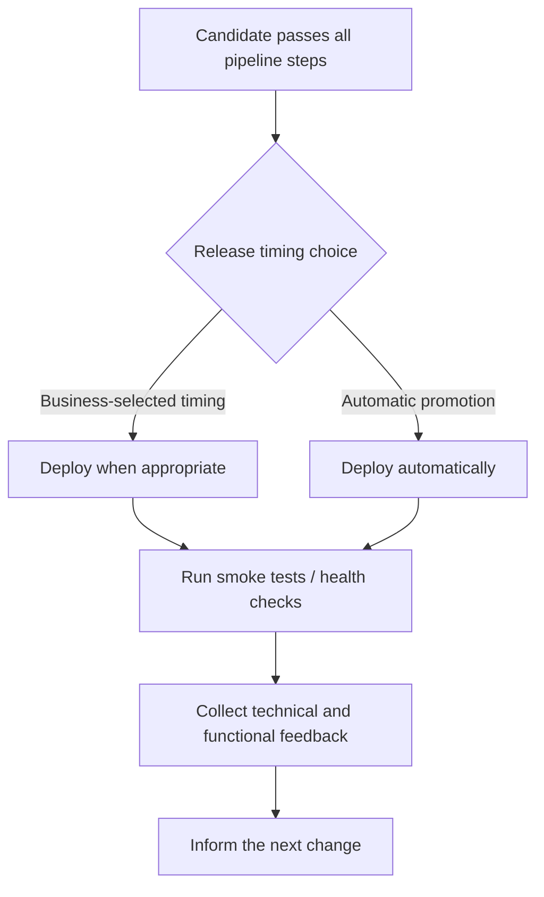

## ch-16 — Infrastructure As Code {#ch-16}

Infrastructure includes operating systems, languages, libraries, scripts, schemas, messaging, web servers, networks, databases, and other dependencies needed to reproduce the system. Version and automate its provisioning and updates so every intended production change can be inspected and replayed through the pipeline.

The chapter contrasts three configuration strategies. Ad hoc administration makes each environment unique and difficult to reproduce. Configuration synchronization repeats a versioned declarative model but needs discipline to avoid drift and can be awkward for deletions. Immutable infrastructure recreates the environment from scripts, reducing persistent differences while taking time to provision.

Whichever strategy is selected, prefer definition files, auditable scripts, frequent tests, small changes, availability during updates where required, and unattended execution. Cloud hosting makes large-scale configuration easier but is not a prerequisite for infrastructure as code. The mechanism is repeatable definition and change, not a provider brand.

## ch-17 — Regulation and Compliance {#ch-17}

The author argues that regulated or large organizations can use CD. He cites external research and the LMAX example to challenge the assumption that regulation requires a separate slow release process. Treat those cited outcomes as the evidence presented by this source, not as a universal effect for every organization.

The chapter criticizes relying on external approvals and accumulating authorization gates as a substitute for controlled change. In the author’s account, such controls can reduce release frequency, increase batch size, and encourage process workarounds without improving stability. Small changes, fast evaluation, and quick reversal are offered as risk controls.

For LMAX, compliance evidence was produced from versioned changes, pairing practices, a machine-generated audit trail, tests for regulatory and security requirements, and immutable infrastructure. The pipeline was the production route; auditors and regulators were treated as users whose information needs could be specified and met by generated records.

The Knight Capital case illustrates the risk of manual release coordination across servers: one host missed an update and ran mismatched code. The mechanism illustrated is configuration inconsistency from a manual process; the case is not evidence that every approval or human decision is harmful.

## ch-18 — Measuring Success {#ch-18}

Farley groups useful measures around purpose, quality, and efficiency. Purpose depends on the product and can use business measures such as acquisition, activation, retention, revenue, and referral. Quality is Stability: change failure rate and failure recovery time. Efficiency is Throughput: production frequency and time from commit to a releasable outcome.

Consider the four throughput and stability measures together. A system that releases quickly but fails often, or rarely fails because it scarcely changes, is not meeting both goals. Gather measures consistently over time and use them to decide whether a change to code, infrastructure, process, or team practice improved the actual outcome. Counts such as tests or lines of code do not directly answer that question.

Figure 18.1 labels a complete cycle under an hour. Farley presents under five minutes for commit feedback and under an hour for full evaluation as practical targets, with about ten minutes to fix or revert a failure. Treat these as heuristics to compare against the team’s constraints and baseline.

Derived from image: chapter21-01 (Figure 18.1)
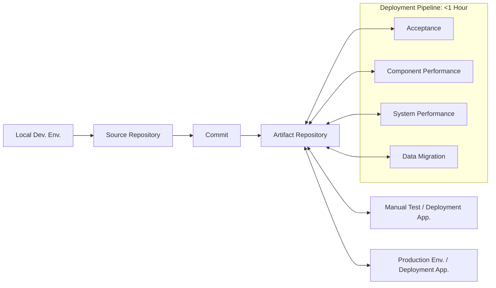

To reduce lead time, inventory stages and durations, identify the purpose of each step, remove work that does not establish releasability, reduce queues and external waits, parallelize compatible evaluations, and automate repeatable activity. Prioritize one incremental improvement, measure its effect, and continue based on evidence.

Derived from text: ch-18, “Suggested Steps to Improve Lead Time”
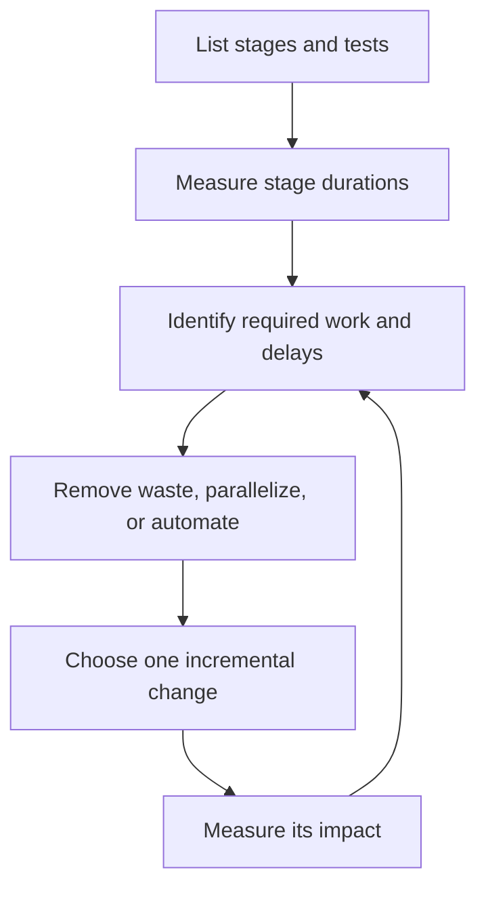

## ch-19 — The LMAX Case Study {#ch-19}

LMAX adopted CD at startup for an exchange with demanding performance, scale, and regulatory needs. It started with a small pipeline supporting early features, then extended that route over several years. The pipeline covered the company’s deployable software and supplied a definite answer on release readiness.

The example joins practices already described: team-wide CI on a shared trunk, small commits, TDD, acceptance specifications in domain language, unique candidate IDs, automated infrastructure, and tests for the different kinds of system users. The team used parallel testing and a latest-candidate policy to keep acceptance work within its feedback target as its test set grew.

LMAX’s pipeline changed tools over time. The case supports the author’s emphasis on durable patterns and modularity over attachment to one product. Its reported test counts, workload, team size, and timings are features of this system and period, not targets that every team should copy.

The case also illustrates that continuous delivery need not mean automatic production promotion. LMAX retained a chosen release window, reused the pipeline’s deployment mechanisms, and ran health checks after production deployment. Manual exploration was limited to candidates that had passed automated acceptance.

## ch-20 — The Role of the Deployment Pipeline {#ch-20}

The deployment pipeline is an organizing mechanism that coordinates versioned change, evaluation, and feedback. Its value comes from giving teams visibility into the path from idea to working software and exposing bottlenecks that can be improved.

The author explicitly gives the pipeline a bounded role: it supports CD but does not by itself complete every organizational, cultural, or product change needed to work effectively. The process should keep learning from feedback and adapt as the system and its needs change.

## Decision rules (summary)

| Trigger (observable in code, diff, plan, or metric) | Rule | Rationale | Src |
|---|---|---|---|
| A change can reach production by a path outside the evaluated pipeline | Route every production change through the defined pipeline | A bypassed path has no comparable release evidence or complete history | src: ch-2, “Scope and Purpose” |
| A green pipeline still requires untracked release work | Expand the pipeline to include the missing release condition | Green should identify a releasable outcome, not the start of another process | src: ch-2, “Scope and Purpose” |
| A pipeline is being built for a large future system before an end-to-end slice exists | Start from a Walking Skeleton and add the smallest working route | A working slice makes assumptions testable before the system grows around them | src: ch-3, “Getting Started” |
| A required behavior is about to be coded with no test specifying it | Write the smallest failing test first, then pass and refactor | The failure checks the test and the passing code satisfies an explicit behavior | src: ch-4, “Red, Green, Refactor” |
| A candidate must be rebuilt separately for test or production | Build once and promote the same identified artifact | Different bytes invalidate earlier evidence about the candidate | src: ch-9, “Scope and Purpose” |
| The commit stage feedback routinely exceeds five minutes | Move slow or variable checks later or reduce their cost | A short technical loop helps developers act while the change is still in focus | src: ch-8, “Feedback in Five Minutes” |
| A shared pipeline check fails after a commit | Fix the cause promptly or revert the change before resuming work | The production route is no longer known to be clear | src: ch-8, “Continuous Integration” |
| An acceptance test depends on private implementation details | Express the expected behavior through public interfaces and a driver layer | The specification can survive a different implementation of the same behavior | src: ch-10, “What are Acceptance Tests?” |
| Repeated regression behavior still requires scripted human execution | Automate the repeatable check and use people for exploration | Machines repeat fixed steps consistently; people can investigate unclear behavior | src: ch-11, “The Role of Manual Testing” |
| A performance result has no declared acceptable threshold | Define the measure and pass/fail boundary before using it for releasability | Raw data without a decision criterion leaves release fitness ambiguous | src: ch-12, “Pass/Fail Performance Tests” |
| A soak test delays every release despite taking days | Determine whether a shorter precise test can reveal the same failure; schedule useful soak work separately | Long duration does not automatically make the check necessary for each candidate | src: ch-12, “Long-Running Tests” |
| A security, resilience, or compliance property is a release condition | Add an observable test or evidence step to the pipeline | A required property left outside the route produces an incomplete release decision | src: ch-13, “Testing Non-Functional Requirements” |
| A schema change has no ordered, versioned migration | Add a delta script and test its behavior with controlled data | Versioned migration makes the transition repeatable and inspectable | src: ch-14, “Delta Scripts” |
| Deployment updates infrastructure through server-by-server manual edits | Define, version, and automate the environment change | Manual variation makes environments hard to reproduce | src: ch-16, “Infrastructure Configuration Management” |
| A release gate is proposed as the primary control for regulatory risk | Put the applicable evidence and checks in the production route | An external approval alone does not demonstrate that the changed system meets requirements | src: ch-17, “The Deployment Pipeline as a Tool for Compliance” |
| A team is choosing between faster delivery and stability using one metric | Track change failure rate, recovery time, release frequency, and lead time together | A single measure can hide poor quality or poor throughput | src: ch-18, “Throughput and Stability” |
| Pipeline time is spent on stale candidates while newer ones wait | Process the newest eligible candidate and preserve result history | Older candidates consume acceptance capacity without moving the current system forward | src: ch-3, “Create an Acceptance Stage”; ch-9, “Storage Management” |
| A release process contains a queue or step with no current release purpose | Measure the delay, remove waste, parallelize, or automate one step at a time | Incremental measured changes reveal which constraint was improved | src: ch-18, “Suggested Steps to Improve Lead Time” |
| A production release is assumed to be automatic after checks pass | Decide separately whether the product needs business-selected or automatic promotion | Continuous Delivery keeps the system releasable; deployment policy depends on the product | src: ch-15, “When to Release?” |
| A production rollout completes with no user or system feedback | Continue measuring technical and functional outcomes after release | Production observations guide the next decision and close the development loop | src: ch-15, “Feedback from Production” |

## Anti-patterns

| Name or cue | Why it fails in this account | Source anchor |
|---|---|---|
| Big-batch integration | Interactions surface late, when fixes, coordination, and release pressure have accumulated | ch-1, “What is Continuous Delivery?” |
| Build-script mistaken for a deployment pipeline | A build alone does not establish user behavior, non-functional readiness, or production deployability | ch-2, “The Deployment Pipeline is NOT” |
| Team- or layer-specific pipelines | Each partial route can pass while the deployable unit still needs joint work | ch-2, “Scope and Purpose” |
| Test-first replaced by coverage chasing | A coverage number does not prove a test asserts useful behavior | ch-4, “Test Driven Development” |
| Repeatable work left to manual execution | Manual steps vary and consume attention better spent on judgment or exploration | ch-5, “Automation” |
| Unversioned environment inputs | Tests and production can use different bits, configuration, or dependencies | ch-6, “What to Version Control?” |
| Long-lived branches and delayed integration | Divergence hides compatibility problems and delays feedback | ch-6, “Branching” |
| Slow checks placed in the commit loop without cause | Developers may stop observing the result while still waiting for it | ch-8, “Feedback in Five Minutes” |
| Rebuilding after tests pass | The tested artifact and deployed artifact may differ | ch-9, “Scope and Purpose” |
| Acceptance scripts coupled to UI or transport details | Internal changes invalidate behavior checks even when the user contract is unchanged | ch-10, “The Four-Layer Approach” |
| Manual regression as a release gate | Repetition is slow and humans are less consistent at routine checks | ch-11, “The Role of Manual Testing” |
| Unbounded performance graphs with no criteria | A reader must invent the decision after seeing the data | ch-12, “Pass/Fail Performance Tests” |
| Soak test as comfort blanket | A slow test can conceal missing fast, precise checks elsewhere | ch-12, “Long-Running Tests” |
| Compliance bolted on outside the pipeline | Evidence is fragmented and release behavior is harder to reproduce | ch-13, “Audit and Traceability”; ch-17 |
| Manual schema edits or undocumented migration | Data and application versions can become impossible to reproduce together | ch-14, “Data Management” |
| Snowflake infrastructure | Server-by-server drift makes deployment inconsistent and error-prone | ch-16, “Ad-Hoc, or Manual Admin” |
| Release approval added as a proxy for safety | It may increase delay and batch size without testing the property at risk | ch-17, “Responding to Regulatory Requirements” |
| Optimizing a convenient proxy | Code counts or test totals can move without improving purpose, quality, or efficiency | ch-18, “Making Evidence-Based Decisions” |

## Applicability & exemptions

- The pipeline’s exact scope and tests depend on the product’s independently deployable unit and release conditions. A microservice pipeline and a whole-system pipeline need not have the same test stages.
- The five-minute commit target, one-hour end-to-end target, and ten-minute repair-or-revert target are the author’s rules of thumb. Measure the local baseline and use judgment where architecture, test cost, or risk makes them unsuitable.
- Continuous Delivery means a candidate can be released; automatic production deployment is a separate choice. Keep a human timing decision when the product, market, or risk profile calls for it, while automating the repeatable mechanics around that decision.
- Manual exploration is useful where human perception or open-ended investigation contributes. It is not required for every product and is not a substitute for repeatable regression checks.
- Long-running performance and resilience tests may be useful periodically. They need not block every candidate if they do not define a per-release condition and their results still inform risk.
- Deployment-time migration is the common case in the text, not an absolute. Migrations too slow for deployment need a runtime or off-peak strategy; the book names approaches but leaves their detailed design to other sources.
- Production data is not the default for transactional or reference-data tests. The chapter recommends synthetic data for those, and identifies configuration testing as a case where production data may be useful.
- The regulatory argument is supported through reported research and one LMAX case. It does not supply a jurisdiction-specific legal interpretation or a claim that all approval systems have identical effects.
- Outside the book’s detailed scope: vendor-specific pipeline recipes, deep security implementation, complete chaos-testing practice, detailed runtime migration algorithms, and a full program for organizational change. Chapter 20 identifies wider cultural and organizational work beyond the pipeline itself.

## Candidate lexicon rows

| Trigger phrase | Rule | Activating question | Tier | Phase | Src |
|---|---|---|---|---|---|
| A change has a path to production outside the tested route | **One route to production**: require every production change to complete the applicable pipeline, or its release evidence is incomplete | Can this change reach production without these checks and results? | should | plan | src: continuous-delivery-pipelines-farley ch-2 |
| A new pipeline is planned before an end-to-end use case works | **Walking Skeleton first**: implement one thin, deployable behavior and the minimum pipeline around it, so assumptions become testable early | What is the smallest useful path from code to production-like execution? | should | plan | src: continuous-delivery-pipelines-farley ch-3 |
| New behavior is coded without a failing test describing it | **Red before green**: write and observe a small failing test before implementation, so intent and test validity get immediate feedback | What failure do you expect before writing the code? | should | write | src: continuous-delivery-pipelines-farley ch-4 |
| A successful test artifact is rebuilt before deployment | **Promote the same candidate**: store and test the deployable bits once, so downstream results apply to the production candidate | Are these the exact bits the next environment will receive? | should | write | src: continuous-delivery-pipelines-farley ch-9 |
| Commit-stage technical feedback routinely exceeds five minutes | **Keep commit feedback short**: move slow variable checks to later stages or make them cheaper, so the author can act on the result | What is making the developer wait in this stage? | should | review | src: continuous-delivery-pipelines-farley ch-8 |
| A required acceptance test describes UI clicks or private methods | **Specify behavior at the boundary**: keep the case in domain terms and isolate transport knowledge in a driver, so implementation changes do not erase the user contract | Would this scenario still make sense with a different implementation? | should | write | src: continuous-delivery-pipelines-farley ch-10 |
| Regression scenarios are repeatedly executed by a person | **Automate repeatable regression**: reserve manual effort for exploration and subjective evaluation, where human judgment adds information | Is this a fixed sequence the computer could repeat reliably? | should | plan | src: continuous-delivery-pipelines-farley ch-11 |
| A performance check reports values but has no pass/fail limit | **Set performance thresholds**: define acceptable latency or throughput before using results to gate a candidate, so measurement can make a decision | What result makes this performance check pass? | should | plan | src: continuous-delivery-pipelines-farley ch-12 |
| A schema update has no versioned migration script | **Version each data change**: add a tested delta script and commit the required schema version with the application, so deployments can apply ordered changes | Which data version does this candidate require and how does it get there? | should | write | src: continuous-delivery-pipelines-farley ch-14 |
| Production infrastructure is changed by repeated manual edits | **Recreate infrastructure from definitions**: version and automate provisioning, so environments remain reproducible and auditable | Can the intended environment be rebuilt from recorded inputs? | should | plan | src: continuous-delivery-pipelines-farley ch-16 |
| A release improvement is justified by one throughput or quality number | **Measure stability and throughput together**: track change failure rate, recovery time, release frequency, and lead time, so a gain in one dimension does not hide a loss in another | Which of the four outcomes moved after this change? | should | review | src: continuous-delivery-pipelines-farley ch-18 |
| Acceptance processing is building a backlog of superseded candidates | **Test the newest eligible candidate**: select the latest commit-stage pass and retain prior results, so capacity evaluates the current system without losing history | Is this run evaluating the newest candidate that is ready? | judgment | write | src: continuous-delivery-pipelines-farley ch-3 |

Disposition: unnumbered candidates awaiting central promotion.

### Candidate dispositions

- **Version each data change:** PROMOTED as DATA-21
- **Set performance thresholds:** merged into RLSE-03
- **Red before green:** PROMOTED as TEST-23
- **Keep commit feedback short:** PROMOTED as TEST-24
- **Specify behavior at the boundary:** PROMOTED as TEST-25
- **Automate repeatable regression:** PROMOTED as TEST-26
- **Walking Skeleton first:** PROMOTED as ARCH-24
- **One route to production:** PROMOTED as RLSE-22
- **Promote the same candidate:** PROMOTED as RLSE-23
- **Recreate infrastructure from definitions:** PROMOTED as RLSE-24
- **Measure stability and throughput together:** PROMOTED as RLSE-25
- **Test the newest eligible candidate:** PROMOTED as RLSE-26

## Cross-links

- **RLSE-11** owns automation of repeated build, deploy, migration, and release steps. Farley broadens the same mechanism to the full pipeline, its environments, measurements, and evidence trail.
- **RLSE-12** owns the release-boundary question: a green pipeline should mean the deployable unit needs no additional integration or sign-off work. Farley develops this as the pipeline’s central contract.
- **REF-14** owns the independent-deployability test for proposed service boundaries. It is a useful check when choosing the scope of the pipeline described in ch-2.
- **TEST-06** owns observing a new test fail with a predicted result. This is the Red step in Farley’s TDD cycle.
- **TEST-09** owns the signal that a difficult test may expose coupling or a missing seam. Farley gives test-first design pressure as a reason to improve modularity.
- **DATA-03** owns compatibility across schema and application versions during rolling upgrades. Farley’s schema version and delta-script practices give one way to manage data transitions.

## Tensions

- **Acceptance testing and end-to-end test volume:** ch-10 gives acceptance tests an important user-facing role, while **TEST-10** warns against making cross-service end-to-end tests the primary verification strategy. These are compatible when acceptance checks express a small set of user contracts at the independently deployable boundary and faster component or interface tests carry the detailed behavior. Do not turn every scenario into a composite test.
- **Automated delivery and manual release choice:** ch-5 recommends automating deployment steps; ch-15 allows a human or business decision about when to release. Partition by action: automate repeatable preparation and deployment mechanics, while retaining an explicit timing decision when product context requires it.
- **Always-releasable cadence and soak-test duration:** ch-12 excludes multi-day soaks from the ordinary per-candidate gate, while some systems need evidence from long runs. Partition by cadence: use short precise checks for normal release decisions and retain useful soak results as scheduled evaluation or monitoring evidence.
- **Pipeline failure policy and exploratory testing:** ch-2 rejects a candidate when a required automated test fails; ch-11 places manual exploration alongside development rather than as a final gate. Keep those roles separate: a required pipeline check determines the candidate state, while exploratory findings feed back into work and may motivate a new required test.
- **Schema delta and runtime migration:** deployment-time migration is presented as the simplest default, but ch-14 explicitly allows strategies for migrations that take too long. Choose by duration and availability needs; the book does not provide enough detail to select among runtime strategies without further design evidence.

## First-principles candidates

none — this distillation identifies useful mechanisms and neighboring rules, but does not establish a new causal principle through independent domains.
