# Database Internals — distilled

> **Source**: Alex Petrov, *Database Internals: A Deep Dive into How Distributed Data Systems Work*. First Edition, O’Reilly Media, October 2019 · extracted from `literature/extracted/engineering/database-internals-petrov.txt` · SHA-256 `1f04f3001359cedd58f04ef000bf3ad81f2911721941116214907b89cec65781` · distilled 2026-09-29 (spec v2)
> **Contributes**: An implementation-level route from data layout and page formats through recovery, storage-engine variants, replica consistency, repair, distributed transactions, and consensus. The book supplies compact mechanism sketches and failure cases rather than complete engine specifications, proofs, or a current product comparison; its unique value here is showing how local storage invariants meet distributed protocol assumptions.

## Chapter map

- ch-1 — Introduction and Overview: which storage layout matches the observed access pattern, and where do data and indexes live?
- ch-2 — B-Tree Basics: how do separators, page fanout, splits, and merges keep an ordered disk index searchable?
- ch-3 — File Formats: how should pages encode, locate, validate, and reclaim variable-size data?
- ch-4 — Implementing B-Trees: what metadata and traversal techniques make a page-oriented tree practical?
- ch-5 — Transaction Processing and Recovery: which log, cache, isolation, lock, and latch invariants survive crashes and concurrency?
- ch-6 — B-Tree Variants: how do copy-on-write, buffering, immutable deltas, and cache-aware layouts alter tree costs?
- ch-7 — Log-Structured Storage: how do memtables, sorted runs, compaction, filters, and value logs trade read, write, and space cost?
- ch-8 — Introduction and Overview: which timing, queue, link, and failure assumptions make remote work unlike local work?
- ch-9 — Failure Detection: how do local detectors balance suspicion speed against mistaken accusations?
- ch-10 — Leader Election: how do groups select a coordinator, and why does election alone not prevent split brain?
- ch-11 — Replication and Consistency: what histories may readers observe, and what coordination does each guarantee cost?
- ch-12 — Anti-Entropy and Dissemination: how do replicas find and repair missed or divergent state?
- ch-13 — Distributed Transactions: how do multiple partitions prepare, commit, recover, or avoid coordination?
- ch-14 — Consensus: how do replicated processes agree on a valid ordered value despite failures?

## ch-1 — Introduction and Overview {#ch-1}

The chapter is an orientation to common DBMS components, not a mandated architecture. Query processing, execution, storage, transactions, locks, buffers, and recovery can be separated or coupled by an implementation (“DBMS Architecture,” Figure 1-1).

**Workload before label.** OLTP commonly asks for complete records by key; OLAP commonly scans many records but only a few fields; HTAP combines both. Row layout keeps fields of a record together. Column layout groups values of a field, avoiding unrelated reads and often helping same-type compression and vectorized processing. Choose from observed query shape and mix. “Wide-column” describes a sorted row-key map with column families and timestamped versions; it does not mean a columnar scan layout (“Column- Versus Row-Oriented DBMS”; “Wide Column Stores”; Figures 1-2–1-4).

**Durable memory stores.** If an in-memory store promises crash durability, a sequential log and a persistent snapshot provide separate recovery roles: append the operation before acknowledgment, then checkpoint log batches into the snapshot; discard only a covered log prefix (“Durability in Memory-Based Stores”). This does not apply to a store that explicitly makes no durability promise.

**Data and index placement.** A heap file appends records without key order and depends on indexes for lookup. An index-organized table keeps records in key order, so range traversal can continue through ordered data. Direct offsets avoid an index lookup but every relocation must repair referencing pointers. Primary-index indirection adds a read hop while reducing pointer repair, especially when several secondary indexes refer to a moving record. A hybrid can check an offset and fall back to the primary index if it is stale (“Data Files and Index Files”; “Primary Index as an Indirection”; Figures 1-5–1-6).

Treat **buffering**, **immutability**, and **ordering** as independent storage choices. Buffering groups writes; immutability avoids in-place overwrite but defers cleanup; ordering makes key ranges local and can add write work (“Buffering, Immutability, and Ordering”).

Derived from text: ch-1, “Durability in Memory-Based Stores”
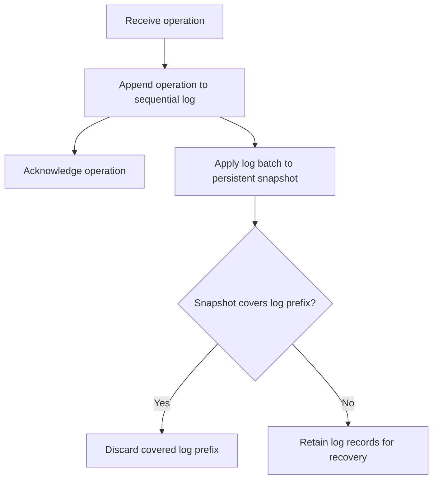

## ch-2 — B-Tree Basics {#ch-2}

A binary search tree can become a long chain under an adverse insertion order. Even a balanced binary tree incurs many page transfers when each pointer crosses a page. A disk B-Tree stores more keys per node; high fanout shortens the page path. Separate in-node key comparisons from page reads (“Tree Balancing”; “Trees for Disk-Based Storage”; Figures 2-3, 2-5–2-10).

Sorted separator keys partition child ranges. Lookup searches each node for the first separator greater than the target, follows its child, and repeats to the leaf. A B+-Tree keeps payload values at leaves and uses internal keys as guides. Where leaf siblings exist, range iteration can advance across them (“B-Tree Hierarchy”; “B+-Trees”; “Separator Keys”; “B-Tree Lookup Algorithm”).

On overflow, split the ordered node, place its new separator and child link in the parent, and continue upward if needed; a root split adds a level. On underflow, merge adjacent same-parent nodes if their contents fit, moving the parent separator into a merged internal node; otherwise redistribute entries and repair parent bounds. Either change must preserve every subtree’s key interval (Figures 2-11–2-14).

Derived from text: ch-2, “B-Tree Lookup Algorithm”
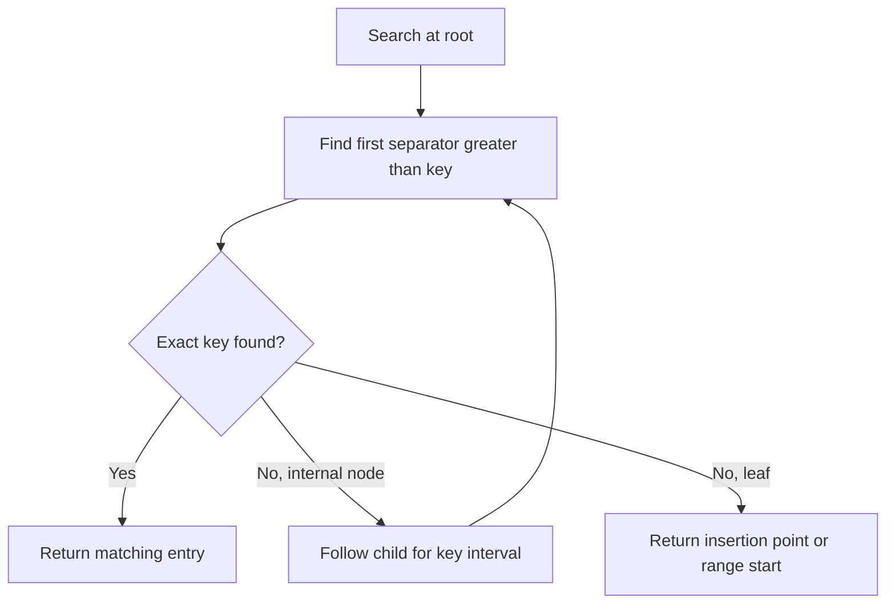

Derived from image: chapter-idm46466890025416-11 (Figure 2-11)
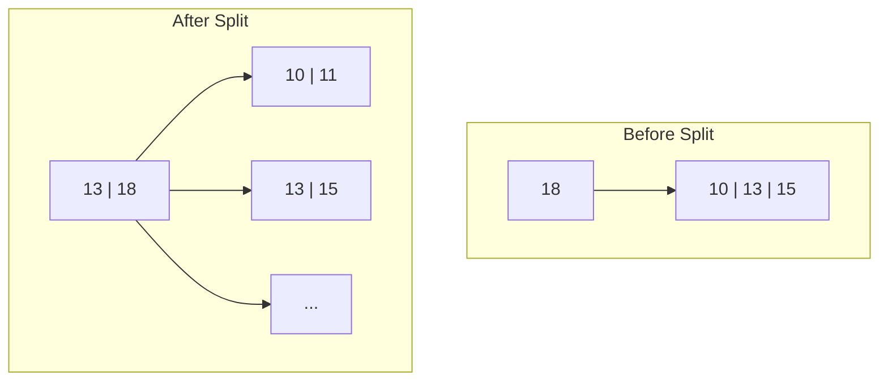

This chapter abstracts away the complete on-disk page layout, versioned record semantics, and concurrent mutation; later chapters add those concerns.

## ch-3 — File Formats {#ch-3}

Persistent formats need explicit byte order, field widths, lengths or offsets for variable-size values, and a stable place for metadata. A reader should identify a supported format version from stable metadata and select its decoder before interpreting the payload (“Binary Encoding”; “General Principles”; “Versioning”). Magic numbers help detect an unexpected page or offset, but they are sanity checks rather than authenticity proofs (“Magic Numbers”).

**Slotted pages** separate an ordered slot directory from cell bytes. Slots preserve logical key order while cells may be appended elsewhere and moved during defragmentation. Track free regions: reuse a fitting gap; if the free bytes are fragmented, rewrite live cells; if compacted space still cannot hold a cell, allocate or extend an overflow page (“Slotted Pages”; “Cell Layout”; “Managing Variable-Size Data”; Figures 3-5–3-9).

Derived from image: chapter-idm46466889190760-05 (Figure 3-5)
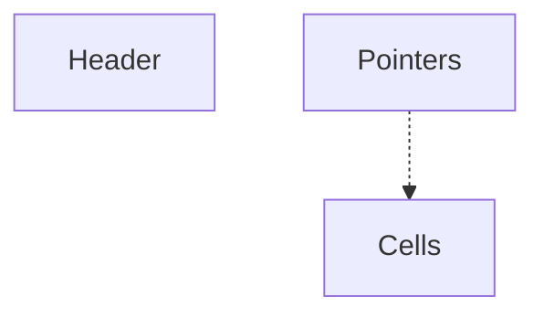

Derived from text: ch-3, “Managing Variable-Size Data”
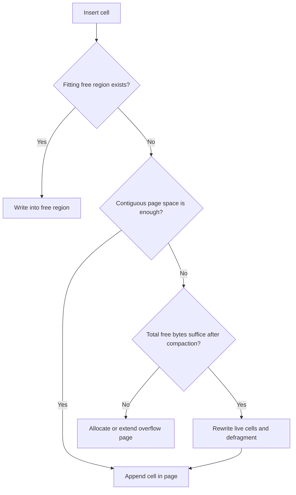

Checksums or CRCs stored with a page can detect accidental damage before the page is consumed. Their guarantees differ: CRCs detect common burst errors, while neither CRC nor an ordinary hash substitutes for cryptographic integrity protection (“Checksumming”).

Derived from text: ch-3, “Checksumming”
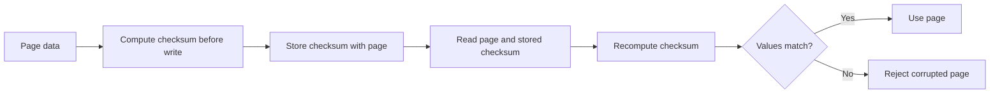

## ch-4 — Implementing B-Trees {#ch-4}

Page headers may record type, version, cell count, free-space bounds, and rightmost child. Sibling links make neighbor traversal direct but splits and merges must repair both ends. A high key can make child bounds and right-edge navigation more uniform (“Page Header”; “Sibling Links”; “Rightmost Pointers”; “Node High Keys”).

Fixed-size pages may run out of bytes before reaching their key-count limit. Overflow pages extend a node in page-size increments; the primary page keeps enough key material for routing. Long overflow chains add read traversal, so predominantly oversized values may fit a separate blob store better (“Overflow Pages”; Figure 4-6).

Cells can be appended physically while sorted slot offsets drive binary search. Inserts and deletes may propagate changes upward, so implementations either keep parent pointers or save the root-to-leaf path as breadcrumbs and pop it while repairing (“Binary Search with Indirection Pointers”; “Propagating Splits and Merges”; “Breadcrumbs”; Figures 4-7–4-8).

Redistribute among siblings before a split or merge only if that variant supports it; parent separators must follow moved keys. A right-edge fast path is valid when incoming keys are monotonic and appends dominate changes. For presorted bulk input, build leaves in key order and construct upper levels from completed child pages instead of issuing ordinary random insertions (“Rebalancing”; “Right-Only Appends”; “Bulk Loading”; Figure 4-9).

Delete and update paths can leave unreachable bytes or old versions. Defragment pages only after identifying live cells; reclaim pages only when older readers no longer need them. Page compression trades CPU for transfer density; whole-file compression makes random updates costly (“Compression”; “Vacuum and Maintenance”; “Page Defragmentation”; Figure 4-11).

Derived from text: ch-4, “Right-Only Appends” and “Bulk Loading”
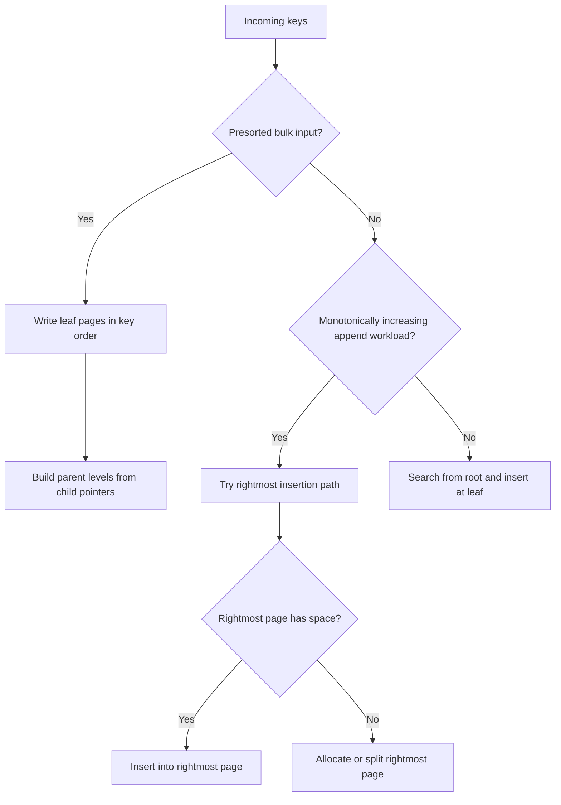

The choice among sibling links, high keys, parent breadcrumbs, rebalancing, and compression is implementation-specific; no one combination is required.

## ch-5 — Transaction Processing and Recovery {#ch-5}

ACID names distinct obligations. Atomicity makes a transaction all-or-none; consistency preserves application invariants; isolation defines concurrent visibility; durability makes committed changes survive a crash (“Transaction Processing and Recovery”).

A page cache keeps disk pages in memory and tracks dirty state. Replacement policy changes I/O and latency: FIFO ignores reuse, LRU tracks recent access, CLOCK-sweep uses compact reference state, and TinyLFU-style admission weighs frequency. Pin or prefetch pages only when measured reuse justifies the memory cost (“Buffer Management”; “Page Replacement”; Figures 5-1–5-3).

**Write-ahead logging.** Log records have monotonic LSNs and reach durable storage in order. A transaction is not committed until its commit record is forced. The log record for a page change must be durable before that dirty page is written. Truncate only the prefix whose affected pages are durable. Fuzzy checkpoints record dirty pages and active transactions; they become the recovery start only when complete (“Recovery”; “Log Semantics”). I/O errors and crash timing can invalidate assumptions about dirty state, so recovery paths need explicit failure exercise (“PostgreSQL Versus fsync()”).

**ARIES** combines steal/no-force with analysis, redo, and undo. Analysis identifies dirty pages and unfinished transactions; redo repeats history to the crash point; undo reverses incomplete transactions and logs compensation records, so a second crash during recovery can continue safely (“Steal and Force Policies”; “ARIES”).

Derived from text: ch-5, “ARIES”
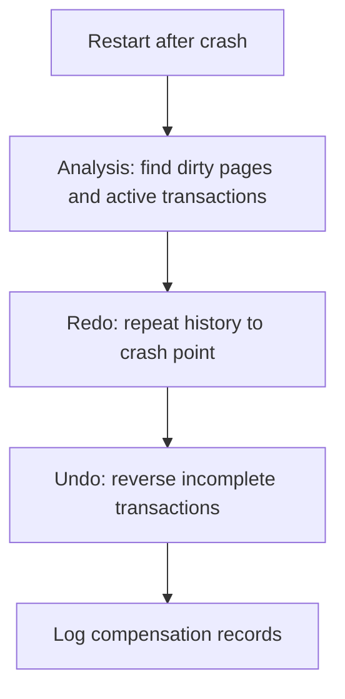

**Isolation is not a name-only guarantee.** Serializability means a concurrent history is equivalent to some serial order and costs coordination. Read committed, repeatable read, and snapshot isolation admit different anomalies. Snapshot isolation aborts competing writes to the same value, preventing lost updates, but independent writes can still create write skew against a cross-row invariant (“Serializability”; “Read and Write Anomalies”; “Isolation Levels”; Figures 5-4–5-5).

In optimistic concurrency control, work stays private until validation checks its read/write sets; conflict causes restart, otherwise the write set commits. Validation and write need an atomic boundary (“Optimistic Concurrency Control”).

Derived from text: ch-5, “Optimistic Concurrency Control”
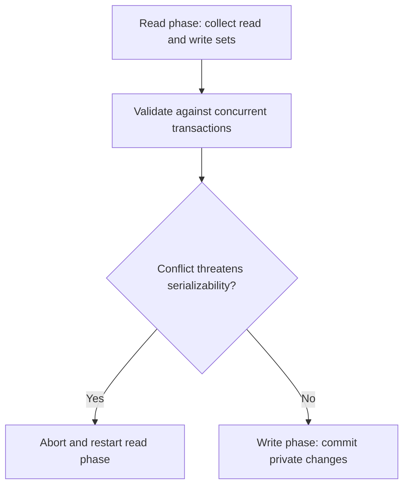

Locks protect logical records or ranges for transaction concurrency; latches protect physical pages for short operations. A waits-for cycle signals deadlock; victim abort and timestamp schemes are resolution choices (“Lock-Based Concurrency Control”; “Deadlocks”; Figure 5-6).

Latch crabbing acquires the child latch before releasing the parent. Reads can release a parent once the child is safe. Insert/delete can release it only if the child cannot split, underflow, or trigger an upward structural repair (“Latch crabbing”; Figure 5-9).

Derived from text: ch-5, “Latch crabbing”
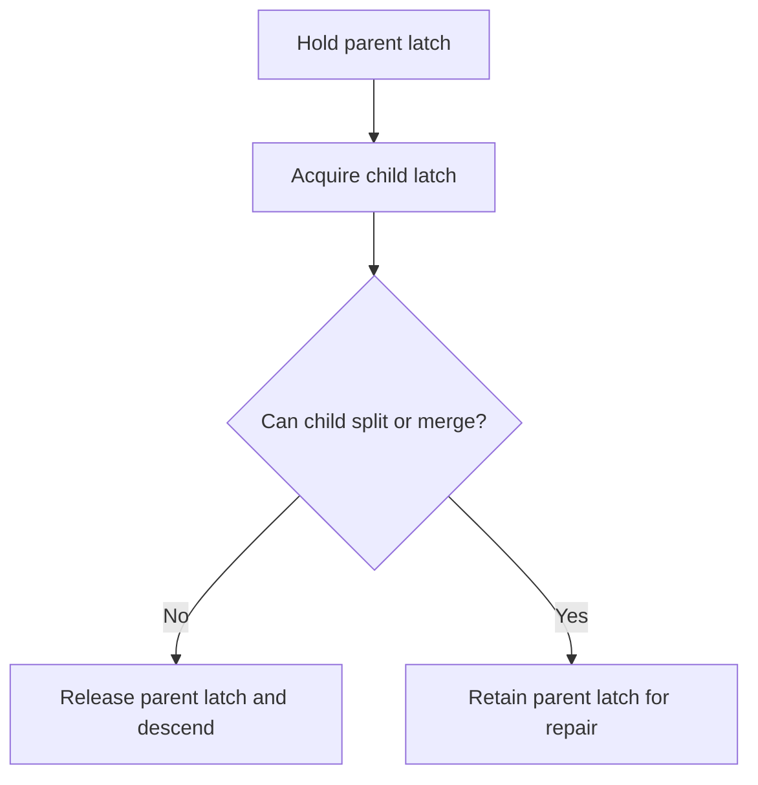

## ch-6 — B-Tree Variants {#ch-6}

Copy-on-write changes pages along the root-to-leaf path and shares untouched pages. Publish the finished version by switching the root; reclaim old pages only after readers using that version finish. It simplifies reader concurrency at the cost of copied-page space and work (“Copy-on-Write”; “Implementing Copy-on-Write: LMDB”; Figure 6-1).

Derived from image: chapter-idm46466888634680-01 (Figure 6-1)
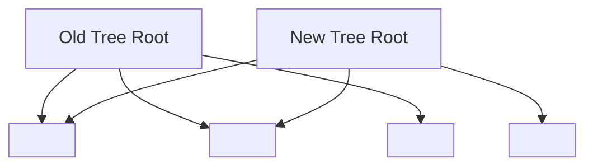

WiredTiger buffers page changes and reconciles them at flush; LA-Trees buffer by subtree and cascade a full buffer down. Both amortize writes but add read lookup and reconciliation work (“WiredTiger”; “Lazy-Adaptive Tree”; Figures 6-2–6-4). FD-Trees combine a mutable head tree with immutable sorted runs; fractional-cascading bridges reduce repeated search, while tombstones must reach all older runs before removal (“FD-Trees”; “Fractional Cascading”; Figure 6-6).

Bw-Trees represent a logical node as an immutable base plus a chain of delta pages. A mapping table points to the newest delta; compare-and-swap installs one update, and a losing concurrent writer retries. Split/merge work can be temporarily incomplete, so readers or helpers follow sibling links and complete the structural change. Consolidation caps read work; epoch-based reclamation waits for old readers before freeing superseded pages (“Bw-Trees”; “Update Chains”; “Taming Concurrency with Compare-and-Swap”; “Consolidation and Garbage Collection”; Figure 6-7).

Derived from text: ch-6, “Taming Concurrency with Compare-and-Swap”
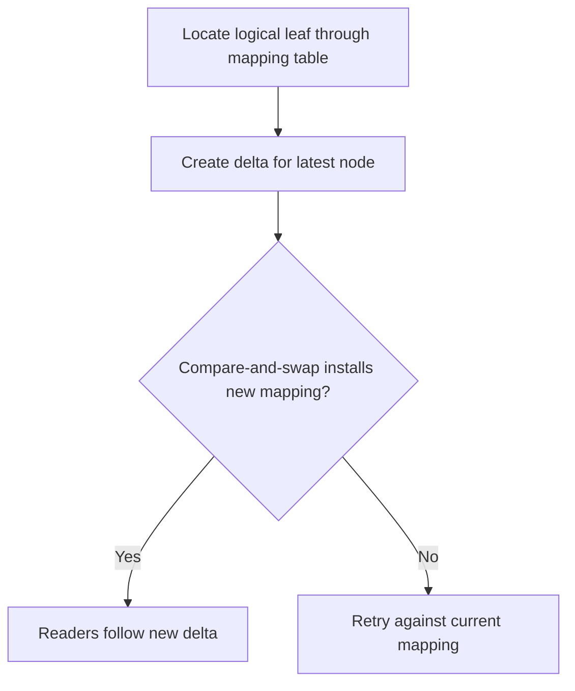

The cache-oblivious section describes recursive van Emde Boas layout and packed arrays as research approaches, not a comparative production recommendation. The book’s implementation-status remark is time-bound (“Cache-Oblivious B-Trees”; “van Emde Boas Layout”; Figure 6-8).

## ch-7 — Log-Structured Storage {#ch-7}

An LSM tree accepts writes in a mutable memtable protected by a WAL. At a size or time threshold, it switches to a fresh memtable, keeps the old one readable while flushing, then publishes an immutable sorted table. Compaction merges tables and reconciles same-key versions; retain old sources until the replacement is ready (“LSM Trees”; “Multicomponent LSM Trees”; “In-memory tables”; Figures 7-1–7-4).

Derived from image: chapter-idm46466887969512-03 (Figure 7-3)


Derived from text: ch-7, “In-memory tables” and “Concurrency in LSM Trees”
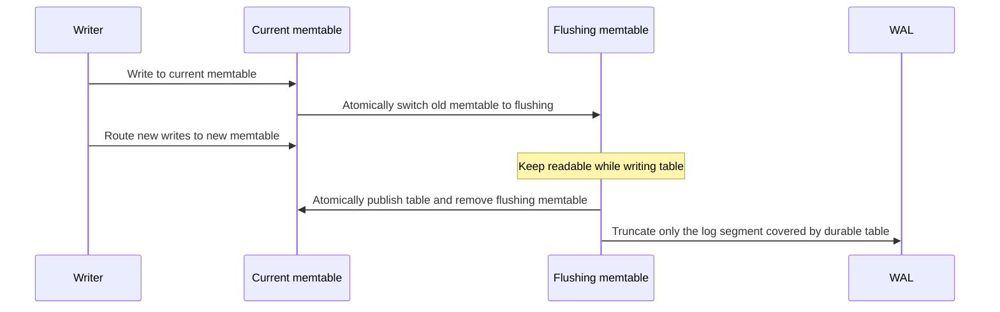

Sorted-source merge keeps an iterator head per source, repeatedly emits the least key, and reconciles equal keys by version and tombstone before returning output (“LSM Tree Lookups”; “Merge-Iteration”; “Reconciliation”; Figure 7-5). Compaction policy trades read amplification, rewrite cost, and duplicate space: leveled compaction limits overlapping ranges above level 0 but rewrites data more often; size-tiered compaction groups similarly sized tables; time-window compaction can discard expired time ranges (“Tombstones and Compaction”; Figures 7-5–7-6).

Delete markers must remain while an older table or replica can expose the deleted value. Dropping a tombstone too soon resurrects that value. Compaction can discard it only when the engine’s level or replica-retention rule proves no shadowed copy remains (“Updates and Deletes”; “Tombstones and Compaction”).

Bloom filters may return false positives but must not return false negatives. A negative proves absence and skips a table; a positive requires a real table lookup (“Bloom Filters”; Figure 7-7).

Derived from text: ch-7, “Bloom Filters”
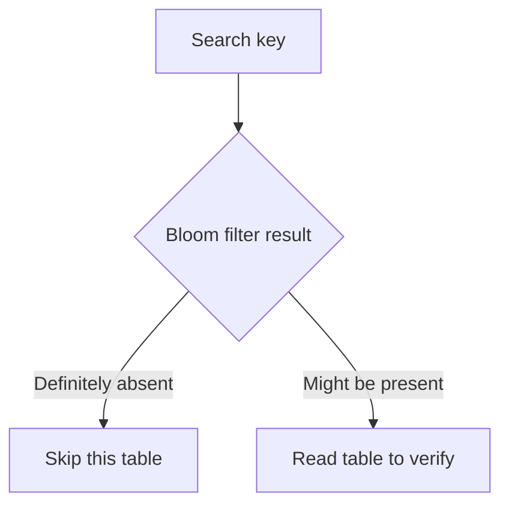

Bitcask appends values and rebuilds an in-memory key directory on restart; it favors point lookup rather than ordered range traversal. WiscKey keeps sorted keys in an LSM index and appends values to a separate log; range scans retain key order but fetch payloads from unordered locations. Value-log cleanup must track live keys and update relocated offsets (“Bitcask”; “WiscKey”; Figures 7-11–7-12).

Writes can be buffered or relocated at the database, filesystem, and flash-translation layers. Misaligned units or streams may make a lower layer rewrite bytes an upper layer soon discards. Align write units and expose discard/lifetime information when the stack permits (“Flash Translation Layer”; “Filesystem Logging”; “LLAMA and Mindful Stacking”; Figures 7-13–7-16).

## ch-8 — Introduction and Overview {#ch-8}

Concurrent work overlaps; parallel work executes simultaneously. A consistency model constrains which histories can be observed. Threads may share memory; distributed participants maintain local state and exchange messages (“Concurrent Execution”; “Concurrent and Parallel”; Figure 8-1).

Remote calls add serialization, network transfer, queueing, and remote processing. Queues can decouple stages and absorb short bursts, but cannot raise the consumer’s service rate; if arrivals exceed service, queue wait grows, so apply backpressure and size from measured throughput and latency (“Fallacies of Distributed Computing”; “Processing”; “Local and Remote Execution”).

Wall clocks can drift or move, and a timestamp only identifies the event its producer sampled. Do not use unsynchronized wall time as causal order. A timeout cannot tell a crash from a slow process or link; partitions can be asymmetric. Backoff with jitter limits synchronized retries, and a circuit breaker can stop repeated calls to a failing dependency (“Clocks and Time”; “Need to Handle Failures”; “Network Partitions and Partial Failures”; “Cascading Failures”).

An acknowledgment proves receipt of a message, not exactly-once application processing. If the acknowledgment is lost, retransmission can duplicate the effect; stable message IDs and receiver-side deduplication make retries safe. Sequence tracking is separately needed when effects must be applied in order (“Links”; “Message acknowledgments”; “Message retransmits”; “Message order”; Figures 8-2–8-4).

Derived from text: ch-8, “Message retransmits” and “Message order”
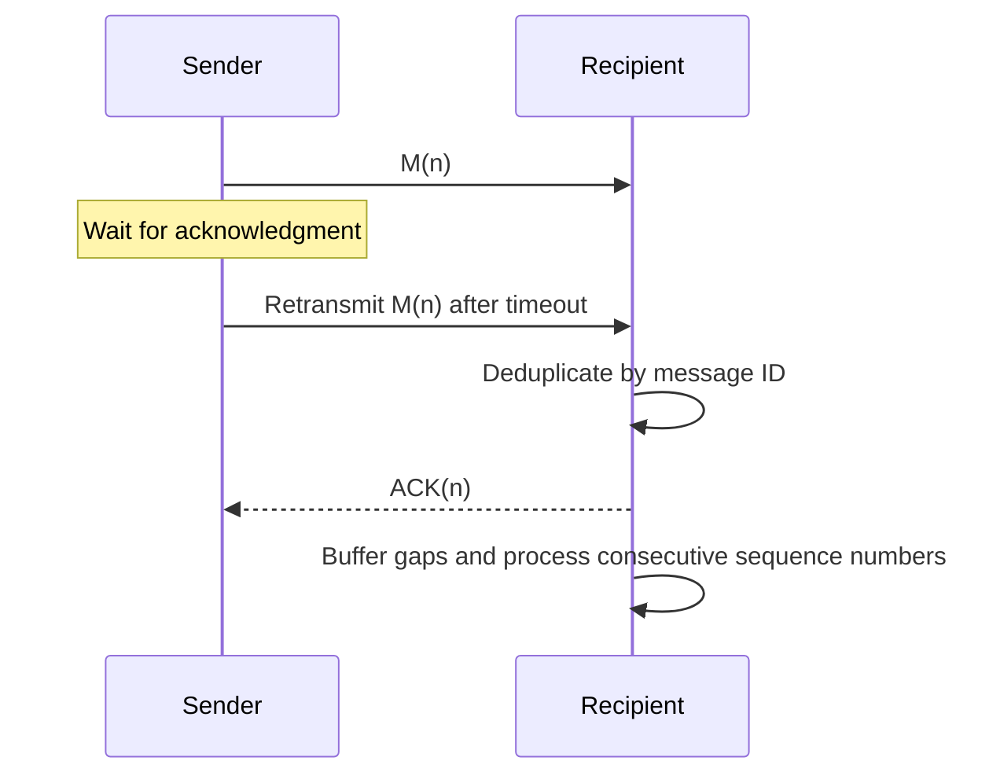

FLP rules out bounded-time deterministic consensus with an unannounced crash in full asynchrony. Partial synchrony and failure detectors can support progress but their time assumptions may still falsely suspect a slow live node (“Two Generals’ Problem”; “FLP Impossibility”; “System Synchrony”). Name the failure model—crash-stop, crash-recovery, omission, or arbitrary faults—before claiming tolerance; a crash-only protocol is not Byzantine protection (“Failure Models”).

## ch-9 — Failure Detection {#ch-9}

A detector’s timeout creates a suspicion, not proof of death. In an asynchronous system, delay and crash are indistinguishable. Completeness measures whether failures are eventually noticed; accuracy measures false accusations. Tuning one affects the other (“Failure Detection”; “Heartbeats and Pings”; Figure 9-2).

SWIM-style outsourced heartbeats let several random helpers probe a peer after a direct ping times out. An indirect acknowledgment can reveal that the target is reachable through another path; the method still cannot prove a timeout means a crash (“Outsourced Heartbeats”; Figure 9-3).

Derived from image: chapter-idm46466887095736-02 (Figure 9-3)
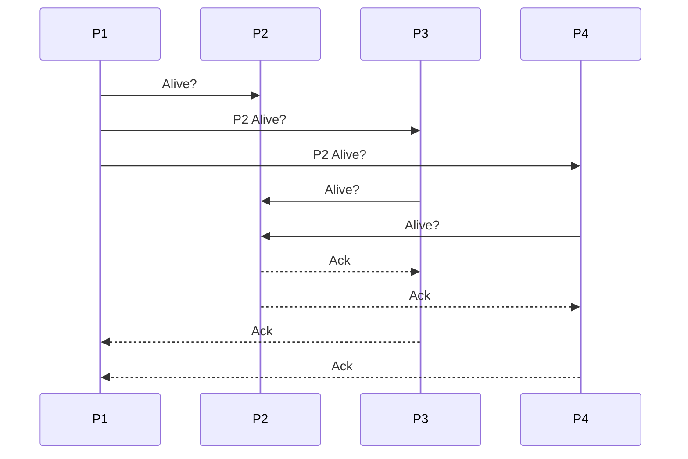

The φ-accrual detector retains a sliding window of recent heartbeat arrival times, estimates a distribution, scores the surprise of the current delay, and invokes a configured action when φ crosses a threshold. Monitoring, interpretation, and action are separate choices; the book’s sampling assumption and threshold are not universal (“Phi-Accrual Failure Detector”).

Derived from text: ch-9, “Phi-Accrual Failure Detector”
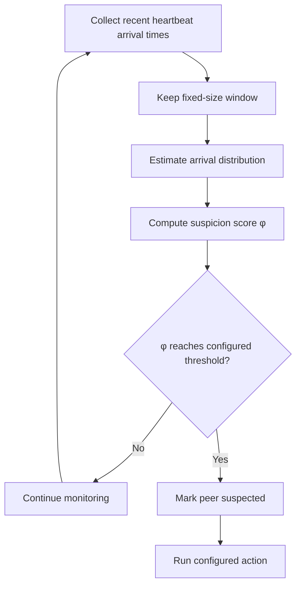

Gossip detectors merge heartbeat counters and update times received from peers; stale counters trigger suspicion after a chosen timeout. FUSE deliberately propagates one local nonresponse as group silence: useful if group-wide failure semantics are desired, dangerous if a single broken link should remain local (“Gossip and Failure Detection”; “Reversing Failure Detection Problem Statement”; Figures 9-4–9-5).

## ch-10 — Leader Election {#ch-10}

A leader can reduce repeated peer coordination, but one leader can become a bottleneck; partitioned replica sets can have separate leaders. Liveness means an election eventually finishes. Safety means one active leader, which simple election examples do not preserve across network partitions (“Leader Election”).

The bully algorithm assigns unique ranks. A process that suspects the leader asks higher-ranked processes; if one replies, it yields to the highest responder; otherwise it announces itself. Next-in-line failover contacts a designated alternative first. Candidate/ordinary variants let ordinary nodes query candidate peers and use staggered delays. Partitions can still elect independent leaders; unstable high-ranked nodes can cause repeated elections (“Bully Algorithm”; “Next-In-Line Failover”; “Candidate/Ordinary Optimization”; Figures 10-1–10-3).

Derived from image: chapter-idm46466886701464-01 (Figure 10-1)
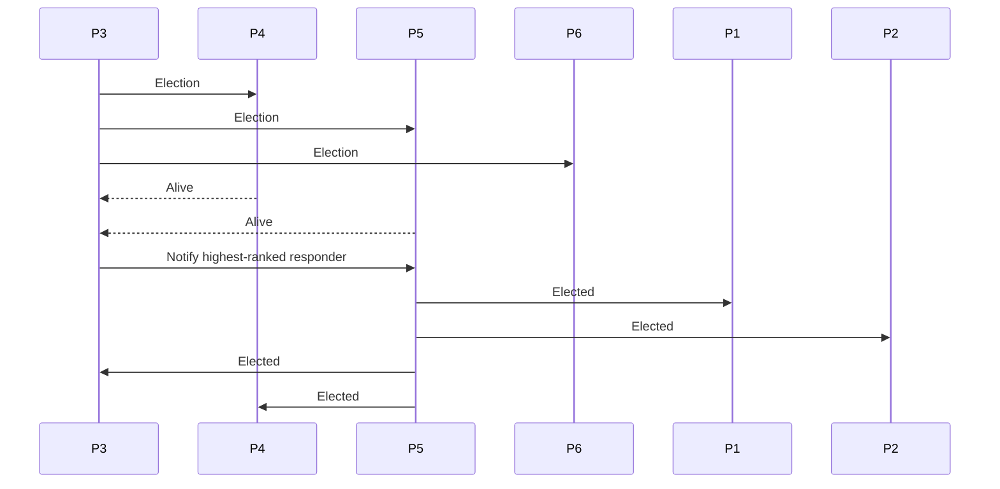

The invitation algorithm forms and merges groups that each may initially have a leader; it is group formation, not proof of one cluster-wide leader. A ring election passes an election message through reachable successors, selects the highest live rank when it returns, and circulates the result. A ring partition can also create multiple leaders (“Invitation Algorithm”; “Ring Algorithm”; Figures 10-4–10-5).

Derived from image: chapter-idm46466886701464-05 (Figure 10-5)
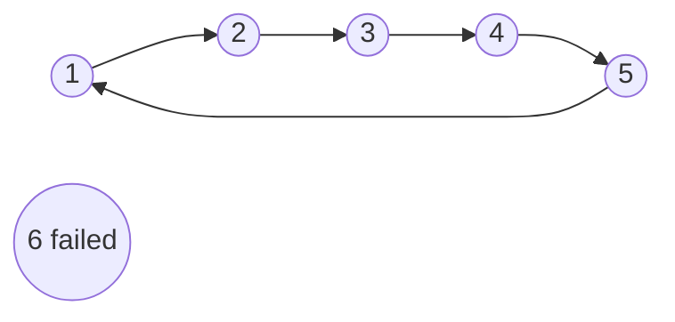

Election does not establish safe exclusive leadership by itself. Consensus protocols add quorum and conflict rules; the chapter’s Bully, invitation, and ring examples are not partition-safe (“Leader Election”; “Summary”).

## ch-11 — Replication and Consistency {#ch-11}

Replication removes a single data-copy failure point and can put data closer to readers, but updating copies atomically requires coordination. State the read/write visibility contract at the operation scope (“Replication and Consistency”).

CAP uses consistency to mean atomic/linearizable behavior and availability to mean a response to every request; the trade appears during network partitions. CP systems may reject or delay requests; AP systems may serve divergent values. Partition tolerance is a deployment condition, not a knob. CAP consistency is not ACID invariant preservation, and CAP availability does not mean ordinary uptime (“Infamous CAP”; “Use CAP Carefully”). PACELEC adds the normal-operation latency/consistency trade.

Harvest describes result completeness; yield describes the fraction of successful requests. A partial result may be preferable to a failed request only when the application accepts missing data (“Harvest and Yield”).

Linearizability orders operations in one total history, preserving real-time order for nonoverlapping calls. Each operation has a linearization point between invocation and completion. It supports real-time and monotonic-read expectations, but costs synchronization. Per-object linearizability does not make a multi-object transaction atomic (“Linearizability”; “Linearization point”; Figures 11-2–11-4). Sequential consistency preserves each process’s program order but may violate cross-process wall-clock order. Causal consistency preserves dependent-write order while allowing independent writes to appear in different orders (“Sequential Consistency”; “Causal Consistency”; Figures 11-5–11-9).

Vector clocks record per-process logical counts. Merge by componentwise maximum; concurrent versions expose divergence but leave conflict resolution to the application (“Vector clocks”). Session guarantees such as read-your-writes and monotonic reads apply per client, not as a global cross-client order (“Session Models”). Eventual consistency promises convergence if writes stop, without a fixed deadline. Tunable quorum reads/writes use R + W > N for set overlap under the model described; sloppy quorums may improve availability while weakening freshness (“Eventual Consistency”; “Tunable Consistency”; “Quorums”).

CRDT merge rules are safe only for operations whose algebra preserves the application invariant. For example, per-replica counter components can merge by maximum; a last-writer-wins timestamp can discard concurrent history, while a multivalue register preserves alternatives for resolution (“Strong Eventual Consistency and CRDTs”).

RIFL identifies an RPC by client ID and monotonically increasing client-local sequence. Persist the completion result atomically with the mutation; retry returns the stored result instead of applying the effect twice. Leases bound retained completion state (“Reusable Infrastructure for Linearizability”).

Derived from text: ch-11, “Reusable Infrastructure for Linearizability”
```mermaid
sequenceDiagram
  participant C as Client
  participant S as Server
  C->>S: RPC with client ID and sequence
  S->>S: Check durable completion object
  alt Already completed
    S-->>C: Return saved result
  else New operation
    S->>S: Apply mutation and persist completion atomically
    S-->>C: Return result
  end
  C->>S: Retry after lost acknowledgment
  S-->>C: Return saved result without reapplying
```

## ch-12 — Anti-Entropy and Dissemination {#ch-12}

An initial broadcast does not guarantee convergence when the sender or recipient is unavailable. Anti-entropy adds later repair, in the foreground during reads/writes or in the background (“Anti-Entropy and Dissemination”; Figure 12-1).

Read repair compares records returned by queried replicas and updates lagging copies. Blocking repair waits before returning and can preserve read monotonicity; asynchronous repair returns sooner but leaves a window for a stale read. Hinted handoff stores a missed write together with its intended replica and replays it after recovery; it is generally not a readable replica and does not count toward replication factor (“Read Repair”; “Hinted Handoff”).

Derived from text: ch-12, “Read Repair”
```mermaid
flowchart TD
  Read["Request key from replicas"] --> Compare["Compare replica responses"]
  Compare --> Match{"Values differ?"}
  Match -->|No| Return["Return read result"]
  Match -->|Yes| Repair["Send missing updates to lagging replicas"]
  Repair --> Blocking{"Wait for repair acknowledgments?"}
  Blocking -->|Yes| Wait["Wait, then return"]
  Blocking -->|No| Async["Schedule asynchronous repair"]
```

Merkle trees hash record ranges at leaves and child hashes above them. Compare roots, descend only through differing hashes, then repair the differing ranges. Smaller ranges sharpen repair but enlarge tree and message cost (“Merkle Trees”; Figure 12-2).

Derived from image: chapter-idm46466886386408-02 (Figure 12-2)
```mermaid
flowchart TD
  Top["Top Hash<br/>hash(Hash 1 & Hash 2)"]
  H1["Hash 1<br/>hash(Hash 3 & Hash 4)"]
  H2["Hash 2<br/>hash(Hash 5 & Hash 6)"]
  H3["Hash 3<br/>hash(Range 1)"]
  H4["Hash 4<br/>hash(Range 2)"]
  H5["Hash 5<br/>hash(Range 3)"]
  H6["Hash 6<br/>hash(Range 4)"]
  D1["Data<br/>Range 1"]
  D2["Data<br/>Range 2"]
  D3["Data<br/>Range 3"]
  D4["Data<br/>Range 4"]
  Top --> H1
  Top --> H2
  H1 --> H3
  H1 --> H4
  H2 --> H5
  H2 --> H6
  H3 --> D1
  H4 --> D2
  H5 --> D3
  H6 --> D4
```

Bitmap version vectors record writer-local dots and gaps. Peers exchange compact clocks, identify missing writes, retrieve their causal values from a dotted causal container, and truncate history only after relevant peers have caught up. A long-offline peer can pin retained history (“Bitmap Version Vectors”; Figure 12-3).

Gossip relays updates through random peers; fanout trades convergence delay against duplicate traffic. Plumtree uses a tree for full messages and lazy links for message IDs and repair. HyParView keeps a small active view and a larger passive replacement view; after a peer is suspected it tries a passive replacement (“Gossip Dissemination”; “Hybrid Gossip”; “Partial Views”; Figures 12-4–12-5).

Derived from text: ch-12, “Bitmap Version Vectors”
```mermaid
flowchart TD
  Write["Write creates dot (sequence, coordinator)"] --> Clock["Record dot in local logical clock"]
  Clock --> Exchange["Exchange compact clocks with peer"]
  Exchange --> Missing["Find missing dots and gaps"]
  Missing --> Values["Resolve dots to records in causal container"]
  Values --> Replicate["Replicate missing records"]
  Replicate --> AllCaughtUp{"Relevant peers contiguous through index?"}
  AllCaughtUp -->|Yes| Truncate["Truncate covered prefix"]
  AllCaughtUp -->|No| Retain["Retain history for lagging peer"]
  Retain --> Exchange
```

## ch-13 — Distributed Transactions {#ch-13}

Multipartition transactions need coordination, commit, and rollback beyond node-local locks or optimistic validation. Atomic commitment requires unanimous participants; its crash-fault assumption does not cover Byzantine votes (“Distributed Transactions”; “Making Operations Appear Atomic”).

In 2PC, a coordinator proposes work; cohorts prepare local state and durably vote. The coordinator commits only after every positive vote, otherwise aborts. A yes-vote leaves the cohort waiting for the final decision; if the coordinator permanently fails after prepare, the cohort cannot guess safely and may block (“Two-Phase Commit”; “Coordinator Failures in 2PC”; Figures 13-1–13-4).

Derived from image: chapter-idm46466885842968-01 (Figure 13-1)
```mermaid
sequenceDiagram
  participant C as Coordinator
  participant H as Cohorts
  C->>H: Propose
  H-->>C: Vote
  C->>H: Commit
  H-->>C: Committed
```

3PC inserts a prepare state and timeout decisions. It can avoid some coordinator blocking under synchrony assumptions, but a partition can leave prepared nodes committing while others abort (“Three-Phase Commit”; “Coordinator Failures in 3PC”; Figures 13-5–13-6).

Derived from image: chapter-idm46466885842968-05 (Figure 13-5)
```mermaid
sequenceDiagram
  participant C as Coordinator
  participant H as Cohorts
  C->>H: Propose
  H-->>C: Vote
  C->>H: Prepare
  H-->>C: ACK
  C->>H: Commit
```

Calvin orders and replicates transaction batches before deterministic execution, reducing execution-time coordination when the read/write sets are known. Dynamic discovery of new sets is outside the described model (“Distributed Transactions with Calvin”; Figure 13-7). Spanner combines per-shard Paxos, cross-shard 2PC, locking, and TrueTime uncertainty bounds; a single-shard transaction avoids cross-shard 2PC (“Distributed Transactions with Spanner”; Figure 13-8).

Percolator uses snapshot isolation with client-driven prewrite locks and a primary lock for recovery. A later transaction can resolve an incomplete commit from the primary lock. Snapshot isolation still permits write skew on disjoint cells (“Distributed Transactions with Percolator”; Figure 13-9).

Derived from image: chapter-idm46466885842968-09 (Figure 13-9)
```mermaid
flowchart LR
  Initial["Initial state before moving $150 from Account2 to Account1"] --> Locked["State after taking locks and updating accounts"]
  Locked --> Committed["Transaction commit releases locks and updates metadata with latest timestamp"]
```

Invariant confluence permits independent local commits only when any two valid states can merge into another valid state. RAMP uses in-flight transaction metadata and multiple versions to detect missing sibling writes and fetch them, avoiding fractured reads without blocking unrelated writers (“Coordination Avoidance”).

Derived from text: ch-13, “Coordination Avoidance”
```mermaid
flowchart TD
  Local["Execute against local snapshot"] --> Prepare["Prepare writes at affected partitions"]
  Prepare --> Publish["Publish commit metadata"]
  Publish --> Check["Reader checks in-flight write metadata"]
  Check --> Missing{"Sibling writes missing?"}
  Missing -->|Yes| Fetch["Fetch missing versions"]
  Fetch --> View["Return complete transaction view"]
  Missing -->|No| View
```

## ch-14 — Consensus {#ch-14}

Consensus requires agreement, validity, and termination. In full asynchrony, FLP rules out bounded-time deterministic termination after an unannounced crash; failure detectors support practical progress hints without making suspicion infallible (“Consensus”; “FLP Impossibility”). Reliable broadcast repairs a sender’s partial delivery by forwarding received messages; atomic broadcast additionally makes all processes deliver the same total order (“Broadcast”; “Atomic Broadcast”; Figure 14-1).

ZAB uses discovery of a newer epoch, synchronization of follower histories, then quorum-acknowledged ordered proposals. Followers accept proposals only from the established epoch leader; loss of a follower quorum makes that leader step down (“Zookeeper Atomic Broadcast (ZAB)”; Figure 14-2).

Derived from image: chapter-idm46466885252488-02 (Figure 14-2)
```mermaid
sequenceDiagram
  participant L as Leader
  participant F as Followers
  L->>F: Current Epoch
  L->>F: New Epoch
  F-->>L: ACK
  L->>F: New Leader
  F-->>L: ACK
  L->>F: Commit Leader
  L->>F: Propose
  F-->>L: ACK
  L->>F: Commit
```

Paxos uses proposal numbers and intersecting quorums. Prepare(n) makes acceptors promise not to accept lower numbers and report prior accepted values. The proposer carries forward the highest-numbered accepted value it learns; if none exists, it can use its own. Accept!(n,v) then replicates that value. A new proposer must not discard a possibly accepted value (“Paxos”; “Quorums in Paxos”; Figure 14-3).

Derived from image: chapter-idm46466885252488-03 (Figure 14-3)
```mermaid
sequenceDiagram
  participant P as Proposer
  participant A as Acceptors
  participant L as Learners
  P->>A: Prepare(n)
  A-->>P: Promise(n,v)
  P->>A: Accept!(n,v)
  A-->>L: Accepted(n,v)
```

Multi-Paxos retains an established proposer across values to avoid repeating prepare each time. Leader leases can optimize reads only under their clock-synchrony assumptions; durable log snapshots and truncation must be atomic (“Multi-Paxos”). Fast Paxos allows direct proposer-to-acceptor traffic with larger quorums and a classic recovery round on collisions (“Fast Paxos”; Figure 14-7). EPaxos records interfering commands as dependencies; if replicas disagree on dependencies, it uses an acceptance round with merged dependencies (“Egalitarian Paxos”; Figure 14-8).

Derived from image: chapter-idm46466885252488-07 (Figure 14-7)
```mermaid
sequenceDiagram
  participant P as Proposer
  participant C as Coordinator
  participant A as Acceptors
  participant L as Learner
  C->>A: Any
  P->>A: Accept (1,V1)
  A-->>L: Accepted
  C->>A: Accept (2,V2)
  A-->>L: Accepted
```

Derived from image: chapter-idm46466885252488-08 (Figure 14-8)
```mermaid
sequenceDiagram
  participant P1
  participant P2
  participant P3
  participant P4
  participant P5
  P1->>P2: PreAccept (1, ∅)
  P1->>P3: PreAccept (1, ∅)
  P2-->>P1: OK (1)
  P3-->>P1: OK (1)
  Note over P1: Commit (1)
  P5->>P3: PreAccept (2, ∅)
  P5->>P4: PreAccept (2, ∅)
  P3-->>P5: Conflict ({1})
  P4-->>P5: Conflict ({1})
  P5->>P3: Accept (2, {1})
  P5->>P4: Accept (2, {1})
  P3-->>P5: ACK
  P4-->>P5: ACK
  Note over P5: Commit (2)
```

Raft elects a candidate with a majority, sends heartbeats, and replicates ordered log entries through AppendEntries. Followers accept entries only when the preceding term/index matches. A majority acknowledgment commits; new leaders reconcile uncommitted suffixes without deleting their own log (“Raft”; “Leader Role in Raft”; Figures 14-10–14-12).

Derived from image: chapter-idm46466885252488-10 (Figure 14-10)
```mermaid
sequenceDiagram
  participant P1
  participant P2
  participant P3
  P1->>P2: RequestVote
  P1->>P3: RequestVote
  P2-->>P1: OK
  P3-->>P1: OK
  Note over P1: Leader
  P1->>P2: Heartbeat
  P1->>P3: Heartbeat
  P2-->>P1: ACK
  P3-->>P1: ACK
  P1->>P2: AppendEntries
  P1->>P3: AppendEntries
  P2-->>P1: ACK
  P3-->>P1: ACK
```

PBFT addresses Byzantine replicas with cross-validated phases and at least 3f+1 replicas to tolerate f faulty members; its all-to-all messages cost roughly quadratically. View change and checkpointing use additional quorum evidence; crash-fault majorities do not supply Byzantine protection (“Byzantine Consensus”; “PBFT Algorithm”; “Recovery and Checkpointing”; Figure 14-13).

Derived from image: chapter-idm46466885252488-13 (Figure 14-13)
```mermaid
sequenceDiagram
  participant C as Client
  participant P1
  participant P2
  participant P3
  participant P4
  C->>P1: Request
  P1->>P2: Pre-Prepare
  P1->>P3: Pre-Prepare
  P1->>P4: Pre-Prepare
  P2->>P1: Prepare
  P2->>P3: Prepare
  P2->>P4: Prepare
  P3->>P1: Prepare
  P3->>P2: Prepare
  P3->>P4: Prepare
  P1->>P2: Commit
  P1->>P3: Commit
  P1->>P4: Commit
  P2->>P1: Commit
  P2->>P3: Commit
  P2->>P4: Commit
  P3->>P1: Commit
  P3->>P2: Commit
  P3->>P4: Commit
  P1-->>C: Response
  P2-->>C: Response
  P3-->>C: Response
```

## Decision rules (summary)

| Trigger (observable in code/diff/plan) | Rule | Rationale | Src |
|---|---|---|---|
| A query mix reads complete keyed records or scans few columns across many rows | Match row or column layout to measured read shape; otherwise the store reads unrelated fields or sacrifices record locality | Physical locality follows query shape rather than workload branding | src: database-internals-petrov ch-1 |
| Secondary indexes retain record offsets while maintenance can relocate rows | Compare direct offsets with primary-index indirection and define pointer repair; otherwise relocated records leave stale references | Read hops and update maintenance costs trade off | src: database-internals-petrov ch-1 |
| A page-oriented ordered index is selected | Account for page transfers and fanout, not only comparison complexity | Tall pointer paths cost disk reads | src: database-internals-petrov ch-2 |
| A B-Tree split, merge, or redistribution changes a node boundary | Repair parent separators, child pointers, and any affected sibling links; otherwise searches can enter the wrong range | Separators encode subtree bounds | src: database-internals-petrov ch-2, ch-4 |
| Variable-size cells can move during page compaction | Keep stable slot identities separate from cell byte offsets; otherwise relocation invalidates references | Slot indirection preserves logical identity | src: database-internals-petrov ch-3 |
| A persistent page format changes across versions | Identify the version from stable metadata before decoding; otherwise a reader can misinterpret bytes | Layout generations need compatible readers | src: database-internals-petrov ch-3 |
| A read loads a page that may have suffered accidental corruption | Validate a page-scoped checksum before use; otherwise damaged bytes can propagate to indexes or replicas | Local detection can contain damage | src: database-internals-petrov ch-3 |
| Input keys are presorted for a B-Tree build | Write leaves in order and construct upper levels from child pointers; otherwise repeated inserts add avoidable search and structural work | Sorted input supports bottom-up construction | src: database-internals-petrov ch-4 |
| A commit depends on dirty pages not yet written to storage | Force the commit log record and retain WAL before page flush; otherwise acknowledged state may be lost on crash | WAL preserves redo/undo history | src: database-internals-petrov ch-5 |
| A transaction enforces an invariant across independent records | Use serializable validation or an equivalent invariant mechanism; snapshot isolation can allow write skew | Same-row conflict checks do not protect every cross-row invariant | src: database-internals-petrov ch-5, ch-13 |
| An LSM flush or compaction publishes a replacement for readable state | Keep old sources readable until the replacement is complete and publish the new view atomically; otherwise a read or crash can miss data | Readers must see a complete source set | src: database-internals-petrov ch-7 |
| A delete marker can coexist with an older value in another table or replica | Retain the tombstone until no eligible older copy can reappear; otherwise compaction resurrects the value | The marker shadows older versions | src: database-internals-petrov ch-7 |
| A Bloom filter rejects a key for an immutable table | Skip the table only on a negative result and verify positive results; otherwise an invalid negative loses a present key | False positives cost reads; false negatives break correctness | src: database-internals-petrov ch-7 |
| A remote call times out after a side effect may have run | Retry with a stable request ID and receiver-side deduplication; otherwise a lost acknowledgment can duplicate the effect | Delivery and application processing are distinct | src: database-internals-petrov ch-8, ch-11 |
| A heartbeat timeout is used to exclude a peer | Keep suspicion distinct from confirmed crash and tune accuracy against detection delay; otherwise a slow live node can be excluded | Timing alone cannot distinguish delay from failure | src: database-internals-petrov ch-9 |
| A leader election completes in a partitionable cluster | Require consensus or quorum conflict rules before treating the result as unique; otherwise independent groups can elect leaders | Simple election algorithms can split brain | src: database-internals-petrov ch-10, ch-14 |
| A read contract depends on real-time order across replicas | Name the consistency model and operation scope; otherwise “consistent” hides whether stale or backward reads are permitted | Models constrain different histories | src: database-internals-petrov ch-11 |
| A replica may miss initial delivery or remain offline | Add a repair path suited to the scope: queried keys, hints, missing dots, or hash ranges; otherwise state can remain divergent indefinitely | Delivery and convergence are separate work | src: database-internals-petrov ch-12 |
| A transaction writes to more than one partition | Use one recoverable commit decision or prove invariant-confluent local commits; otherwise partial visibility can violate atomicity or invariants | Local concurrency control is not distributed atomicity | src: database-internals-petrov ch-13 |
| A new proposer may follow a failed consensus proposer | Preserve the highest previously accepted value returned by the prepare quorum; otherwise a different value can violate agreement | Quorum intersection carries prior decisions forward | src: database-internals-petrov ch-14 |

## Anti-patterns

- **Layout by product label:** choose row, column, or wide-column storage without observing key, record, and scan patterns.
- **Unrepaired pointer identity:** keep direct row offsets in secondary indexes while vacuum or page movement relocates records.
- **Comparison-only tree sizing:** assess an on-disk index by Big-O comparisons while ignoring node fanout, page transfers, and balancing writes.
- **Format guessing:** decode a page using assumed byte order, padding, or current layout without a version marker and explicit field encoding.
- **Checksum as authenticity:** use CRC or ordinary hashing to claim defense against intentional modification.
- **WAL truncation before durable coverage:** discard records while an affected page or table can still be lost.
- **Isolation-name substitution:** equate repeatable reads or snapshot isolation with serializability despite a visible cross-row invariant.
- **Unbounded delta or overflow chain:** defer consolidation until reads must traverse arbitrarily many pages or deltas.
- **Early tombstone removal:** drop a delete marker while an older value can still surface.
- **Bloom-positive as proof:** treat possible membership as confirmed instead of checking the table.
- **Remote call as local call:** hide paging, latency, partial failure, or visibility semantics behind a local-looking API.
- **Timeout as crash proof:** exclude a live participant solely because a message was delayed.
- **Election as uniqueness proof:** treat a Bully, ring, or invitation result as safe across network partitions.
- **Consistency without a model:** use the word “consistent” without naming the object scope, history guarantee, and partition behavior.
- **One-shot convergence:** assume initial broadcast, read repair, or a single coordinator delivers all changes to every returning replica.
- **Prepared participant guesses:** allow a 2PC cohort to serve uncertain state before learning commit or abort.
- **Consensus by majority alone:** apply crash-fault quorum reasoning to arbitrary or Byzantine participants.

## Applicability & exemptions

- Row/column guidance is workload-dependent; hybrid engines can use more than one layout. Wide-column stores remain a separate row-key/family organization.
- Direct offsets may be appropriate when records remain stable or reads dominate; indirection has lookup cost. The source supplies no universal crossover.
- A rightmost B-Tree fast path requires monotonic keys and low update/delete share; a different key mix invalidates it.
- Page checksums detect accidental damage, not malicious tampering. Format version policy depends on whether multiple generations must coexist.
- Cache pinning, prefetch, balancing, compression granularity, and compaction thresholds need workload and engine-specific measurements.
- Snapshot isolation is useful where its anomaly set fits the application; it does not itself enforce arbitrary cross-record invariants.
- Bloom-filter positives are intentionally uncertain. A negative is safe only if the filter was built and maintained without false negatives.
- Tombstone retention, repair logs, quorum formulas, and replica membership depend on the selected consistency and failure model.
- 2PC assumes crash/omission faults and can block. 3PC’s nonblocking argument assumes synchrony and excludes network partitions. PBFT is the explicit Byzantine protocol sketch.
- Consensus mechanisms are summaries, not implementation proofs or recommended quorum, timer, fanout, or threshold values. Leases and time-based ordering require their stated clock assumptions.
- The book’s product examples, implementation status, and popularity observations reflect its 2019 publication context. Operational manuals, current product behavior, and full protocol proofs are outside this source.

## Candidate lexicon rows

| Trigger phrase | Rule | Activating question | Tier | Phase | Src |
|---|---|---|---|---|---|
| Variable-sized page cells can move while other structures retain references | **Stable slot indirection**: keep cell identity in a slot directory and relocate payload bytes behind it, so page compaction does not invalidate references | Can compaction move cells without changing their logical identifiers? | should | write | src: database-internals-petrov ch-3 |
| A persisted page can be read by binaries using more than one layout generation | **Version before decode**: store a stable version marker and dispatch a compatible reader, so unsupported layouts fail before payload interpretation | How does the reader identify the page format before decoding it? | should | write | src: database-internals-petrov ch-3 |
| A page crosses a storage boundary where accidental corruption is possible | **Validate pages on read**: store and check a page-scoped checksum before use, so damaged bytes do not propagate into indexes or replicas | What validates this page before another component consumes it? | should | review | src: database-internals-petrov ch-3 |
| A transaction can commit while modified pages remain dirty | **Force the commit record first**: durably force its WAL record and retain the protecting log prefix until page coverage is durable, so a crash can recover acknowledged work | Which durable record reconstructs this committed page after a crash? | blocker | write | src: database-internals-petrov ch-5 |
| Compaction can encounter an older value below a newer delete marker | **Retain tombstones until safe**: keep the marker while an eligible older table or replica may still expose the key, preventing data resurrection | Which older copy could still return the deleted value? | blocker | write | src: database-internals-petrov ch-7 |
| A lookup checks multiple immutable tables for the same key | **Skip tables only on Bloom negatives**: treat a negative as absence but check positive results in the table, preserving correctness despite false positives | Is this filter allowed to return false negatives? | blocker | write | src: database-internals-petrov ch-7 |
| A remote write may have succeeded before its acknowledgment was lost | **Persist request deduplication**: identify retries by client and sequence and store completion with the mutation, so retry does not apply the effect twice | Can the server recognize this retry after restart? | blocker | write | src: database-internals-petrov ch-11 |
| A timeout is used to mark a remote process failed | **Keep suspicion provisional**: separate suspected from confirmed failure and tune the threshold against observed delay, so slow peers are not silently treated as dead | What evidence distinguishes a failed peer from a delayed response? | should | review | src: database-internals-petrov ch-9 |
| A quorum read needs to preserve the value a client has already observed | **Block on repair when monotonicity requires it**: wait for target replicas to acknowledge repair before returning; asynchronous repair leaves a stale-read window | Must the next read keep at least the value just observed? | judgment | review | src: database-internals-petrov ch-12 |
| A prepared distributed transaction waits on an unavailable coordinator | **Do not guess the final decision**: recover the durable coordinator outcome before serving the cohort, since an uncertain participant can contradict other partitions | Has the cohort learned a durable commit or abort decision? | blocker | review | src: database-internals-petrov ch-13 |
| A new consensus proposer learns that an earlier proposal may have been accepted | **Carry forward the highest accepted value**: use the highest-numbered value returned by the prepare quorum, preserving agreement after proposer failure | Did any prepare response report an earlier accepted proposal? | blocker | write | src: database-internals-petrov ch-14 |
| A replica set may contain arbitrary or malicious participants | **Choose a Byzantine protocol for Byzantine faults**: size and cross-validate for the stated f bound, since crash-only majorities do not constrain forged or conflicting messages | How many replicas may behave arbitrarily while the guarantee must hold? | judgment | plan | src: database-internals-petrov ch-14 |

Disposition: unnumbered candidates awaiting central promotion.

### Candidate dispositions

- **Force the commit record first:** not promoted: Database Internals: A Deep Dive into How Distributed Data Systems Work, chapter 5, supports forcing a commit record, making page-change log records durable before dirty-page writes, and retaining log history until covered pages are durable. The cell-only merge cannot add that citation to RES-18 while preserving its Operating Systems: Three Easy Pieces, chapter 42 commit and pointer-ordering contract. The proposal is not promoted until both claims can be represented with their sources. Book-use audit: accepted the merge-scope finding (preserve RES-18's incumbent durability contract and defer the WAL branch until both works can be cited).
- **Keep suspicion provisional:** PROMOTED as RES-21
- **Version before decode:** not promoted: Database Internals: A Deep Dive into How Distributed Data Systems Work, chapter 3, supports choosing a version-specific reader from stable metadata before decoding. Applying the cell-only merge would replace DATA-03's broader schema-evolution compatibility trigger and rule, while the resulting citation would remain Designing Data-Intensive Applications, chapter 4. The proposal is not promoted until both source claims can be represented in the target. Book-use audit: accepted the merge-scope finding (leave DATA-03's incumbent compatibility cells unchanged unless the resulting row can cite both works).
- **Persist request deduplication:** not promoted: Database Internals: A Deep Dive into How Distributed Data Systems Work, chapter 11, supports RIFL client IDs, client-local sequence numbers, and durable completion atomic with mutation. The cell-only merge would narrow DATA-13 to RPCs and the resulting citation would remain Designing Data-Intensive Applications, chapter 12, which does not support the RIFL details. The proposal is not promoted so the existing network-wide retry trigger and guidance remain intact. Book-use audit: accepted the network-scope and citation finding (defer the RIFL addition until it can retain the broad trigger and carry its source).
- **Block on repair when monotonicity requires it:** PROMOTED as DATA-22
- **Do not guess the final decision:** PROMOTED as DATA-23
- **Carry forward the highest accepted value:** PROMOTED as DATA-24
- **Choose a Byzantine protocol for Byzantine faults:** PROMOTED as DATA-25
- **Stable slot indirection:** PROMOTED as STOR-08
- **Validate pages on read:** PROMOTED as STOR-09
- **Retain tombstones until safe:** PROMOTED as STOR-10
- **Skip tables only on Bloom negatives:** PROMOTED as STOR-11

## Cross-links

- [STOR-02] owns the B-Tree versus LSM selection trigger; Chapters 2, 6, and 7 detail page-transfer, buffering, and compaction mechanisms without claiming one universal winner.
- [STOR-01] covers write cost added by indexes; Chapter 1 makes direct-offset repair versus primary-index indirection concrete.
- [STOR-06] covers columnar storage for analytical scans; Chapter 1 adds the row-access case and distinguishes wide-column from columnar layout.
- [RES-17], [RES-18], and [DATA-16] own durable intent, write ordering, and fsync semantics; Chapter 5 applies them to dirty-page flush, commit records, checkpoints, and WAL truncation.
- [RES-19] owns idempotent redo; Chapter 5 describes ARIES repeating history and logging undo work.
- [RES-07] owns steady-state reclamation; B-Tree vacuum, LSM compaction, tombstone cleanup, and flash garbage collection are source-specific reclaimers.
- [DATA-17], [DATA-18], [DATA-20], and [CON-05] cover isolation anomalies, snapshot-isolation gaps, and serializability trade-offs; Chapters 5 and 13 explain the mechanisms behind them.
- [RES-01], [FLOW-05], and [DATA-13] own retry safety and end-to-end request identity; Chapter 8 distinguishes delivery acknowledgments from application effects, and RIFL gives a durable deduplication mechanism.
- [RES-02] owns bounded blocking waits; Chapters 8–9 show why a timeout also changes failure-suspicion accuracy.
- [RES-15] owns circuit-breaker integration; Chapter 8 adds backoff and jitter for repeated dependency failures.
- [RES-16] owns exercising claimed tolerance paths; Chapter 8 names partitions, latency, clock divergence, and storage faults as useful cases.
- [DATA-02] owns replica-lag anomalies; Chapters 11–12 refine visibility and repair consequences.
- [DATA-05] owns distributed-transaction / 2PC cost; Chapter 13 separates blocking 2PC, partition-sensitive 3PC, and alternatives.
- [DATA-06] owns the linearizability trigger for consensus; Chapter 10’s partition counterexamples explain why plain election does not supply safe uniqueness.
- [DATA-15] owns logical-clock ordering; Chapters 11–12 add causal context, vector clocks, and missing-dot repair.
- [PERF-14] covers batching latency trade-offs; Chapters 1, 5, 6, and 7 show how buffering amortizes writes while delaying flushes.
- [PERF-15] covers coordination latency; Chapters 11 and 13 make quorum, locking, and cross-partition costs explicit.

## Tensions

- **Row locality versus column scans.** Complete-record keyed access benefits from row locality; narrow scans over many rows benefit from column layout. Partition by measured query shape under [STOR-06].
- **B-Tree versus LSM.** Direct ordered access can suit point and range reads; buffered sequential writes can suit ingest-heavy paths. Compaction and steady-state cost can change the apparent advantage; measure under [STOR-02].
- **Direct offsets versus indirection.** Direct offsets reduce read work, while primary-index indirection reduces pointer repair after relocation. Resolve using the read/update and relocation profile under [STOR-01].
- **Buffering versus durability.** Batching reduces repeated writes, but buffered data is not durable until WAL and page/table publication order are satisfied under [RES-17], [RES-18], and [DATA-16].
- **Snapshot reads versus invariant protection.** Snapshot isolation avoids some read anomalies but can permit write skew. When transactions enforce cross-record invariants, use serializable validation or an equivalent mechanism under [DATA-18], [DATA-20], and [CON-05].
- **Timeout speed versus suspicion accuracy.** [RES-02] bounds waits; failure detectors trade detection delay against false positives. A timeout must not become proof of process death.
- **Linearizability versus eventual convergence.** Linearizability preserves real-time order at a coordination cost; eventual or causal models allow some stale or differently ordered reads. Select by client-visible operation contract, not the broad label “strong consistency.”
- **2PC versus 3PC.** 2PC can block in an uncertain prepared state; 3PC adds messages and depends on synchrony without partitions. Partition by the actual failure model, not by protocol name alone.
- **Immutability versus cleanup.** Immutable versions simplify reads but defer merge and reclamation work. Keep compaction capacity and space headroom aligned with ingestion under [RES-07] and [STOR-03].
- **Retry liveness versus duplicate effects.** Retries can restore progress after loss, but a lost acknowledgment can follow a successful effect. Require a deduplicating sink under [RES-01] and [FLOW-05].

## First-principles candidates

None — this distillation is one primary source and does not establish an independent second domain for a shared causal mechanism.
