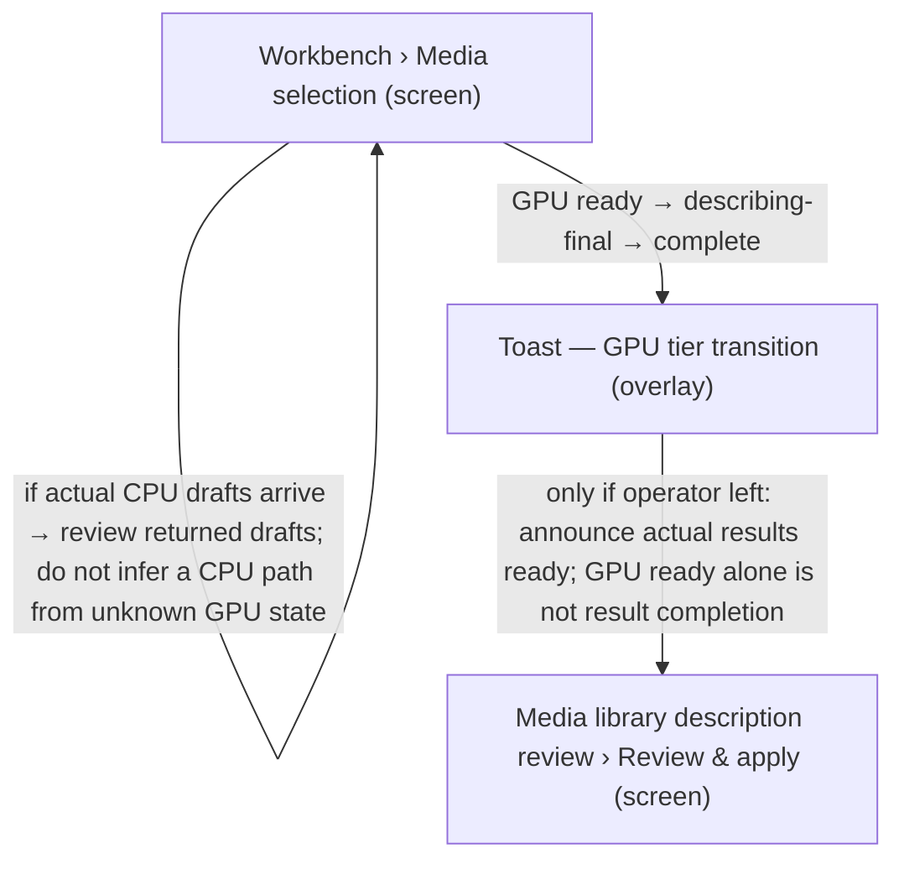
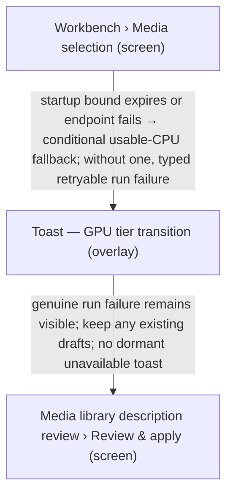
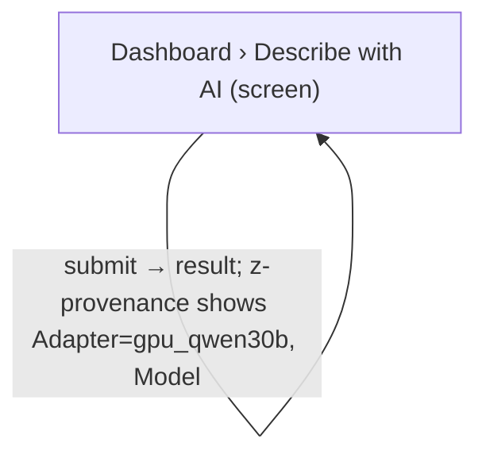
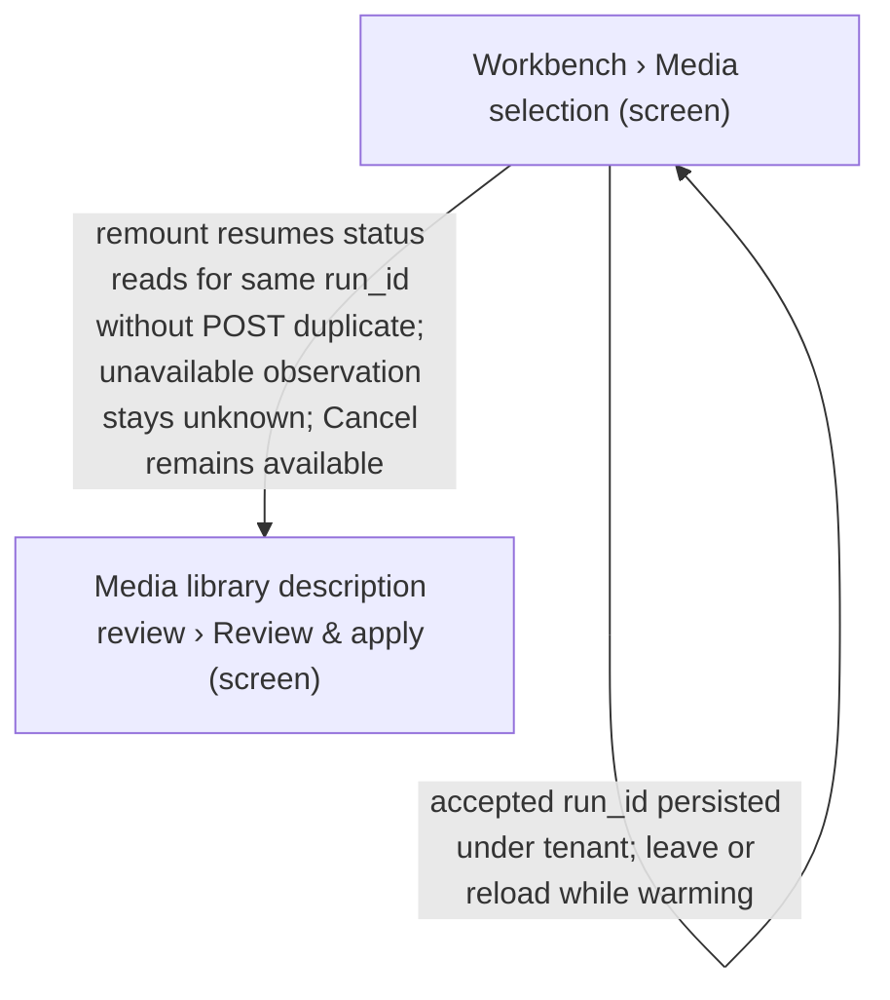

# UX Map — describe-gpu-tier

**Product:** `alt-context WP plugin admin SPA — describe run GPU tier + lifecycle state`
**Source fixture:** `apps/prototype-wp-alt-context/js/admin/pages/workbench/QueueDraftCell.tsx`

## Goals
- UXREC-1 target contract awaiting map gate: distinguish idle/unknown service observation, known blocked configuration, active warming/running, genuine failure, retry and remount. Existing code references are anchors, not implementation claims.
- An accepted run exposes observed startup progress, its actual deadline, cancel and return-to-run; historical cold-start measurements are not a current ETA guarantee.
- Existing CPU drafts remain reviewable with their reported item tier. Unknown GPU/capability never promises CPU continuation; CPU fallback is conditional on a usable configured adapter, not generic API health.
- Before Describe, disclose possible GPU warm-up and infrastructure charges separately from credits, with a Settings link (INT-07, NAV-11). Read failures retain saved rows and apply recovery, show a stale notice, and offer a read-only Retry (INT-10).

## Jobs
- `bulk-describe` — Describe selected media with AI and apply results
- `single-describe` — Describe one image from the dashboard panel
- `gpu-tier-awareness` — Know which tier produced a description and what it will cost/take

## Code references
- `screen:workbench-media-selection` — `apps/prototype-wp-alt-context/js/admin/pages/workbench/MediaSelection.tsx`
- `screen:describe-run-apply` — `apps/prototype-wp-alt-context/js/admin/pages/workbench/QueueDraftCell.tsx`
- `screen:dashboard-describe-panel` — `apps/prototype-wp-alt-context/js/admin/pages/dashboard/DescribePanel.tsx`
- `screen:toast-gpu-transition` — `apps/prototype-wp-alt-context/js/admin/context/ToastContext.tsx`

## Screens
| id | kind | route | title |
| --- | --- | --- | --- |
| `workbench-media-selection` | screen | `#/workbench` | Workbench › Media selection |
| `describe-run-apply` | screen | `#/workbench?hasDraft=1&run=<id>` | Media library description review › Review & apply |
| `dashboard-describe-panel` | screen | `#/` | Dashboard › Describe with AI |
| `toast-gpu-transition` | overlay | `#/workbench (transient toast; no dedicated route)` | Toast — GPU tier transition |

### Workbench › Media selection (`workbench-media-selection`)

Purpose: Select media and describe; UXREC-1 proposed quiet unknown consequence copy: GPU tier not reported. Description readiness is unconfirmed. No idle failure toast. Known configuration error is separate from an accepted run failure. Existing tenant-scoped operation storage resumes accepted run_id on remount without resubmission; this is source behavior, runtime acceptance pending.

url_params: `run_id`

| zone id | label | role | states |
| --- | --- | --- | --- |
| `z-bulk-cta` | Describe selected; selection and service readiness are separate. Proposed unknown copy makes no CPU promise. Known blocked configuration names the service and Settings recovery without inventing a new readiness API or disabling otherwise legal submissions. | job | default, loading, empty |
| `z-bulk-progress` | Accepted run only: starting/warming/running, observed deadline, Cancel and return-to-run; completed/cancelled outcome; genuine failure with cause and supported retry. CPU drafts appear only when actual results exist. | status | default, loading, error, degraded |
| `z-gpu-tier-chip` | GPU observation is not description readiness: idle unknown stays quiet; starting/warming/ready/degraded do not certify completed results. Proposed neutral unknown copy is owned by gpuStatePresentation.ts. | status | default, loading, empty, degraded |
| `z-review-link` | Review & apply drafts link — Hidden until the run is terminal; terminal runs link to #/workbench?hasDraft=1&run=<id>, regardless of item tier. | nav | default, empty, degraded |
| `z-recovery-envelope` | Recovery contract: read-only status retry does not restart inference; remount resumes stored tenant run_id; cancellation acknowledgement ends pending state; rejected persistence remains visible. | status | default, loading, empty, error, degraded |

```
+------------------------------------------------------------+
| Workbench › Media selection  [screen]  #/workbench         |
| Select media and describe; UXREC-1 proposed quiet unknown\ |
|    consequence copy: GPU tier not reported. Description r\ |
|   eadiness is unconfirmed. No idle failure toast. Known c\ |
|   onfiguration error is separate from an accepted run fai\ |
|   lure. Existing tenant-scoped operation storage resumes \ |
|   accepted run_id on remount without resubmission; this i\ |
|   s source behavior, runtime acceptance pending.           |
+------------------------------------------------------------+
| ZONES                                                      |
|   - Describe selected; selection and service readiness ar\ |
|   e separate. Proposed unknown copy makes no CPU promise.\ |
|    Known blocked configuration names the service and Sett\ |
|   ings recovery without inventing a new readiness API or \ |
|   disabling otherwise legal submissions. (job) states=[de\ |
|   fault,loading,empty]                                     |
|   - Accepted run only: starting/warming/running, observed\ |
|    deadline, Cancel and return-to-run; completed/cancelle\ |
|   d outcome; genuine failure with cause and supported ret\ |
|   ry. CPU drafts appear only when actual results exist. (\ |
|   status) states=[default,loading,error,degraded]          |
|   - GPU observation is not description readiness: idle un\ |
|   known stays quiet; starting/warming/ready/degraded do n\ |
|   ot certify completed results. Proposed neutral unknown \ |
|   copy is owned by gpuStatePresentation.ts. (status) stat\ |
|   es=[default,loading,empty,degraded]                      |
|   - Review & apply drafts link — Hidden until the run is \ |
|   terminal; terminal runs link to #/workbench?hasDraft=1&\ |
|   run=<id>, regardless of item tier. (nav) states=[defaul\ |
|   t,empty,degraded]                                        |
|   - Recovery contract: read-only status retry does not re\ |
|   start inference; remount resumes stored tenant run_id; \ |
|   cancellation acknowledgement ends pending state; reject\ |
|   ed persistence remains visible. (status) states=[defaul\ |
|   t,loading,empty,error,degraded]                          |
+------------------------------------------------------------+
| ACTIONS                                                    |
|   [PRIMARY] Describe N selected -> POST describe/run (cos\ |
|   tly,preview)                                             |
|   [secondary] Cancel run -> POST describe/run/:id/cancel   |
|   [secondary] Review existing drafts (only when returned)\ |
|    -> navigate describe-run-apply                          |
|   [secondary] Retry -> refetch run status                  |
+------------------------------------------------------------+
| states: default | loading | empty | error | degraded       |
+------------------------------------------------------------+
```

### Media library description review › Review & apply (`describe-run-apply`)

Purpose: Review, edit and explicitly approve each image draft beside saved alt text. The run query parameter previews that run; the visible version chooser selects previous descriptions. Loading = loading; no drafts = empty; unavailable history = error or degraded. No selection saves automatically. Serves job `gpu-tier-awareness`.

url_params: `run`

| zone id | label | role | states |
| --- | --- | --- | --- |
| `z-item-tier-badge` | Per-image draft and saved-alt distinction, with version run/time provenance. Run result tier and naming provenance remain in the existing result API; this row does not infer a tier from failure status. | status | default, error, degraded |
| `z-upgrade-notice` | Future lifecycle requirement (M03), not implemented in review: any upgrade notice requires explicit item upgrade state; GPU readiness alone never promises final descriptions. | status | default, loading, empty |

```
+------------------------------------------------------------+
| Media library description review › Review & apply  [scree\ |
|   n]  #/workbench?hasDraft=1&run=<id>                      |
| Review, edit and explicitly approve each image draft besi\ |
|   de saved alt text. The run query parameter previews tha\ |
|   t run; the visible version chooser selects previous des\ |
|   criptions. Loading = loading; no drafts = empty; unavai\ |
|   lable history = error or degraded. No selection saves a\ |
|   utomatically. Serves job `gpu-tier-awareness`.           |
+------------------------------------------------------------+
| ZONES                                                      |
|   - Per-image draft and saved-alt distinction, with versi\ |
|   on run/time provenance. Run result tier and naming prov\ |
|   enance remain in the existing result API; this row does\ |
|    not infer a tier from failure status. (status) states=\ |
|   [default,error,degraded]                                 |
|   - Future lifecycle requirement (M03), not implemented i\ |
|   n review: any upgrade notice requires explicit item upg\ |
|   rade state; GPU readiness alone never promises final de\ |
|   scriptions. (status) states=[default,loading,empty]      |
+------------------------------------------------------------+
| ACTIONS                                                    |
|   [PRIMARY] Accept draft -> POST description/correct for \ |
|   one media item (preview)                                 |
+------------------------------------------------------------+
| states: default | loading | empty | error | degraded       |
+------------------------------------------------------------+
```

### Dashboard › Describe with AI (`dashboard-describe-panel`)

Purpose: Single-image describe; shows adapter/model provenance. Run phases: result = default; submitting = loading. Serves job `single-describe`.

| zone id | label | role | states |
| --- | --- | --- | --- |
| `z-provenance` | Provenance (Adapter / Model / Source / Latency) — State vocabulary: gpu and seeded = default; cpu (provisional tier) = degraded. | ai_review | default, degraded |
| `z-inline-error` | Inline error (role=alert) — State vocabulary: hidden = empty; generic = error; gpu-unreachable = offline. | status | empty, error, offline |

```
+------------------------------------------------------------+
| Dashboard › Describe with AI  [screen]  #/                 |
| Single-image describe; shows adapter/model provenance. Ru\ |
|   n phases: result = default; submitting = loading. Serve\ |
|   s job `single-describe`.                                 |
+------------------------------------------------------------+
| ZONES                                                      |
|   - Provenance (Adapter / Model / Source / Latency) — Sta\ |
|   te vocabulary: gpu and seeded = default; cpu (provision\ |
|   al tier) = degraded. (ai_review) states=[default,degrad\ |
|   ed]                                                      |
|   - Inline error (role=alert) — State vocabulary: hidden \ |
|   = empty; generic = error; gpu-unreachable = offline. (s\ |
|   tatus) states=[empty,error,offline]                      |
+------------------------------------------------------------+
| ACTIONS                                                    |
|   [PRIMARY] Describe with AI -> POST scene/describe (cost\ |
|   ly)                                                      |
+------------------------------------------------------------+
| states: default | loading | error                          |
+------------------------------------------------------------+
```

### Toast — GPU tier transition (`toast-gpu-transition`)

Purpose: Preserve source suppression of dormant GPU_STATUS_UNAVAILABLE when runId is null. Genuine in-run failures and actual completion remain meaningful feedback. UXREC-1 proposed quiet unknown wording does not suppress failures or add per-poll notices.

| zone id | label | role | states |
| --- | --- | --- | --- |
| `z-toast-body` | Toast body — State vocabulary: info and success = default; error = error. | status | default, error |

```
+------------------------------------------------------------+
| Toast — GPU tier transition  [overlay]  #/workbench (tran\ |
|   sient toast; no dedicated route)                         |
| Preserve source suppression of dormant GPU_STATUS_UNAVAIL\ |
|   ABLE when runId is null. Genuine in-run failures and ac\ |
|   tual completion remain meaningful feedback. UXREC-1 pro\ |
|   posed quiet unknown wording does not suppress failures \ |
|   or add per-poll notices.                                 |
+------------------------------------------------------------+
| ZONES                                                      |
|   - Toast body — State vocabulary: info and success = def\ |
|   ault; error = error. (status) states=[default,error]     |
+------------------------------------------------------------+
| ACTIONS                                                    |
|   [tertiary] Dismiss -> toast                              |
+------------------------------------------------------------+
| states: default | error | degraded                         |
+------------------------------------------------------------+
```

## Actions

| id | verb | target | hierarchy | costly | irreversible | preview required | screen id |
| --- | --- | --- | --- | --- | --- | --- | --- |
| `start-bulk-describe` | Describe N selected | `POST describe/run` | primary | yes | no | yes | `workbench-media-selection` |
| `cancel-run` | Cancel run | `POST describe/run/:id/cancel` | secondary | no | no | no | `workbench-media-selection` |
| `keep-provisional` | Review existing drafts (only when returned) | `navigate describe-run-apply` | secondary | no | no | no | `workbench-media-selection` |
| `retry-polling` | Retry | `refetch run status` | secondary | no | no | no | `workbench-media-selection` |
| `apply-descriptions` | Accept draft | `POST description/correct for one media item` | primary | no | no | yes | `describe-run-apply` |
| `describe-single` | Describe with AI | `POST scene/describe` | primary | yes | no | no | `dashboard-describe-panel` |
| `dismiss-toast` | Dismiss | `toast` | tertiary | no | no | no | `toast-gpu-transition` |

## Flows
### Bulk describe when GPU is stopped (`bulk-describe-cold-gpu`)

```
flow: Bulk describe when GPU is stopped (bulk-describe-cold-g\
  pu) job=bulk-describe
  1. Workbench › Media selection [workbench-media-selection]
     --select → readiness/cost preview; unknown is not a CPU \
  capability claim-->
  2. Workbench › Media selection [workbench-media-selection] \
  (visit 2)
     --accepted run → observed starting/warming with actual b\
  ound and Cancel; no fixed current ETA-->
  3. Workbench › Media selection [workbench-media-selection] \
  (visit 3)
     --if actual CPU drafts arrive → review returned drafts; \
  do not infer a CPU path from unknown GPU state-->
  4. Workbench › Media selection [workbench-media-selection] \
  (visit 4)
     --GPU ready → describing-final → complete-->
  5. Toast — GPU tier transition [toast-gpu-transition]
     --only if operator left: announce actual results ready; \
  GPU ready alone is not result completion-->
  6. Media library description review › Review & apply [descr\
  ibe-run-apply]
```



### GPU fails to come up / unreachable (`bulk-describe-gpu-degraded`)

```
flow: GPU fails to come up / unreachable (bulk-describe-gpu-d\
  egraded) job=bulk-describe
  1. Workbench › Media selection [workbench-media-selection]
     --startup bound expires or endpoint fails → conditional \
  usable-CPU fallback; without one, typed retryable run failu\
  re-->
  2. Toast — GPU tier transition [toast-gpu-transition]
     --genuine run failure remains visible; keep any existing\
   drafts; no dormant unavailable toast-->
  3. Media library description review › Review & apply [descr\
  ibe-run-apply]
```



### Dashboard single describe on GPU tier (`single-describe-gpu`)

```
flow: Dashboard single describe on GPU tier (single-describe-\
  gpu) job=single-describe
  1. Dashboard › Describe with AI [dashboard-describe-panel]
     --submit → result; z-provenance shows Adapter=gpu_qwen30\
  b, Model-->
  2. Dashboard › Describe with AI [dashboard-describe-panel] \
  (visit 2)
```



### Source persistence regression: navigation and reload (`uxrec-remount-recovery`)

```
flow: Source persistence regression: navigation and reload (u\
  xrec-remount-recovery) job=bulk-describe
  1. Workbench › Media selection [workbench-media-selection]
     --accepted run_id persisted under tenant; leave or reloa\
  d while warming-->
  2. Workbench › Media selection [workbench-media-selection] \
  (visit 2)
     --remount resumes status reads for same run_id without P\
  OST duplicate; unavailable observation stays unknown; Cance\
  l remains available-->
  3. Media library description review › Review & apply [descr\
  ibe-run-apply]
```



## Open questions
- Should the WP operator ever get an explicit 'Start GPU' / 'Stop GPU' control (HAI-04 activate–operate–override), or is warm-on-enqueue + idle reap the only lifecycle (DEMO-UX-1-GPU-01 proposes enqueue-triggered start)? Current recommendation: no manual control in the plugin; CTA discloses the cost and lifecycle is implicit.
- gpu_state source of truth: lifecycle reaper writes /run/acx/gpu-state.json vs API probes ACX_GPU_ENDPOINT_URL/health. One writer only (DATA-14).
- Toast when the operator IS on the progress screen: suppress (double announcement with the polite live region, A11Y-21) — confirm with a screen-reader pass.
- UXREC-1: no runtime window granted. Validate starting/results and remount on exact deployment separately; API health and recognition policy do not establish description readiness. No new GPU controls in this slice.

## Parity index

Machine-checked by `js/admin/__tests__/uxmap-parity.test.ts` and
`js/admin/__tests__/uxmap-render-parity.test.ts`: every id, state, and verbatim label
below must exist in the sibling `.uxmap.json`, and no `z-*`/`act-*` id may appear here
that the JSON does not define. Regenerate with `docs/ux-maps/render_ux_maps.py` — never
hand-edit one side.

Zone ids: z-bulk-cta z-bulk-progress z-gpu-tier-chip z-review-link z-recovery-envelope z-item-tier-badge z-upgrade-notice z-provenance z-inline-error z-toast-body

Action ids: start-bulk-describe cancel-run keep-provisional retry-polling apply-descriptions describe-single dismiss-toast

Zone labels (verbatim; the tables above escape `|` for markdown, this list does not):

- Describe selected; selection and service readiness are separate. Proposed unknown copy makes no CPU promise. Known blocked configuration names the service and Settings recovery without inventing a new readiness API or disabling otherwise legal submissions.
- Accepted run only: starting/warming/running, observed deadline, Cancel and return-to-run; completed/cancelled outcome; genuine failure with cause and supported retry. CPU drafts appear only when actual results exist.
- GPU observation is not description readiness: idle unknown stays quiet; starting/warming/ready/degraded do not certify completed results. Proposed neutral unknown copy is owned by gpuStatePresentation.ts.
- Review & apply drafts link — Hidden until the run is terminal; terminal runs link to #/workbench?hasDraft=1&run=<id>, regardless of item tier.
- Recovery contract: read-only status retry does not restart inference; remount resumes stored tenant run_id; cancellation acknowledgement ends pending state; rejected persistence remains visible.
- Per-image draft and saved-alt distinction, with version run/time provenance. Run result tier and naming provenance remain in the existing result API; this row does not infer a tier from failure status.
- Future lifecycle requirement (M03), not implemented in review: any upgrade notice requires explicit item upgrade state; GPU readiness alone never promises final descriptions.
- Provenance (Adapter / Model / Source / Latency) — State vocabulary: gpu and seeded = default; cpu (provisional tier) = degraded.
- Inline error (role=alert) — State vocabulary: hidden = empty; generic = error; gpu-unreachable = offline.
- Toast body — State vocabulary: info and success = default; error = error.

States (all zones and screens): default loading empty error degraded offline

## Not doing
- No confirm tab / modal before bulk describe (workbench not-doing inherited); cost disclosure lives in the CTA label + CTA hint.
- No per-poll toasts; no toast for provisional→final per item.
- No GPU cost meter in the plugin (billing is operator-side, OCI).
