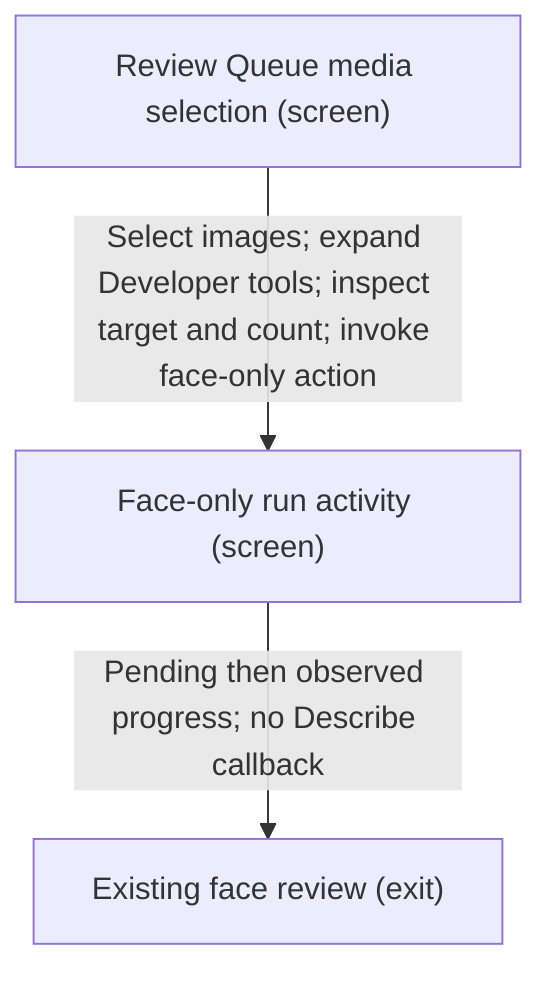
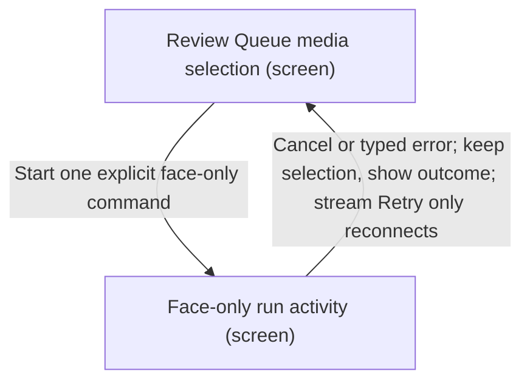

# UX Map — dev-face-recognition

**Product:** `AltContext WordPress developer face-only recognition`
**Source fixture:** `apps/prototype-wp-alt-context/js/admin/pages/workbench/MediaSelection.tsx`

## Goals
- Recognize selected images on the configured remote development API CPU without creating descriptions or starting GPU work.
- Expose the one-shot action only when WordPress is local/development and the effective hosted API is one of the explicitly mapped development deployments. Server rechecks on every submission.
- Reuse scan progress, cancellation, failure recovery, clustering, projection and existing evidence review. Manual diagnosis is not a benchmark or a model winner claim.
- One fixed model per LocalWP instance, selected only in that instance's API settings. The command runs that pipeline; its target display is read-only.

## Jobs
- `inspect-fir` — Inspect faces and occlusion outcomes on one isolated development model stack

## Screens
| id | kind | route | title |
| --- | --- | --- | --- |
| `media-selection` | screen | `#/workbench` | Review Queue media selection |
| `scan-activity` | screen | `#/workbench` | Face-only run activity |
| `face-review` | exit | `#/workbench` | Existing face review |

## Code references
- `screen:media-selection` — `apps/prototype-wp-alt-context/js/admin/pages/workbench/MediaSelection.tsx`
- `screen:scan-activity` — `apps/prototype-wp-alt-context/js/admin/pages/workbench/ScanTabContent.tsx`
- `screen:face-review` — `apps/prototype-wp-alt-context/js/admin/pages/workbench/ScanTabContent.tsx`

### Review Queue media selection (`media-selection`)

```
+------------------------------------------------------------+
| Review Queue media selection  [screen]  #/workbench        |
| Select images; Describe selected remains the normal prima\ |
|   ry. A collapsed Developer tools disclosure offers a sep\ |
|   arate CPU face-only command. Production/demo/staging en\ |
|   vironments and unknown settings omit this disclosure.    |
+------------------------------------------------------------+
| ZONES                                                      |
|   - Selected image thumbnails and filenames, shared with \ |
|   Describe (content) states=[default,loading,empty,error]  |
|   - Collapsed Developer tools; read-only configured API t\ |
|   arget; Run FIR pipeline (CPU). Preview explains selecte\ |
|   d image count, recognition writes and no descriptions/G\ |
|   PU. Disabled with an explanation for empty selection, r\ |
|   ecognition off, offline or another active operation. On\ |
|   e fixed model per LocalWP instance; this command runs i\ |
|   ts configured pipeline. (job) states=[default,loading,e\ |
|   mpty,degraded]                                           |
+------------------------------------------------------------+
| ACTIONS                                                    |
|   [PRIMARY] Describe selected -> Existing describe submis\ |
|   sion (costly,preview)                                    |
|   [secondary] Run FIR pipeline (CPU) -> POST recognition/\ |
|   analyze {development_faces_only:true}; existing scan pi\ |
|   peline only (costly,preview)                             |
+------------------------------------------------------------+
| states: default | loading | empty | error | degraded       |
+------------------------------------------------------------+
```

### Face-only run activity (`scan-activity`)

```
+------------------------------------------------------------+
| Face-only run activity  [screen]  #/workbench              |
| Accepted work uses existing scan progress, Cancel, stream\ |
|    Retry and job history beside the selected media. Start\ |
|   ing is pending; failures remain visible and do not star\ |
|   t descriptions. Collapsing developer disclosure does no\ |
|   t hide the shared job activity.                          |
+------------------------------------------------------------+
| ZONES                                                      |
|   - Existing face scan progress, phase and processed coun\ |
|   ts; polite announcement; Cancel; read-only stream Retry\ |
|    (status) states=[loading,error,degraded,default]        |
+------------------------------------------------------------+
| ACTIONS                                                    |
|   [secondary] Cancel face scan -> Existing cancelScan; ne\ |
|   ver describe                                             |
|   [secondary] Retry status connection -> Existing retrySc\ |
|   anStream; no duplicate inference                         |
+------------------------------------------------------------+
| states: loading | error | degraded | default               |
+------------------------------------------------------------+
```

### Existing face review (`face-review`)

```
+------------------------------------------------------------+
| Existing face review  [exit]  #/workbench                  |
| Inspect found face boxes beside the source image and revi\ |
|   ew suggestions in the existing queue; unknown or missed\ |
|    faces remain observable. Completion never promises a m\ |
|   atch, complete coverage, a model winner or a new descri\ |
|   ption.                                                   |
+------------------------------------------------------------+
| ZONES                                                      |
|   - Existing source image, face boxes and recognition evi\ |
|   dence; empty and error states remain distinct (ai_revie\ |
|   w) states=[default,empty,error,degraded]                 |
+------------------------------------------------------------+
| states: default | empty | error | degraded                 |
+------------------------------------------------------------+
```

## Flows
### Run selected media through CPU recognition only (`recognize-selected`)

```
flow: Run selected media through CPU recognition only (recogn\
  ize-selected) job=inspect-fir
  1. Review Queue media selection [media-selection]
     --Select images; expand Developer tools; inspect target \
  and count; invoke face-only action-->
  2. Face-only run activity [scan-activity]
     --Pending then observed progress; no Describe callback-->
  3. Existing face review [face-review]
```



### Recover without a description or hidden GPU work (`cancel-or-failure`)

```
flow: Recover without a description or hidden GPU work (cance\
  l-or-failure) job=inspect-fir
  1. Review Queue media selection [media-selection]
     --Start one explicit face-only command-->
  2. Face-only run activity [scan-activity]
     --Cancel or typed error; keep selection, show outcome; s\
  tream Retry only reconnects-->
  3. Review Queue media selection [media-selection] (visit 2)
```



## Not doing
- No persistent processing-mode switch or relabelled Describe button.
- No per-request model switching, embedding-space mixing, production/demo access or local laptop execution.
- No comparison metrics, ground-truth editor or claim that the face UI chooses AuraFace vs SFace. Use the existing isolated benchmark harness and fixed occlusion corpus.
- No new review tab, modal, navigation hierarchy or GPU readiness gate.
