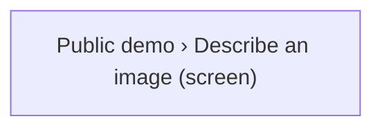
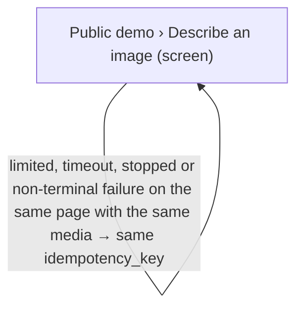

# UX Map — public-demo-describe

**Product:** `alt-context WP plugin public demo — [acx_demo_describe] anonymous describe widget`
**Source fixture:** `apps/prototype-wp-alt-context/src/public/class-public-demo-shortcode.php`

## Goals
- Inventory OBSERVED-UI public-demo states from the shortcode and client: idle selection, static illustrative example, queued, warming, describing, typed complete labels, 429 limited, error/failed, client-only Stop waiting, and the 120-second poll ceiling (INT-10, RES-02, RES-03).
- Record OBSERVED-FEATURE on this branch (these feature changes have not been deployed): completed nonempty envelopes emit description_tier; parser and pollRun preserve provisional_cpu | final_gpu | null; missing legacy is explicit null; completed UI labels are final_gpu = GPU description complete., provisional_cpu = CPU fallback draft (not GPU final)., null/legacy = Description available, processing tier unavailable. Do not infer from gpu_state (HAI-05, HAI-08, PROV-06, DATA-13, rg-015).
- Same-page re-attach after Stop waiting, timeout or transient errors keeps the same-media in-memory key. Refresh-safe resume remains proposed. The 120-second poll ceiling and nonce/allowlist stay; no backend cancellation or authorization changes.

## Jobs
- `describe-allowlisted-image` — Choose one operator-curated image and receive a generic alt-text draft
- `retry-same-trigger` — Retry the same in-page trigger without minting a new idempotency key

## Code references
- `screen:public-demo-describe` — `apps/prototype-wp-alt-context/js/public/demo-describe.js`
- `screen:public-demo-unavailable` — `apps/prototype-wp-alt-context/src/public/class-public-demo-shortcode.php`
- `screen:refresh-page-drops-retry-key` — `apps/prototype-wp-alt-context/js/public/demo-describe.js`

## Screens
| id | kind | route | title |
| --- | --- | --- | --- |
| `public-demo-describe` | screen | `[acx_demo_describe]` | Public demo › Describe an image |
| `public-demo-unavailable` | screen | `[acx_demo_describe]` | Public demo › Unavailable |
| `refresh-page-drops-retry-key` | exit | `[acx_demo_describe] (browser refresh)` | Refresh page (drops in-memory retry key) |

### Public demo › Describe an image (`public-demo-describe`)

Purpose: OBSERVED visitor widget. Domain vocabulary behind canonical states: idle selection and Stop waiting (stopped) = default; queued, warming and describing = loading; no allowlisted images is a different screen; 429 limited = degraded; failed, invalid response, incomplete result and 120s poll timeout = error. Complete UI labels come from description_tier. A static illustrative example sits before Describe; it is not the selected image. Production is deployed; these feature changes have not been deployed. Serves job describe-allowlisted-image.

Action states: idle, in_flight, completed, failed, limited, timeout, stopped

| zone id | label | role | states |
| --- | --- | --- | --- |
| `z-media-choice` | OBSERVED image picker — idle radios are instance-scoped (acx-demo-media-N) and read from the submitting form only. Empty-selection submit stays on this screen as error copy. No images is public-demo-unavailable, not this zone. | form | default, loading, error |
| `z-submit` | OBSERVED primary Describe selected image — enabled in idle, completed, failed, limited, timeout and stopped; disabled in in_flight. Same control retries and re-attaches with the same image; key reuse is in-memory only. | job | default, loading, error, degraded |
| `z-preview` | OBSERVED-FEATURE static illustrative example before Describe, labeled Illustrative example — not a live result. Fictional sentence is not the selected image, not a saved result, not a GPU receipt. Separate from data-acx-demo-result. Absent when the demo is disabled or the allowlist is empty. | content | default |
| `z-status` | OBSERVED polite status — idle, queued, warming, describing, completed, limited (HTTP 429), failed, client error, 120s poll timeout, stopped. Icon plus token color. Envelope gpu_state is unused telemetry. Completed labels: GPU description complete. / CPU fallback draft (not GPU final). / Description available, processing tier unavailable. | status | default, loading, error, degraded |
| `z-result` | OBSERVED-FEATURE completed result is alt_text_draft with focus move. Status labels come from description_tier (provisional_cpu \| final_gpu \| null; missing legacy is null) and are never inferred from gpu_state. OBSERVED-PRODUCTION is deployed; these feature changes have not been deployed. Prior observation: old Florence recognition image; Qwen-on-GPU entity-description proof is absent. | ai_review | default, empty |
| `z-stop` | OBSERVED secondary Stop waiting — outside the form; visible only in in_flight, including submit, fetch body and backoff. Client-only (no request); keeps the key, returns focus to Describe after re-enabling controls. | job | loading |

```
+------------------------------------------------------------+
| Public demo › Describe an image  [screen]  [acx_demo_desc\ |
|   ribe]                                                    |
| OBSERVED visitor widget. Domain vocabulary behind canonic\ |
|   al states: idle selection and Stop waiting (stopped) = \ |
|   default; queued, warming and describing = loading; no a\ |
|   llowlisted images is a different screen; 429 limited = \ |
|   degraded; failed, invalid response, incomplete result a\ |
|   nd 120s poll timeout = error. Complete UI labels come f\ |
|   rom description_tier. A static illustrative example sit\ |
|   s before Describe; it is not the selected image. Produc\ |
|   tion is deployed; these feature changes have not been d\ |
|   eployed. Serves job describe-allowlisted-image.          |
+------------------------------------------------------------+
| ZONES                                                      |
|   - OBSERVED image picker — idle radios are instance-scop\ |
|   ed (acx-demo-media-N) and read from the submitting form\ |
|    only. Empty-selection submit stays on this screen as e\ |
|   rror copy. No images is public-demo-unavailable, not th\ |
|   is zone. (form) states=[default,loading,error]           |
|   - OBSERVED primary Describe selected image — enabled in\ |
|    idle, completed, failed, limited, timeout and stopped;\ |
|    disabled in in_flight. Same control retries and re-att\ |
|   aches with the same image; key reuse is in-memory only.\ |
|    (job) states=[default,loading,error,degraded]           |
|   - OBSERVED-FEATURE static illustrative example before D\ |
|   escribe, labeled Illustrative example — not a live resu\ |
|   lt. Fictional sentence is not the selected image, not a\ |
|    saved result, not a GPU receipt. Separate from data-ac\ |
|   x-demo-result. Absent when the demo is disabled or the \ |
|   allowlist is empty. (content) states=[default]           |
|   - OBSERVED polite status — idle, queued, warming, descr\ |
|   ibing, completed, limited (HTTP 429), failed, client er\ |
|   ror, 120s poll timeout, stopped. Icon plus token color.\ |
|    Envelope gpu_state is unused telemetry. Completed labe\ |
|   ls: GPU description complete. / CPU fallback draft (not\ |
|    GPU final). / Description available, processing tier u\ |
|   navailable. (status) states=[default,loading,error,degr\ |
|   aded]                                                    |
|   - OBSERVED-FEATURE completed result is alt_text_draft w\ |
|   ith focus move. Status labels come from description_tie\ |
|   r (provisional_cpu | final_gpu | null; missing legacy i\ |
|   s null) and are never inferred from gpu_state. OBSERVED\ |
|   -PRODUCTION is deployed; these feature changes have not\ |
|    been deployed. Prior observation: old Florence recogni\ |
|   tion image; Qwen-on-GPU entity-description proof is abs\ |
|   ent. (ai_review) states=[default,empty]                  |
|   - OBSERVED secondary Stop waiting — outside the form; v\ |
|   isible only in in_flight, including submit, fetch body \ |
|   and backoff. Client-only (no request); keeps the key, r\ |
|   eturns focus to Describe after re-enabling controls. (j\ |
|   ob) states=[loading]                                     |
+------------------------------------------------------------+
| ACTIONS                                                    |
| when idle                                                  |
|   [PRIMARY] Describe selected image                        |
| when in_flight                                             |
|   [secondary] Stop waiting                                 |
| when completed                                             |
|   [PRIMARY] Describe selected image                        |
| when failed                                                |
|   [PRIMARY] Describe selected image                        |
| when limited                                               |
|   [PRIMARY] Describe selected image                        |
| when timeout                                               |
|   [PRIMARY] Describe selected image                        |
| when stopped                                               |
|   [PRIMARY] Describe selected image                        |
+------------------------------------------------------------+
| states: default | loading | error | degraded               |
+------------------------------------------------------------+
```

### Public demo › Unavailable (`public-demo-unavailable`)

Purpose: OBSERVED PHP shortcode substitutes when the widget cannot run. Demo flag off = degraded limited copy. Allowlist empty or unreadable = error copy. No form, no client, no paid dispatch. Serves neither job until an operator enables the demo and curates media.

| zone id | label | role | states |
| --- | --- | --- | --- |
| `z-unavailable-status` | OBSERVED substitute status — limited when the demo is disabled; error when no demo images are available. Not a describe-run phase. | status | error, degraded |

```
+------------------------------------------------------------+
| Public demo › Unavailable  [screen]  [acx_demo_describe]   |
| OBSERVED PHP shortcode substitutes when the widget cannot\ |
|    run. Demo flag off = degraded limited copy. Allowlist \ |
|   empty or unreadable = error copy. No form, no client, n\ |
|   o paid dispatch. Serves neither job until an operator e\ |
|   nables the demo and curates media.                       |
+------------------------------------------------------------+
| ZONES                                                      |
|   - OBSERVED substitute status — limited when the demo is\ |
|    disabled; error when no demo images are available. Not\ |
|    a describe-run phase. (status) states=[error,degraded]  |
+------------------------------------------------------------+
| states: error | degraded                                   |
+------------------------------------------------------------+
```

### Refresh page (drops in-memory retry key) (`refresh-page-drops-retry-key`)

Purpose: OBSERVED: a full page load drops the in-memory idempotency key and the in-memory run_id. PROPOSED durable resume is not this exit and is not implemented.

| zone id | label | role | states |
| --- | --- | --- | --- |
| `z-refresh-consequence` | OBSERVED refresh consequence — in-memory retry key is gone. Same-page retry would have retained it. Do not claim a new paid job is proven or disproven after refresh. | status | default |

```
+------------------------------------------------------------+
| Refresh page (drops in-memory retry key)  [exit]  [acx_de\ |
|   mo_describe] (browser refresh)                           |
| OBSERVED: a full page load drops the in-memory idempotenc\ |
|   y key and the in-memory run_id. PROPOSED durable resume\ |
|    is not this exit and is not implemented.                |
+------------------------------------------------------------+
| ZONES                                                      |
|   - OBSERVED refresh consequence — in-memory retry key is\ |
|    gone. Same-page retry would have retained it. Do not c\ |
|   laim a new paid job is proven or disproven after refres\ |
|   h. (status) states=[default]                             |
+------------------------------------------------------------+
| states: default                                            |
+------------------------------------------------------------+
```

## Actions

| id | verb | target | hierarchy | costly | irreversible | preview required | screen id | when (recovery state) |
| --- | --- | --- | --- | --- | --- | --- | --- | --- |
| `submit-describe` | Describe selected image | `POST /acx/v1/public/demo/describe` | primary | yes | no | yes | `public-demo-describe` | idle, completed, failed, limited, timeout, stopped |
| `stop-waiting` | Stop waiting | `client-only (no request)` | secondary | no | no | no | `public-demo-describe` | in_flight |

## Flows
### OBSERVED: illustrative example, select image, wait, typed complete label (`observed-happy-path`)

```
flow: OBSERVED: illustrative example, select image, wait, typ\
  ed complete label (observed-happy-path) job=describe-allowl\
  isted-image
  1. Public demo › Describe an image [public-demo-describe]
     --illustrative example visible; idle selection (instance\
  -scoped radio in this form) → POST describe-->
  2. Public demo › Describe an image [public-demo-describe] (\
  visit 2)
     --queued → warming → describing (client poll, 120s ceili\
  ng)-->
  3. Public demo › Describe an image [public-demo-describe] (\
  visit 3)
```

```mermaid
flowchart TD
  %% flow: OBSERVED: illustrative example, select image, wait, typed complete label job=describe-allowlisted-image
  %% steps: [{"screen_id":"public-demo-describe","branch_label":"illustrative example visible; idle selection (instance-scoped radio in this form) → POST describe"},{"screen_id":"public-demo-describe","branch_label":"queued → warming → describing (client poll, 120s ceiling)"},{"screen_id":"public-demo-describe","branch_label":"completed typed label from description_tier plus live alt text; illustrative example stays"}]
  n_public_demo_describe["Public demo › Describe an image (screen)"]
  n_public_demo_describe -->|illustrative example visible; idle selection (instance-scoped radio in this form) → POST describe| n_public_demo_describe
  n_public_demo_describe -->|queued → warming → describing (client poll, 120s ceiling)| n_public_demo_describe
```

### OBSERVED: HTTP 429 bulkhead or rate limit (`observed-429-limited`)

```
flow: OBSERVED: HTTP 429 bulkhead or rate limit (observed-429\
  -limited) job=describe-allowlisted-image
  1. Public demo › Describe an image [public-demo-describe]
```



### OBSERVED: failed pipeline, invalid envelope, or 120s poll timeout (`observed-error-or-timeout`)

```
flow: OBSERVED: failed pipeline, invalid envelope, or 120s po\
  ll timeout (observed-error-or-timeout) job=describe-allowli\
  sted-image
  1. Public demo › Describe an image [public-demo-describe]
     --failed / cancelled / completed_with_errors / incomplet\
  e (terminal) → data-state=failed; form re-enabled; key clea\
  red. Invalid envelope or transient error → data-state=faile\
  d; key kept-->
  2. Public demo › Describe an image [public-demo-describe] (\
  visit 2)
     --120s client ceiling → timeout copy (same image re-atta\
  ches); form re-enabled; in-memory key kept-->
  3. Public demo › Describe an image [public-demo-describe] (\
  visit 3)
     --visitor refreshes anyway (voluntary; timeout alone sta\
  ys on this page) → in-memory key and run_id dropped (refres\
  h-safe resume not implemented)-->
  4. Refresh page (drops in-memory retry key) [refresh-page-d\
  rops-retry-key]
```

```mermaid
flowchart TD
  %% flow: OBSERVED: failed pipeline, invalid envelope, or 120s poll timeout job=describe-allowlisted-image
  %% steps: [{"screen_id":"public-demo-describe","branch_label":"failed / cancelled / completed_with_errors / incomplete (terminal) → data-state=failed; form re-enabled; key cleared. Invalid envelope or transient error → data-state=failed; key kept"},{"screen_id":"public-demo-describe","branch_label":"120s client ceiling → timeout copy (same image re-attaches); form re-enabled; in-memory key kept"},{"screen_id":"public-demo-describe","branch_label":"visitor refreshes anyway (voluntary; timeout alone stays on this page) → in-memory key and run_id dropped (refresh-safe resume not implemented)"},{"screen_id":"refresh-page-drops-retry-key","branch_label":null}]
  n_public_demo_describe["Public demo › Describe an image (screen)"]
  n_public_demo_describe -->|failed / cancelled / completed_with_errors / incomplete (terminal) → data-state=failed; form re-enabled; key cleared. Invalid envelope or transient error → data-state=failed; key kept| n_public_demo_describe
  n_public_demo_describe -->|120s client ceiling → timeout copy (same image re-attaches); form re-enabled; in-memory key kept| n_public_demo_describe
  n_refresh_page_drops_retry_key["Refresh page (drops in-memory retry key) (exit)"]
  n_public_demo_describe -->|visitor refreshes anyway (voluntary; timeout alone stays on this page) → in-memory key and run_id dropped (refresh-safe resume not implemented)| n_refresh_page_drops_retry_key
```

### OBSERVED: same-page retry reuses the in-memory key (`observed-same-page-retry`)

```
flow: OBSERVED: same-page retry reuses the in-memory key (obs\
  erved-same-page-retry) job=retry-same-trigger
  1. Public demo › Describe an image [public-demo-describe]
     --limited, timeout, stopped or non-terminal failure on t\
  he same page with the same media → same idempotency_key-->
  2. Public demo › Describe an image [public-demo-describe] (\
  visit 2)
```



### OBSERVED: Stop waiting is client-only and keeps the key (`stop-waiting`)

```
flow: OBSERVED: Stop waiting is client-only and keeps the key\
   (stop-waiting) job=describe-allowlisted-image
  1. Public demo › Describe an image [public-demo-describe]
     --in_flight → Stop waiting (secondary) → local fetch or \
  backoff stops; no request; data-state=stopped; ■ icon; focu\
  s returns to Describe-->
  2. Public demo › Describe an image [public-demo-describe] (\
  visit 2)
```

```mermaid
flowchart TD
  %% flow: OBSERVED: Stop waiting is client-only and keeps the key job=describe-allowlisted-image
  %% steps: [{"screen_id":"public-demo-describe","branch_label":"in_flight → Stop waiting (secondary) → local fetch or backoff stops; no request; data-state=stopped; ■ icon; focus returns to Describe"},{"screen_id":"public-demo-describe","branch_label":"Describe again with the same image → same idempotency_key re-attaches to the run"}]
  n_public_demo_describe["Public demo › Describe an image (screen)"]
  n_public_demo_describe -->|in_flight → Stop waiting (secondary) → local fetch or backoff stops; no request; data-state=stopped; ■ icon; focus returns to Describe| n_public_demo_describe
```

## Open questions
- PROPOSED, not implemented: same-run resume after refresh. Same-page re-attach after the 120s poll ceiling or Stop waiting is implemented by E15-38 (kept key, same image). Bound remains existing inflight owner + idempotency and terminal capability replay; 120s per-poll ceiling, bulkhead, nonce and allowlist stay.
- Design question: refresh-safe durable resume remains unimplemented. Current status first attempts matching terminal capability replay; otherwise absent or mismatched inflight ownership returns 403 run_not_available. Do not weaken authorization to read arbitrary run IDs.

## Suggested task-slice decomposition (from map)

1. PROPOSED follow-up: same-run resume after refresh. Same-page re-attach after timeout or Stop waiting is implemented (E15-38). Keep the 120s ceiling, inflight bulkhead, nonce and allowlist.
2. Follow-up design question: refresh-safe durable capability; terminal capability replay already exists on this source baseline. No authorization weakening.

## Domain state mapping

| domain state(s) | canonical state |
| --- | --- |
| `idle`, `completed`, `stopped` | `default` |
| `queued`, `warming`, `describing`, `in_flight` | `loading` |
| `limited` | `degraded` |
| `failed`, `error`, `timeout` | `error` |

## Parity index

Machine-checked by `js/admin/__tests__/uxmap-parity.test.ts` and
`js/admin/__tests__/uxmap-render-parity.test.ts`: every id, state, and verbatim label
below must exist in the sibling `.uxmap.json`, and no `z-*`/`act-*` id may appear here
that the JSON does not define. Regenerate with `docs/ux-maps/render_ux_maps.py` — never
hand-edit one side.

Zone ids: z-media-choice z-submit z-preview z-status z-result z-stop z-unavailable-status z-refresh-consequence

Action ids: submit-describe stop-waiting

Zone labels (verbatim; the tables above escape `|` for markdown, this list does not):

- OBSERVED image picker — idle radios are instance-scoped (acx-demo-media-N) and read from the submitting form only. Empty-selection submit stays on this screen as error copy. No images is public-demo-unavailable, not this zone.
- OBSERVED primary Describe selected image — enabled in idle, completed, failed, limited, timeout and stopped; disabled in in_flight. Same control retries and re-attaches with the same image; key reuse is in-memory only.
- OBSERVED-FEATURE static illustrative example before Describe, labeled Illustrative example — not a live result. Fictional sentence is not the selected image, not a saved result, not a GPU receipt. Separate from data-acx-demo-result. Absent when the demo is disabled or the allowlist is empty.
- OBSERVED polite status — idle, queued, warming, describing, completed, limited (HTTP 429), failed, client error, 120s poll timeout, stopped. Icon plus token color. Envelope gpu_state is unused telemetry. Completed labels: GPU description complete. / CPU fallback draft (not GPU final). / Description available, processing tier unavailable.
- OBSERVED-FEATURE completed result is alt_text_draft with focus move. Status labels come from description_tier (provisional_cpu | final_gpu | null; missing legacy is null) and are never inferred from gpu_state. OBSERVED-PRODUCTION is deployed; these feature changes have not been deployed. Prior observation: old Florence recognition image; Qwen-on-GPU entity-description proof is absent.
- OBSERVED secondary Stop waiting — outside the form; visible only in in_flight, including submit, fetch body and backoff. Client-only (no request); keeps the key, returns focus to Describe after re-enabling controls.
- OBSERVED substitute status — limited when the demo is disabled; error when no demo images are available. Not a describe-run phase.
- OBSERVED refresh consequence — in-memory retry key is gone. Same-page retry would have retained it. Do not claim a new paid job is proven or disproven after refresh.

States (all zones and screens): default loading error degraded empty

## Not doing
- Do not treat this map as the admin describe-gpu-tier map. Admin GPU chip, provisional/final badges, and gpu_state presentation are operator SPA, not public demo.
- Do not infer CPU-fallback, GPU-final, or unknown description-tier UI from envelope gpu_state. That field is optional lifecycle telemetry and is unused by presentation.
- Do not treat the on-feature description_tier labels or illustrative example as deployed production. Production is deployed; these feature changes have not been deployed. Prior observation used the old Florence recognition image; Qwen-on-GPU entity-description proof is absent.
- Do not treat the illustrative example as a preview of the selected image or as a GPU receipt. Allowlist thumbnails remain input choices (INT-07).
- Do not invent extra states on the refresh exit. kind=exit and states=default are correct; RLSE-04 warning is a scope mismatch, not a missing journey (RLSE-04).
- Do not claim official ux-map critique, schema, or gate passed. Critique 10316 used extra=allow; official strict extra=forbid still fails 4 local extras.
- Do not claim refresh-safe resume is implemented. Refresh drops the in-memory retry key and run_id.
- Do not claim same-page retry already proven to create duplicate paid jobs. Same-page retry reuses the key; duplicate-dispatch behaviour after refresh is not claimed here.
- Do not raise the public 120-second poll ceiling to the server warmup-plus-inference deadline.
- Do not add a new paid job, upload field, or URL input to resume or retry.
- Do not weaken public status authorization to read arbitrary run_ids after inflight release.
