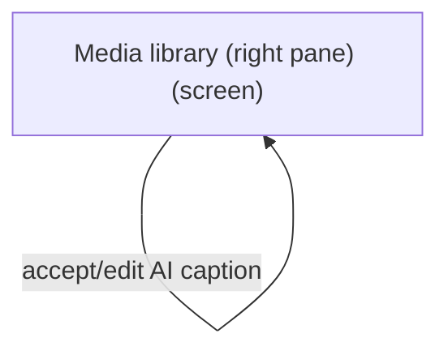
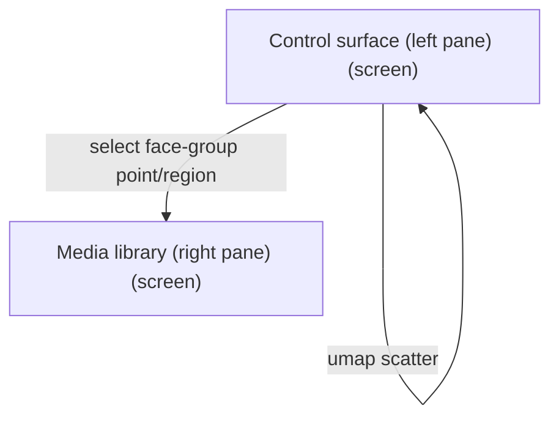
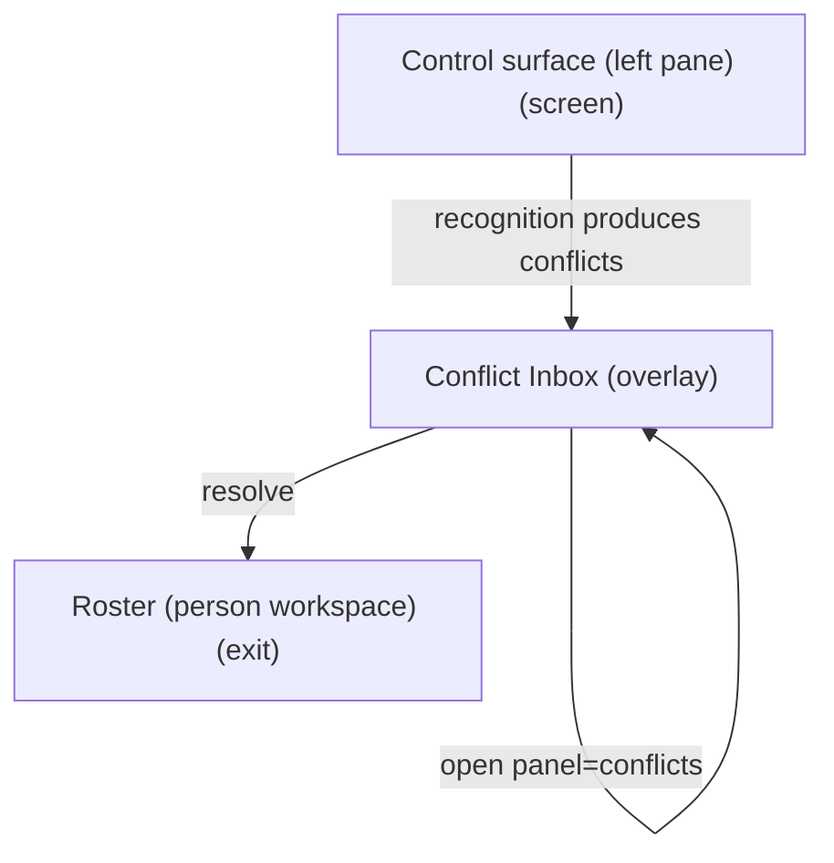
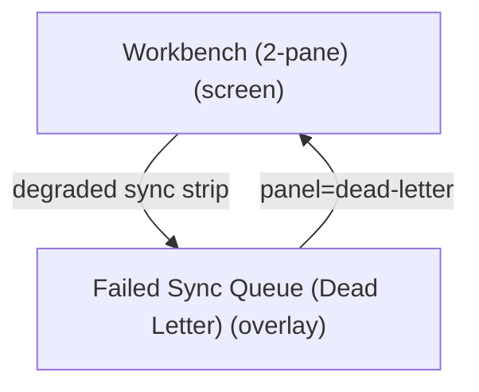

# UX Map — workbench-2pane

**Product:** `prototype-wp-alt-context`
**Source fixture:** `apps/prototype-wp-alt-context/js/admin/pages/WorkbenchPage.tsx`

## Vocabulary (say / don't say)

Controlled say/don't-say list for operator-facing workbench copy (UXW2-3; NAV-13/NAV-14).
Engineering terms stay legal in code identifiers, `acx_*` CSS classes, and job ids — never in
rendered strings on the review surfaces. Roster page and dashboard/jobs/ops surfaces are owned
by other lanes and are not yet covered by this list.

| Don't say | Say | Notes |
| --- | --- | --- |
| cluster | face group (unnamed) / person (once named) | A cluster the operator has not named yet is "these faces" / "this face group"; after naming it is the person |
| identities / instances | faces | Members of a group are faces |
| Review Cluster | Review these faces | Panel headline + review triggers |
| %d faces in cluster | %d faces | Count of member faces on a review card |
| Skip this cluster for now | Skip these faces for now | |
| Unnamed cluster | Unnamed face group | Merge suggestion sides |
| first/second cluster | first/second group | Merge suggestion alt text + context |
| This cluster is no longer available. | These faces are no longer available. | Queue empty-item fallback |
| Cluster member / Remove from cluster | Face / Remove this face | Review panel member rows + removal dialog |
| Just label — don't add to roster | (removed) | Naming always creates/binds a roster person; the roster is a consequence, not a decision |

### Minimum photos on the global review surface

The optional native select is mounted in Review Suggestions. All omits the minimum and preserves the existing review population. Choosing a minimum applies to unlabeled groups across their full membership before paging. Separate close-match, merge and name suggestions stay available; the hint states that scope. No page is intersected with a second list.

```
+------------------------------------------------------------+
| Review Suggestions                                         |
| Minimum photos (optional) [All v]                          |
| Photos are distinct; unavailable counts do not match       |
| Unlabeled groups only; other suggestions stay available    |
| [Clear minimum photos] (when a minimum is selected)        |
| [Previous groups page] [Next groups page]                  |
| Existing kind / similarity chips and position              |
| Suggestion OR unlabeled group: 2 photos / 8 faces          |
| Name this person [human draft] [existing Save name]        |
+------------------------------------------------------------+
```

| State | Presentation and recovery | Focus / retained work |
|---|---|---|
| All | Existing review population; unknown photo counts say Photo count unavailable | Existing selection and naming remain |
| Loading a new minimum/page | Loading unlabeled groups; old-scope rows are not placeholders | Native select keeps focus; prior request is cancelled on scope change |
| Paused | Waiting for connection to load groups | Select and clear action remain reachable |
| Successful no-match | No unlabeled groups match this minimum; Clear minimum photos | Clear returns focus to the select and resets the groups page |
| Empty later page | No unlabeled groups on this page; Previous groups page remains | No claim of a zero backlog |
| Request failure | Existing classified error with Retry; no no-match/all-caught-up claim | Select remains mounted; Retry keeps the same filter |
| Cached rows plus failed refresh | Showing previously loaded groups. Refresh failed. | Rows remain visible as stale; next-page action is held |
| Unknown remote total | Total groups unavailable; continuation alone governs Next groups page | No invented total or person binding |
| Unavailable source | Unlabeled groups are unavailable | No measured zero or automatic name choice |

The view state resets on tenant change. Filtering does not clear pending suggestion selection, independent name judgment, or human naming drafts; hidden group drafts are restored by group ID. Existing naming/commit gates, person authority, suggestion identity, thresholds, policy, Settings-only GPU controls and three-step/two-pane composition remain. Filter/page navigation uses the existing held-action flush before changing view state. Filter/page changes reset the card index and return focus to the select. The global findings summary keeps its existing unfiltered scope.

Exact composition/query refs: `apps/prototype-wp-alt-context/js/admin/pages/workbench/ScanTabContent.tsx`, `apps/prototype-wp-alt-context/js/admin/pages/workbench/identity-clusters/ReviewQueue.tsx`, `ReviewPhotoFilterContext.tsx`, and `useSuggestionReviewQueries.ts` in that same identity-clusters directory. Photo rendering: `TopClusterCard.tsx`; retained human draft adapter: `PersonCommitControl.tsx`. Opt-in envelope contract: `packages/shared-contracts/schemas/recognition-cluster-list-response.schema.json#/definitions/reviewPhotoFilteredResponse`. These are implemented source contracts, not a claim of installed canary or independent gate acceptance.

## Goals
- Four ACX submenus have distinct goals: Overview orients; Review Queue owns recognizing people and reviewing/editing/approving descriptions beside each image; People manages named people; Settings configures the service. Previous description runs are choices within the image Alt text area. The retired Description Runs URL redirects to Workbench.
- One primary action per screen (NAV-01), reachable from zero state (rg-003); other CTAs are secondary. In the library footer the single primary is Describe — recognition is a global Settings toggle disclosed under the button, never a second competing CTA (INT-05, COG-03).
- Operator runs the full recognize -> name -> curate loop and edits alt-text/descriptions without leaving one surface (control-left, library-right)
- Read face-group status at a glance in the control pane and act on the selection in the same viewport
- Decompose the 2-pane redesign from screens/zones/states/flows instead of inventing IA mid-plan

## Jobs
- `job-cluster-recognize` — Build & recognize face groups (refresh groups, run recognition)
- `job-name-curate` — Name & curate people (confirm/correct/merge/split, assign names)
- `job-caption-library` — Caption & describe media (alt-text + long description on library rows)
- `job-triage-sync` — Triage people conflicts / failed sync (overlays)

## Code references
- `screen:workbench-2pane-shell` — `apps/prototype-wp-alt-context/js/admin/pages/WorkbenchPage.tsx`
- `screen:workbench-control` — `apps/prototype-wp-alt-context/js/admin/pages/workbench/ScanTabContent.tsx`
- `screen:workbench-library` — `apps/prototype-wp-alt-context/js/admin/pages/workbench/MediaSelection.tsx`
- `screen:workbench-conflicts` — `apps/prototype-wp-alt-context/js/admin/pages/workbench/ConflictInbox.tsx`
- `screen:workbench-dead-letter` — `apps/prototype-wp-alt-context/js/admin/pages/workbench/DeadLetterPanel.tsx`
- `screen:exit-roster` — `apps/prototype-wp-alt-context/js/admin/pages/RosterPage.tsx`
- `screen:exit-settings` — `apps/prototype-wp-alt-context/js/admin/pages/SettingsPage.tsx`

## Screens
| id | kind | route | title |
| --- | --- | --- | --- |
| `workbench-2pane-shell` | screen | `#/workbench` | Workbench (2-pane) |
| `workbench-control` | screen | `#/workbench` | Control surface (left pane) |
| `workbench-library` | screen | `#/workbench` | Media library (right pane) |
| `workbench-conflicts` | overlay | `#/workbench?panel=conflicts` | Conflict Inbox |
| `workbench-dead-letter` | overlay | `#/workbench?panel=dead-letter` | Failed Sync Queue (Dead Letter) |
| `exit-roster` | exit | `#/roster` | Roster (person workspace) |
| `exit-settings` | exit | `#/settings` | Settings / service health |

### Workbench (2-pane) (`workbench-2pane-shell`)

Purpose: Two-pane operator surface: left control (face-group/recognize/name/curate), right media library (alt-text + long-description). Overlays host conflicts and dead-letter.

url_params: `panes`, `cluster`, `media`, `panel`, `status`, `endpoint`, `s`, `p`, `perPage`

| zone id | label | role | states |
| --- | --- | --- | --- |
| `z-topbar` | Workbench header + recognition endpoint (read-only status; server-resolved) + sync/projection status strip | status | default, loading, error, degraded |
| `z-left-host` | Left pane host (control surface) | content | default, loading, empty, error |
| `z-splitter` | Pane divider / collapse-left control | other | default |
| `z-right-host` | Right pane host (media library) | content | default, loading, empty, error |
| `z-overlay-host` | Overlay host (conflicts \| dead-letter) | other | default, empty |

```
+------------------------------------------------------------+
| Workbench (2-pane)  [screen]  #/workbench                  |
| Two-pane operator surface: left control (face-group/recog\ |
|   nize/name/curate), right media library (alt-text + long\ |
|   -description). Overlays host conflicts and dead-letter.  |
+------------------------------------------------------------+
| ZONES                                                      |
|   - Workbench header + recognition endpoint (read-only st\ |
|   atus; server-resolved) + sync/projection status strip (\ |
|   status) states=[default,loading,error,degraded]          |
|   - Left pane host (control surface) (content) states=[de\ |
|   fault,loading,empty,error]                               |
|   - Pane divider / collapse-left control (other) states=[\ |
|   default]                                                 |
|   - Right pane host (media library) (content) states=[def\ |
|   ault,loading,empty,error]                                |
|   - Overlay host (conflicts | dead-letter) (other) states\ |
|   =[default,empty]                                         |
+------------------------------------------------------------+
| ACTIONS                                                    |
|   [secondary] Open Conflict Inbox -> workbench-conflicts   |
|   [secondary] Open Failed Sync Queue -> workbench-dead-le\ |
|   tter                                                     |
+------------------------------------------------------------+
| states: default | loading | error | degraded | offline     |
+------------------------------------------------------------+
```

### Control surface (left pane) (`workbench-control`)

Purpose: Recognize, name, and curate: recognition endpoint + health, face-group status region, face-group list, run/refresh controls, and the name/curate forced-choice form.

url_params: `panes`, `cluster`, `endpoint`

| zone id | label | role | states |
| --- | --- | --- | --- |
| `z-endpoint` | Recognition endpoint + health (read-only: InsightFace :10010 interim; FIR when stable; target is server-resolved via ACX_RECOGNITION_URL, no UI toggle per RECOG-1) | status | default, loading, error, degraded |
| `z-recognition-controls` | Face-group/recognition controls (run, refresh, threshold) | job | default, loading, error |
| `z-cluster-umap` | Face-group status (scan/sync health; not a 2D scatter) | status | default, loading, empty, error, first_time, degraded |
| `z-cluster-list` | Face-group list / selection (size, confidence, unnamed-first) + NameFaceControl (loading = in-flight name write; the suggestions disclosure being open or closed is part of default). Twin-pending (an edge_input of default) copy: Same person as <survivor label>? — Merge into <survivor label> / Not the same (chip on the unlabeled twin; decision persists on the labeled survivor; COG-03 one decision per pair; DATA-14 single authority is the survivor resolver). Actions merge_twin / keep_separate are implemented in the list item — see code_ref. Minimum photos (optional), default All, applies to unlabeled groups only. Other review suggestions remain available. Groups show distinct photo counts separately from face counts; unavailable counts stay unavailable. Clear minimum photos recovers a successful no-match result; Retry recovers a failed read. Previous/Next groups page follows continuation without guessing a total. Selections and human name drafts survive filter changes. | queue | default, loading, empty, error, first_time, degraded, edge_input |
| `z-name-curate` | Name this person (NameFaceControl; confirm / correct / merge / split; forced-choice; loading = pending roster write; error = roster write failed; edge_input = ambiguous candidate set or duplicate-name guard; default = overlay closed or suggestions open) | forced_choice | default, loading, error, edge_input |

```
+------------------------------------------------------------+
| Control surface (left pane)  [screen]  #/workbench         |
| Recognize, name, and curate: recognition endpoint + healt\ |
|   h, face-group status region, face-group list, run/refre\ |
|   sh controls, and the name/curate forced-choice form.     |
+------------------------------------------------------------+
| ZONES                                                      |
|   - Recognition endpoint + health (read-only: InsightFace\ |
|    :10010 interim; FIR when stable; target is server-reso\ |
|   lved via ACX_RECOGNITION_URL, no UI toggle per RECOG-1)\ |
|    (status) states=[default,loading,error,degraded]        |
|   - Face-group/recognition controls (run, refresh, thresh\ |
|   old) (job) states=[default,loading,error]                |
|   - Face-group status (scan/sync health; not a 2D scatter\ |
|   ) (status) states=[default,loading,empty,error,first_ti\ |
|   me,degraded]                                             |
|   - Face-group list / selection (size, confidence, unname\ |
|   d-first) + NameFaceControl (loading = in-flight name wr\ |
|   ite; the suggestions disclosure being open or closed is\ |
|    part of default). Twin-pending (an edge_input of defau\ |
|   lt) copy: Same person as <survivor label>? — Merge into\ |
|    <survivor label> / Not the same (chip on the unlabeled\ |
|    twin; decision persists on the labeled survivor; COG-0\ |
|   3 one decision per pair; DATA-14 single authority is th\ |
|   e survivor resolver). Actions merge_twin / keep_separat\ |
|   e are implemented in the list item — see code_ref. Mini\ |
|   mum photos (optional), default All, applies to unlabele\ |
|   d groups only. Other review suggestions remain availabl\ |
|   e. Groups show distinct photo counts separately from fa\ |
|   ce counts; unavailable counts stay unavailable. Clear m\ |
|   inimum photos recovers a successful no-match result; Re\ |
|   try recovers a failed read. Previous/Next groups page f\ |
|   ollows continuation without guessing a total. Selection\ |
|   s and human name drafts survive filter changes. (queue)\ |
|    states=[default,loading,empty,error,first_time,degrade\ |
|   d,edge_input]                                            |
|   - Name this person (NameFaceControl; confirm / correct \ |
|   / merge / split; forced-choice; loading = pending roste\ |
|   r write; error = roster write failed; edge_input = ambi\ |
|   guous candidate set or duplicate-name guard; default = \ |
|   overlay closed or suggestions open) (forced_choice) sta\ |
|   tes=[default,loading,error,edge_input]                   |
+------------------------------------------------------------+
| ACTIONS                                                    |
|   [PRIMARY] Run / refresh recognition + grouping -> job-p\ |
|   ipeline (costly,preview)                                 |
|   [secondary] Clear minimum photos -> workbench-control    |
|   [secondary] Choose Minimum photos for unlabeled groups \ |
|   -> workbench-control                                     |
|   [secondary] Go to Roster -> exit-roster                  |
|   [secondary] Save name (NameFaceControl) -> identity-sto\ |
|   re (costly,preview)                                      |
|   [secondary] Previous / Next groups page -> workbench-co\ |
|   ntrol                                                    |
|   [secondary] Select face group (list) -> workbench-libra\ |
|   ry                                                       |
|   [secondary] View / change recognition endpoint + recogn\ |
|   ition ON/OFF toggle (Settings; server-resolved endpoint\ |
|   ) -> exit-settings                                       |
|   [secondary] Keep twin separate -> identity-store         |
|   [DESTRUCTIVE] Merge / split / correct group -> identity\ |
|   -store (costly,preview)                                  |
|   [DESTRUCTIVE] Merge twin into labeled survivor -> ident\ |
|   ity-store                                                |
+------------------------------------------------------------+
| states: default | loading | empty | error | first_time     |
| states+: degraded                                          |
|   degraded                                                 |
+------------------------------------------------------------+
```

### Media library (right pane) (`workbench-library`)

Purpose: Media library table with alt-text caption and long-description columns; inline editing, AI-suggested captions/descriptions (editable before accept), and bulk describe/scan.

url_params: `panes`, `media`, `cluster`, `status`, `s`, `p`, `perPage`

| zone id | label | role | states |
| --- | --- | --- | --- |
| `z-lib-filters` | Library filters (status, has-alt, has-description, face group, search) | form | default, loading, error |
| `z-lib-table` | Media library table (thumb \| title \| status \| alt-text \| long description \| people) | queue | default, loading, empty, error, first_time, edge_input |
| `z-lib-inline-edit` | Inline person naming (NameFaceControl) + alt-text / long-description editor (loading = pending save; the suggestions disclosure being open or closed is part of default) | form | default, loading, error, edge_input |
| `z-lib-ai-suggest` | AI name / caption suggestions (evidence-linked; editable before accept; loading = suggestion request in flight; the suggestions disclosure being open or closed is part of default) | ai_review | default, loading, empty, error |
| `z-lib-actions` | Footer job zone (the media-selection footer): ONE job CTA — 'Describe N selected' (plain count, no plural switch; primary accent in select state; zero-state label 'Describe selected', rg-003) with a recognition disclosure directly under it (aria-describedby): ON = names people it knows while describing; OFF = descriptions only, change in Settings; unknown = settings not loaded. MediaAnalyzeCta / 'Analyze selected' is deleted (L2c, WBUX-6) — Describe owns the scan trigger, so recognition is never a separate operator step (INT-05 one job entry; COG-03 one decision: the global toggle). Four hold reasons keep the primary focusable with aria-disabled="true" plus an onClick no-op — never the HTML disabled attribute — and each contributes a reason id joined into aria-describedby: offline (empty/offline state), zero-selection (empty state), identifying (loading state, label 'Identifying people…'), settings-pending (loading state, label 'Loading settings…'). settings-unavailable is a fifth, hold-adjacent state and NOT a hold: when the recognition-settings query errors the hold is RELEASED, Describe proceeds with recognition treated as off, and the disclosure reads 'Recognition settings unavailable — describing without identifying people · ~N credits' paired with an AlertTriangle icon so the degradation is never colour-alone (sr-004; degraded state; RLSE-05 the failure is visible, never silent). A11Y contract for that notice (WBUX6-W4-B-02): the disclosure text node stays the aria-describedby target and is therefore only reachable on focus, so the degraded copy is ALSO mirrored into a separate polite live region (role="status" aria-live="polite") that is not the describedby target — one surface to describe, one surface to announce, never the same node doing both (A11Y-21). A single Cancel control spans the identifying and describing phases; its visible label is state-dependent, not a fixed string — identifying = 'Cancel people identification', describing = 'Cancel describe run', in-flight cancel = 'Cancelling…' — and exactly one control matching /^Cancel / is rendered at a time. Run progress phases queued -> warming -> describing -> complete \| failed \| cancelled come from describeApi DESCRIBE_RUN_PHASE (single authority, sr-007) and render as loading (queued/warming/describing) or default (terminal). Done copy: ✔ N drafts ready to review[ · M failed]; Review drafts links to #/workbench?hasDraft=1&run=<id>. Credit estimates describe selected images; zero selection prompts choosing images and does not imply a zero account balance. | job | default, loading, empty, error, offline, degraded |
| `z-lib-description-history` | Alt text per image: latest generated draft on the normal media view, visible previous-description chooser with run/time provenance, edit and explicit approval using the existing correction contract. Older versions load in bounded pages; unavailable history is visible and retryable. Choosing a version only previews it and never saves or starts inference. | ai_review | default, loading, empty, error |

```
+------------------------------------------------------------+
| Media library (right pane)  [screen]  #/workbench          |
| Media library table with alt-text caption and long-descri\ |
|   ption columns; inline editing, AI-suggested captions/de\ |
|   scriptions (editable before accept), and bulk describe/\ |
|   scan.                                                    |
+------------------------------------------------------------+
| ZONES                                                      |
|   - Library filters (status, has-alt, has-description, fa\ |
|   ce group, search) (form) states=[default,loading,error]  |
|   - Media library table (thumb | title | status | alt-tex\ |
|   t | long description | people) (queue) states=[default,\ |
|   loading,empty,error,first_time,edge_input]               |
|   - Inline person naming (NameFaceControl) + alt-text / l\ |
|   ong-description editor (loading = pending save; the sug\ |
|   gestions disclosure being open or closed is part of def\ |
|   ault) (form) states=[default,loading,error,edge_input]   |
|   - AI name / caption suggestions (evidence-linked; edita\ |
|   ble before accept; loading = suggestion request in flig\ |
|   ht; the suggestions disclosure being open or closed is \ |
|   part of default) (ai_review) states=[default,loading,em\ |
|   pty,error]                                               |
|   - Footer job zone (the media-selection footer): ONE job\ |
|    CTA — 'Describe N selected' (plain count, no plural sw\ |
|   itch; primary accent in select state; zero-state label \ |
|   'Describe selected', rg-003) with a recognition disclos\ |
|   ure directly under it (aria-describedby): ON = names pe\ |
|   ople it knows while describing; OFF = descriptions only\ |
|   , change in Settings; unknown = settings not loaded. Me\ |
|   diaAnalyzeCta / 'Analyze selected' is deleted (L2c, WBU\ |
|   X-6) — Describe owns the scan trigger, so recognition i\ |
|   s never a separate operator step (INT-05 one job entry;\ |
|    COG-03 one decision: the global toggle). Four hold rea\ |
|   sons keep the primary focusable with aria-disabled="tru\ |
|   e" plus an onClick no-op — never the HTML disabled attr\ |
|   ibute — and each contributes a reason id joined into ar\ |
|   ia-describedby: offline (empty/offline state), zero-sel\ |
|   ection (empty state), identifying (loading state, label\ |
|    'Identifying people…'), settings-pending (loading stat\ |
|   e, label 'Loading settings…'). settings-unavailable is \ |
|   a fifth, hold-adjacent state and NOT a hold: when the r\ |
|   ecognition-settings query errors the hold is RELEASED, \ |
|   Describe proceeds with recognition treated as off, and \ |
|   the disclosure reads 'Recognition settings unavailable \ |
|   — describing without identifying people · ~N credits' p\ |
|   aired with an AlertTriangle icon so the degradation is \ |
|   never colour-alone (sr-004; degraded state; RLSE-05 the\ |
|    failure is visible, never silent). A11Y contract for t\ |
|   hat notice (WBUX6-W4-B-02): the disclosure text node st\ |
|   ays the aria-describedby target and is therefore only r\ |
|   eachable on focus, so the degraded copy is ALSO mirrore\ |
|   d into a separate polite live region (role="status" ari\ |
|   a-live="polite") that is not the describedby target — o\ |
|   ne surface to describe, one surface to announce, never \ |
|   the same node doing both (A11Y-21). A single Cancel con\ |
|   trol spans the identifying and describing phases; its v\ |
|   isible label is state-dependent, not a fixed string — i\ |
|   dentifying = 'Cancel people identification', describing\ |
|    = 'Cancel describe run', in-flight cancel = 'Cancellin\ |
|   g…' — and exactly one control matching /^Cancel / is re\ |
|   ndered at a time. Run progress phases queued -> warming\ |
|    -> describing -> complete | failed | cancelled come fr\ |
|   om describeApi DESCRIBE_RUN_PHASE (single authority, sr\ |
|   -007) and render as loading (queued/warming/describing)\ |
|    or default (terminal). Done copy: ✔ N drafts ready to \ |
|   review[ · M failed]; Review drafts links to #/workbench\ |
|   ?hasDraft=1&run=<id>. Credit estimates describe selecte\ |
|   d images; zero selection prompts choosing images and do\ |
|   es not imply a zero account balance. (job) states=[defa\ |
|   ult,loading,empty,error,offline,degraded]                |
|   - Alt text per image: latest generated draft on the nor\ |
|   mal media view, visible previous-description chooser wi\ |
|   th run/time provenance, edit and explicit approval usin\ |
|   g the existing correction contract. Older versions load\ |
|    in bounded pages; unavailable history is visible and r\ |
|   etryable. Choosing a version only previews it and never\ |
|    saves or starts inference. (ai_review) states=[default\ |
|   ,loading,empty,error]                                    |
+------------------------------------------------------------+
| ACTIONS                                                    |
|   [PRIMARY] Describe N selected (footer primary; runs rec\ |
|   ognition first when the Settings toggle is ON, then des\ |
|   cription; disclosure states ON/OFF/unknown) -> job-pipe\ |
|   line (costly,preview)                                    |
|   [secondary] Accept AI caption/description (editable) ->\ |
|    media-store (preview)                                   |
|   [secondary] Edit alt-text inline -> media-store          |
|   [secondary] Edit long description inline -> media-store  |
+------------------------------------------------------------+
| states: default | loading | empty | error | first_time     |
| states+: edge_input                                        |
|   edge_input                                               |
+------------------------------------------------------------+
```

### Conflict Inbox (`workbench-conflicts`)

Purpose: Review people conflicts; commit human judgment with evidence

url_params: `panel`

| zone id | label | role | states |
| --- | --- | --- | --- |
| `z-conflict-list` | Conflict list | queue | default, loading, empty, error |
| `z-conflict-detail` | Conflict detail / candidates | forced_choice | default, loading, empty, error |
| `z-conflict-actions` | Resolve / defer actions | form | default, loading, empty, error |

```
+------------------------------------------------------------+
| Conflict Inbox  [overlay]  #/workbench?panel=conflicts     |
| Review people conflicts; commit human judgment with evide\ |
|   nce                                                      |
+------------------------------------------------------------+
| ZONES                                                      |
|   - Conflict list (queue) states=[default,loading,empty,e\ |
|   rror]                                                    |
|   - Conflict detail / candidates (forced_choice) states=[\ |
|   default,loading,empty,error]                             |
|   - Resolve / defer actions (form) states=[default,loadin\ |
|   g,empty,error]                                           |
+------------------------------------------------------------+
| ACTIONS                                                    |
|   [PRIMARY] Resolve conflict -> identity-store (costly,pr\ |
|   eview)                                                   |
+------------------------------------------------------------+
| states: default | loading | empty | error                  |
+------------------------------------------------------------+
```

### Failed Sync Queue (Dead Letter) (`workbench-dead-letter`)

Purpose: Inspect failed sync ops; retry or discard

url_params: `panel`

| zone id | label | role | states |
| --- | --- | --- | --- |
| `z-dl-list` | Dead-letter items | queue | default, loading, empty, error |
| `z-dl-actions` | Retry / discard | form | default, loading, empty, error |

```
+------------------------------------------------------------+
| Failed Sync Queue (Dead Letter)  [overlay]  #/workbench?p\ |
|   anel=dead-letter                                         |
| Inspect failed sync ops; retry or discard                  |
+------------------------------------------------------------+
| ZONES                                                      |
|   - Dead-letter items (queue) states=[default,loading,emp\ |
|   ty,error]                                                |
|   - Retry / discard (form) states=[default,loading,empty,\ |
|   error]                                                   |
+------------------------------------------------------------+
| ACTIONS                                                    |
|   [PRIMARY] Retry failed op -> sync (costly,preview)       |
|   [DESTRUCTIVE] Discard failed op -> sync (costly,preview\ |
|   ,irreversible)                                           |
+------------------------------------------------------------+
| states: default | loading | empty | error                  |
+------------------------------------------------------------+
```

### Roster (person workspace) (`exit-roster`)

Purpose: Manage identified persons after naming/curating in Workbench

url_params: `personFilter`, `person`

| zone id | label | role | states |
| --- | --- | --- | --- |
| `z-roster-entry` | Roster entry | nav | default |

```
+------------------------------------------------------------+
| Roster (person workspace)  [exit]  #/roster                |
| Manage identified persons after naming/curating in Workbe\ |
|   nch                                                      |
+------------------------------------------------------------+
| ZONES                                                      |
|   - Roster entry (nav) states=[default]                    |
+------------------------------------------------------------+
| states: default | loading | empty | error                  |
+------------------------------------------------------------+
```

### Settings / service health (`exit-settings`)

Purpose: Configure the service: recognition endpoint + connection health, the global recognition ON/OFF toggle, and Data & retention (consolidated from the retired alt-context-retention submenu, E1)

url_params: `section`

| zone id | label | role | states |
| --- | --- | --- | --- |
| `z-settings-form` | Settings form + test connection | form | default, loading, error |
| `z-settings-recognition` | Recognition toggle (acx_recognition_enabled; default ON; global, not per-image — OFF makes Describe produce descriptions only and the Workbench footer disclosure says so; analyze endpoint answers 409 recognition_disabled) | form | default, loading, error |
| `z-settings-retention` | Data & retention section (RetentionSection on the retention screen; one stable h3#acx-retention-title across loading/error/loaded so the ?section=retention deep-link focus survives pending -> loaded; retention mode, export, import, audit events) | form | default, loading, error, degraded |

```
+------------------------------------------------------------+
| Settings / service health  [exit]  #/settings              |
| Configure the service: recognition endpoint + connection \ |
|   health, the global recognition ON/OFF toggle, and Data \ |
|   & retention (consolidated from the retired alt-context-\ |
|   retention submenu, E1)                                   |
+------------------------------------------------------------+
| ZONES                                                      |
|   - Settings form + test connection (form) states=[defaul\ |
|   t,loading,error]                                         |
|   - Recognition toggle (acx_recognition_enabled; default \ |
|   ON; global, not per-image — OFF makes Describe produce \ |
|   descriptions only and the Workbench footer disclosure s\ |
|   ays so; analyze endpoint answers 409 recognition_disabl\ |
|   ed) (form) states=[default,loading,error]                |
|   - Data & retention section (RetentionSection on the ret\ |
|   ention screen; one stable h3#acx-retention-title across\ |
|    loading/error/loaded so the ?section=retention deep-li\ |
|   nk focus survives pending -> loaded; retention mode, ex\ |
|   port, import, audit events) (form) states=[default,load\ |
|   ing,error,degraded]                                      |
+------------------------------------------------------------+
| states: default | loading | error                          |
+------------------------------------------------------------+
```

## Actions

| id | verb | target | hierarchy | costly | irreversible | preview required | screen id |
| --- | --- | --- | --- | --- | --- | --- | --- |
| `act-filter-minimum-photos` | Choose Minimum photos for unlabeled groups | `workbench-control` | secondary | no | no | no | `workbench-control` |
| `act-clear-minimum-photos` | Clear minimum photos | `workbench-control` | secondary | no | no | no | `workbench-control` |
| `act-page-unlabeled-groups` | Previous / Next groups page | `workbench-control` | secondary | no | no | no | `workbench-control` |
| `act-run-recognition` | Run / refresh recognition + grouping | `job-pipeline` | primary | yes | no | yes | `workbench-control` |
| `act-select-cluster` | Select face group (list) | `workbench-library` | secondary | no | no | no | `workbench-control` |
| `act-name-cluster` | Save name (NameFaceControl) | `identity-store` | secondary | yes | no | yes | `workbench-control` |
| `act-curate-cluster` | Merge / split / correct group | `identity-store` | destructive | yes | no | yes | `workbench-control` |
| `merge_twin` | Merge twin into labeled survivor | `identity-store` | destructive | no | no | no | `workbench-control` |
| `keep_separate` | Keep twin separate | `identity-store` | secondary | no | no | no | `workbench-control` |
| `act-view-endpoint-settings` | View / change recognition endpoint + recognition ON/OFF toggle (Settings; server-resolved endpoint) | `exit-settings` | secondary | no | no | no | `workbench-control` |
| `act-edit-alt` | Edit alt-text inline | `media-store` | secondary | no | no | no | `workbench-library` |
| `act-edit-desc` | Edit long description inline | `media-store` | secondary | no | no | no | `workbench-library` |
| `act-accept-ai-caption` | Accept AI caption/description (editable) | `media-store` | secondary | no | no | yes | `workbench-library` |
| `act-bulk-describe` | Describe N selected (footer primary; runs recognition first when the Settings toggle is ON, then description; disclosure states ON/OFF/unknown) | `job-pipeline` | primary | yes | no | yes | `workbench-library` |
| `act-open-conflicts` | Open Conflict Inbox | `workbench-conflicts` | secondary | no | no | no | `workbench-2pane-shell` |
| `act-open-dead-letter` | Open Failed Sync Queue | `workbench-dead-letter` | secondary | no | no | no | `workbench-2pane-shell` |
| `act-resolve-conflict` | Resolve conflict | `identity-store` | primary | yes | no | yes | `workbench-conflicts` |
| `act-retry-dead-letter` | Retry failed op | `sync` | primary | yes | no | yes | `workbench-dead-letter` |
| `act-discard-dead-letter` | Discard failed op | `sync` | destructive | yes | yes | yes | `workbench-dead-letter` |
| `act-goto-roster` | Go to Roster | `exit-roster` | secondary | no | no | no | `workbench-control` |

## Flows
### Run recognition -> select face group -> name/curate -> library people column updates (`flow-recognize-name-curate`)

```
flow: Run recognition -> select face group -> name/curate -> \
  library people column updates (flow-recognize-name-curate) \
  job=job-name-curate
  1. Workbench (2-pane) [workbench-2pane-shell]
     --enter-->
  2. Control surface (left pane) [workbench-control]
     --run recognition (preview cost)-->
  3. Control surface (left pane) [workbench-control] (visit 2)
     --select face group (umap/list)-->
  4. Control surface (left pane) [workbench-control] (visit 3)
     --name / curate-->
  5. Media library (right pane) [workbench-library]
```

```mermaid
flowchart TD
  %% flow: Run recognition -> select face group -> name/curate -> library people column updates job=job-name-curate
  %% steps: [{"screen_id":"workbench-2pane-shell","branch_label":"enter"},{"screen_id":"workbench-control","branch_label":"run recognition (preview cost)"},{"screen_id":"workbench-control","branch_label":"select face group (umap/list)"},{"screen_id":"workbench-control","branch_label":"name / curate"},{"screen_id":"workbench-library","branch_label":"right pane reflects assignment"}]
  n_workbench_2pane_shell["Workbench (2-pane) (screen)"]
  n_workbench_control["Control surface (left pane) (screen)"]
  n_workbench_2pane_shell -->|enter| n_workbench_control
  n_workbench_control -->|run recognition (preview cost)| n_workbench_control
  n_workbench_control -->|select face group (umap/list)| n_workbench_control
  n_workbench_library["Media library (right pane) (screen)"]
  n_workbench_control -->|name / curate| n_workbench_library
```

### Filter needs-alt -> accept/edit AI caption -> edit long description (`flow-caption-library`)

```
flow: Filter needs-alt -> accept/edit AI caption -> edit long\
   description (flow-caption-library) job=job-caption-library
  1. Media library (right pane) [workbench-library]
     --filter has-alt=false-->
  2. Media library (right pane) [workbench-library] (visit 2)
     --accept/edit AI caption-->
  3. Media library (right pane) [workbench-library] (visit 3)
```



### UMAP scatter -> select face group -> right library filters to face-group media (`flow-umap-select-to-library`)

```
flow: UMAP scatter -> select face group -> right library filt\
  ers to face-group media (flow-umap-select-to-library) job=j\
  ob-cluster-recognize
  1. Control surface (left pane) [workbench-control]
     --umap scatter-->
  2. Control surface (left pane) [workbench-control] (visit 2)
     --select face-group point/region-->
  3. Media library (right pane) [workbench-library]
```



### Recognition produces conflicts -> conflict overlay -> resolve -> roster if needed (`flow-scan-to-conflict`)

```
flow: Recognition produces conflicts -> conflict overlay -> r\
  esolve -> roster if needed (flow-scan-to-conflict) job=job-\
  triage-sync
  1. Control surface (left pane) [workbench-control]
     --recognition produces conflicts-->
  2. Conflict Inbox [workbench-conflicts]
     --open panel=conflicts-->
  3. Conflict Inbox [workbench-conflicts] (visit 2)
     --resolve-->
  4. Roster (person workspace) [exit-roster]
```



### Sync failure -> dead letter -> retry/discard (`flow-dead-letter-recover`)

```
flow: Sync failure -> dead letter -> retry/discard (flow-dead\
  -letter-recover) job=job-triage-sync
  1. Workbench (2-pane) [workbench-2pane-shell]
     --degraded sync strip-->
  2. Failed Sync Queue (Dead Letter) [workbench-dead-letter]
     --panel=dead-letter-->
  3. Workbench (2-pane) [workbench-2pane-shell] (visit 2)
```



## Open questions
- OPEN: long-description has no data field yet (media items have only alt text). Ship the alt-text column first, long-description behind a new field? [FORM]
- OPEN: no 2D projection data exists (only bbox + 3D head pose). Ship the left pane as a face-group list first; scatter map is a fast-follow once a projection endpoint exists? [VIZ-01,VIZ-15]
- RESOLVED: operator vocab is group / person / face — never cluster / identities / embeddings. Enforced by the banned-vocabulary sweep.
- OPEN: Selecting a face group in the map/list: filter the right library pane, open the naming form, or both (coordinated views)? [VIZ-15]
- RESOLVED: one naming surface (NameFaceControl) with a single-gesture Save name; overlay candidates and confirm share that control.
- OPEN: Endpoint switch (InsightFace vs FIR/SFace) changes the recognition model server-side; do existing face groups invalidate and need a fresh grouping on switch? [HAI-02]
- OPEN: Left/right min-width + left-collapse on narrow (<1100px) viewports; control collapses to a drawer, library stays reachable? [NAV-08,A11Y-08]
- OPEN: Alt-text vs long-description: two fixed columns or one expandable row-detail? [PERC-01,UI-04]
- RESOLVED (WBUX-6): 'Describe selected' vs 'Analyze selected' unified into one Describe CTA; recognition on/off is a GLOBAL Settings toggle (default ON), not a per-image choice — one decision per operator, per-image override deferred until a real demand appears (COG-03, INT-05).
- OPEN: Bulk-describe cost preview granularity: per-image cost surfaced before start? [INT-07]

## Parity index

Machine-checked by `js/admin/__tests__/uxmap-parity.test.ts` and
`js/admin/__tests__/uxmap-render-parity.test.ts`: every id, state, and verbatim label
below must exist in the sibling `.uxmap.json`, and no `z-*`/`act-*` id may appear here
that the JSON does not define. Regenerate with `docs/ux-maps/render_ux_maps.py` — never
hand-edit one side.

Zone ids: z-topbar z-left-host z-splitter z-right-host z-overlay-host z-endpoint z-recognition-controls z-cluster-umap z-cluster-list z-name-curate z-lib-filters z-lib-table z-lib-inline-edit z-lib-ai-suggest z-lib-actions z-lib-description-history z-conflict-list z-conflict-detail z-conflict-actions z-dl-list z-dl-actions z-roster-entry z-settings-form z-settings-recognition z-settings-retention

Action ids: act-filter-minimum-photos act-clear-minimum-photos act-page-unlabeled-groups act-run-recognition act-select-cluster act-name-cluster act-curate-cluster merge_twin keep_separate act-view-endpoint-settings act-edit-alt act-edit-desc act-accept-ai-caption act-bulk-describe act-open-conflicts act-open-dead-letter act-resolve-conflict act-retry-dead-letter act-discard-dead-letter act-goto-roster

Zone labels (verbatim; the tables above escape `|` for markdown, this list does not):

- Workbench header + recognition endpoint (read-only status; server-resolved) + sync/projection status strip
- Left pane host (control surface)
- Pane divider / collapse-left control
- Right pane host (media library)
- Overlay host (conflicts | dead-letter)
- Recognition endpoint + health (read-only: InsightFace :10010 interim; FIR when stable; target is server-resolved via ACX_RECOGNITION_URL, no UI toggle per RECOG-1)
- Face-group/recognition controls (run, refresh, threshold)
- Face-group status (scan/sync health; not a 2D scatter)
- Face-group list / selection (size, confidence, unnamed-first) + NameFaceControl (loading = in-flight name write; the suggestions disclosure being open or closed is part of default). Twin-pending (an edge_input of default) copy: Same person as <survivor label>? — Merge into <survivor label> / Not the same (chip on the unlabeled twin; decision persists on the labeled survivor; COG-03 one decision per pair; DATA-14 single authority is the survivor resolver). Actions merge_twin / keep_separate are implemented in the list item — see code_ref. Minimum photos (optional), default All, applies to unlabeled groups only. Other review suggestions remain available. Groups show distinct photo counts separately from face counts; unavailable counts stay unavailable. Clear minimum photos recovers a successful no-match result; Retry recovers a failed read. Previous/Next groups page follows continuation without guessing a total. Selections and human name drafts survive filter changes.
- Name this person (NameFaceControl; confirm / correct / merge / split; forced-choice; loading = pending roster write; error = roster write failed; edge_input = ambiguous candidate set or duplicate-name guard; default = overlay closed or suggestions open)
- Library filters (status, has-alt, has-description, face group, search)
- Media library table (thumb | title | status | alt-text | long description | people)
- Inline person naming (NameFaceControl) + alt-text / long-description editor (loading = pending save; the suggestions disclosure being open or closed is part of default)
- AI name / caption suggestions (evidence-linked; editable before accept; loading = suggestion request in flight; the suggestions disclosure being open or closed is part of default)
- Footer job zone (the media-selection footer): ONE job CTA — 'Describe N selected' (plain count, no plural switch; primary accent in select state; zero-state label 'Describe selected', rg-003) with a recognition disclosure directly under it (aria-describedby): ON = names people it knows while describing; OFF = descriptions only, change in Settings; unknown = settings not loaded. MediaAnalyzeCta / 'Analyze selected' is deleted (L2c, WBUX-6) — Describe owns the scan trigger, so recognition is never a separate operator step (INT-05 one job entry; COG-03 one decision: the global toggle). Four hold reasons keep the primary focusable with aria-disabled="true" plus an onClick no-op — never the HTML disabled attribute — and each contributes a reason id joined into aria-describedby: offline (empty/offline state), zero-selection (empty state), identifying (loading state, label 'Identifying people…'), settings-pending (loading state, label 'Loading settings…'). settings-unavailable is a fifth, hold-adjacent state and NOT a hold: when the recognition-settings query errors the hold is RELEASED, Describe proceeds with recognition treated as off, and the disclosure reads 'Recognition settings unavailable — describing without identifying people · ~N credits' paired with an AlertTriangle icon so the degradation is never colour-alone (sr-004; degraded state; RLSE-05 the failure is visible, never silent). A11Y contract for that notice (WBUX6-W4-B-02): the disclosure text node stays the aria-describedby target and is therefore only reachable on focus, so the degraded copy is ALSO mirrored into a separate polite live region (role="status" aria-live="polite") that is not the describedby target — one surface to describe, one surface to announce, never the same node doing both (A11Y-21). A single Cancel control spans the identifying and describing phases; its visible label is state-dependent, not a fixed string — identifying = 'Cancel people identification', describing = 'Cancel describe run', in-flight cancel = 'Cancelling…' — and exactly one control matching /^Cancel / is rendered at a time. Run progress phases queued -> warming -> describing -> complete | failed | cancelled come from describeApi DESCRIBE_RUN_PHASE (single authority, sr-007) and render as loading (queued/warming/describing) or default (terminal). Done copy: ✔ N drafts ready to review[ · M failed]; Review drafts links to #/workbench?hasDraft=1&run=<id>. Credit estimates describe selected images; zero selection prompts choosing images and does not imply a zero account balance.
- Alt text per image: latest generated draft on the normal media view, visible previous-description chooser with run/time provenance, edit and explicit approval using the existing correction contract. Older versions load in bounded pages; unavailable history is visible and retryable. Choosing a version only previews it and never saves or starts inference.
- Conflict list
- Conflict detail / candidates
- Resolve / defer actions
- Dead-letter items
- Retry / discard
- Roster entry
- Settings form + test connection
- Recognition toggle (acx_recognition_enabled; default ON; global, not per-image — OFF makes Describe produce descriptions only and the Workbench footer disclosure says so; analyze endpoint answers 409 recognition_disabled)
- Data & retention section (RetentionSection on the retention screen; one stable h3#acx-retention-title across loading/error/loaded so the ?section=retention deep-link focus survives pending -> loaded; retention mode, export, import, audit events)

States (all zones and screens): default loading error degraded offline empty first_time edge_input

## Not doing
- Clusters tab inside Roster (retired; cluster structure lives in Workbench left pane now)
- UI toggle for the recognition endpoint (server-resolved per RECOG-1; topbar is read-only status)
- Pixel/token values (design tokens referenced --acx-*, not specified here)
- Attachment-edit SPA (separate map_ref)
- Big-bang removal of the current tabbed shell (migration path, not in this map)
- REST sequence diagrams (see docs/workbench-data-flow.mmd)
- Per-image recognition opt-out on the library row (global Settings toggle only; revisit if operators ask)
- Standalone Data Retention admin submenu (retired into Settings ?section=retention)
