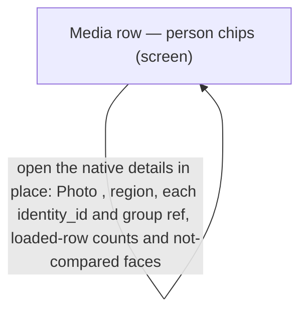
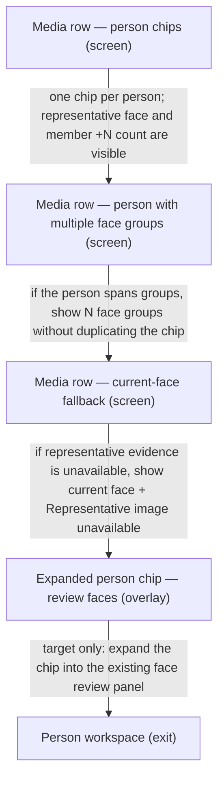

# UX Map — workbench-identity-chips

**Product:** `prototype-wp-alt-context`
**Source fixture:** `apps/prototype-wp-alt-context/js/admin/pages/workbench/identity-clusters/IdentityClusterList.tsx`

## Goals
- Show one person chip per person in each media row; a person's face-group membership stays in the +N count instead of becoming duplicate chips.
- Render the store's representative face crop before the person label (HAI-01/HAI-17); use the current face only when representative evidence is unavailable.
- Keep optional person_id and representative_face absence unresolved and visible without fabricating a person or representative image (rg-015, DDIA).
- Keep ungrouped residue in one Not yet grouped (N) section with every unresolved face; never render N Unnamed person cards or visually deduplicate faces (GPUFLOW-2 C5).
- Pre-existing target, not current source and not a UXREC-1 outcome: expose an N face groups badge when one person spans more than one face group, and let the chip expand into the existing face review panel.
- Pre-existing target, not current source and not a UXREC-1 outcome: let chip name, avatar, and face-group-count buttons open the person workspace while preserving reversible roster merge behavior (INT-07, INT-09).
- Current source: each group card's label button and its Name this person / Edit label control open the existing inline naming editor; that naming action is the media row's primary. The thumbnail (ClusterPreview) is noninteractive, and no chip-to-review or chip-to-workspace navigation exists.
- UXREC-1 IDENTITY (proposed): a new projection buildRepeatedRegionEvidence reads the row's raw DetectedIdentity records before groupIdentitiesByClusters de-duplicates within a group. It reports a repeated region only for the same positive media_id with exactly equal finite x, y, width and height (x and y at least 0, width and height above 1) under two or more different group keys (person:<id>, else cluster:<id>, else ungrouped), using one shared group-key helper so grouping and evidence cannot drift. No IoU or similarity threshold, cross-photo content match, automatic merge or transitive grouping ([GRPH-18] Never trust the transitive closure of a raw similarity threshold, Introduction to Information Retrieval, § 17.2).
- UXREC-1 evidence is text in an in-place native details disclosure on the group card or Not yet grouped section: Photo <media_id>, the region, and each identity_id with its group ref ([VIZ-23] Show the evidence path, Richard Feynman's Mental Models, ch. 5 + Envisioning Information, ch. 4). Counts cover only unique faces loaded for this row; there is no source title, hash, corpus total or completeness field ([VIZ-41] Reveal the image-selection pool, Visual Explanations, ch. 1). Matching coordinates are not identity truth or detector repair. The operator's statement that the supplied Emma crops show one person stays supplied ground truth, not a new identification.

## Jobs
- `job-media-person-chips` — Read person chips in a media row and verify face evidence
- `job-review-person-evidence` — Expand a person chip into face-group review or the person workspace

## Code references
- `screen:workbench-media-row-person-chips` — `apps/prototype-wp-alt-context/js/admin/pages/workbench/identity-clusters/IdentityClusterList.tsx`
- `screen:workbench-media-row-face-group-badge` — `apps/prototype-wp-alt-context/js/admin/pages/workbench/identity-clusters/IdentityClusterItem.tsx`
- `screen:workbench-media-row-current-face-fallback` — `apps/prototype-wp-alt-context/js/admin/pages/workbench/identity-clusters/IdentityClusterItem.tsx`
- `screen:workbench-person-chip-expanded` — `apps/prototype-wp-alt-context/js/admin/pages/workbench/identity-clusters/ClusterReviewPanel.tsx`
- `screen:exit-roster` — `apps/prototype-wp-alt-context/js/admin/pages/roster/PersonWorkspacePanel.tsx`

## Screens
| id | kind | route | title |
| --- | --- | --- | --- |
| `workbench-media-row-person-chips` | screen | `#/workbench?media=` | Media row — person chips |
| `workbench-media-row-face-group-badge` | screen | `#/workbench?media=` | Media row — person with multiple face groups |
| `workbench-media-row-current-face-fallback` | screen | `#/workbench?media=` | Media row — current-face fallback |
| `workbench-person-chip-expanded` | overlay | `#/workbench?tab=scan&panel=review&cluster=` | Expanded person chip — review faces |
| `exit-roster` | exit | `#/roster?person=` | Person workspace |

### Media row — person chips (`workbench-media-row-person-chips`)

Purpose: A media row renders one group card per group key (person, else face group), then one Not yet grouped (N) section. Current source: the card label and Name this person / Edit label open the inline naming editor, which is the primary action; Remove from group and Split keep their targets. UXREC-1 adds only an in-place details disclosure for an exact repeated photo region; the chip navigation elsewhere in this map is a pre-existing target.

url_params: `media`

| zone id | label | role | states |
| --- | --- | --- | --- |
| `z-media-row` | Selected media row (title, description status, and person chip rail) | content | default, loading, empty, error |
| `z-person-chip-rail` | One person chip per person (no duplicate chip for each face group) | ai_review | default, loading, empty, error, degraded |
| `z-ungrouped-residue` | Not yet grouped section (every unresolved face, never N Unnamed person cards) | ai_review | default, error, degraded |
| `z-representative-avatar` | Representative face avatar (store reference crop rendered before the person's label) | ai_review | default, error, degraded |
| `z-member-count` | Member count (+N faces on this person chip) | status | default, loading, empty, error |
| `z-chip-actions` | Group card controls (current source): the label button and Name this person / Edit label open the inline naming editor; Remove from group and Split keep their existing identity and group targets | form | default, loading, error |
| `z-repeated-region-evidence` | Proposed repeated-region details (native details and summary, in place): shown only on a group card or the Not yet grouped section that lists an exact repeated photo region. Summary: the same photo region is also listed in N other loaded groups. Expanded text: Photo <media_id>, region x, y, width, height, and each identity_id with its group ref; checked M loaded faces in K loaded groups for this row, and not-compared faces with unusable or conflicting region data. The thumbnail is context only; no new crop, image, title, merge or naming change. empty = no repeated region, nothing rendered; degraded = some loaded faces not compared. | ai_review | default, empty, degraded |

```
+------------------------------------------------------------+
| Media row — person chips  [screen]  #/workbench?media=     |
| A media row renders one group card per group key (person,\ |
|    else face group), then one Not yet grouped (N) section\ |
|   . Current source: the card label and Name this person /\ |
|    Edit label open the inline naming editor, which is the\ |
|    primary action; Remove from group and Split keep their\ |
|    targets. UXREC-1 adds only an in-place details disclos\ |
|   ure for an exact repeated photo region; the chip naviga\ |
|   tion elsewhere in this map is a pre-existing target.     |
+------------------------------------------------------------+
| ZONES                                                      |
|   - Selected media row (title, description status, and pe\ |
|   rson chip rail) (content) states=[default,loading,empty\ |
|   ,error]                                                  |
|   - One person chip per person (no duplicate chip for eac\ |
|   h face group) (ai_review) states=[default,loading,empty\ |
|   ,error,degraded]                                         |
|   - Not yet grouped section (every unresolved face, never\ |
|    N Unnamed person cards) (ai_review) states=[default,er\ |
|   ror,degraded]                                            |
|   - Representative face avatar (store reference crop rend\ |
|   ered before the person's label) (ai_review) states=[def\ |
|   ault,error,degraded]                                     |
|   - Member count (+N faces on this person chip) (status) \ |
|   states=[default,loading,empty,error]                     |
|   - Group card controls (current source): the label butto\ |
|   n and Name this person / Edit label open the inline nam\ |
|   ing editor; Remove from group and Split keep their exis\ |
|   ting identity and group targets (form) states=[default,\ |
|   loading,error]                                           |
|   - Proposed repeated-region details (native details and \ |
|   summary, in place): shown only on a group card or the N\ |
|   ot yet grouped section that lists an exact repeated pho\ |
|   to region. Summary: the same photo region is also liste\ |
|   d in N other loaded groups. Expanded text: Photo <media\ |
|   _id>, region x, y, width, height, and each identity_id \ |
|   with its group ref; checked M loaded faces in K loaded \ |
|   groups for this row, and not-compared faces with unusab\ |
|   le or conflicting region data. The thumbnail is context\ |
|    only; no new crop, image, title, merge or naming chang\ |
|   e. empty = no repeated region, nothing rendered; degrad\ |
|   ed = some loaded faces not compared. (ai_review) states\ |
|   =[default,empty,degraded]                                |
+------------------------------------------------------------+
| ACTIONS                                                    |
|   [PRIMARY] Name this person / Edit label -> inline namin\ |
|   g editor (existing rename, assign or confirmed merge)    |
|   [secondary] Expand face-group review (pre-existing targ\ |
|   et, not current source) -> workbench-person-chip-expand\ |
|   ed                                                       |
|   [secondary] Open person workspace (pre-existing target,\ |
|    not current source) -> exit-roster                      |
|   [secondary] Show or hide repeated photo-region details \ |
|   -> in-place details disclosure (no navigation)           |
+------------------------------------------------------------+
| states: default | loading | empty | error | degraded       |
+------------------------------------------------------------+
```

### Media row — person with multiple face groups (`workbench-media-row-face-group-badge`)

Purpose: Pre-existing target, not current source and outside UXREC-1. The same person keeps one chip when person_id spans several face groups; the chip adds an N face groups badge while retaining the representative avatar and member +N count.

url_params: `media`

| zone id | label | role | states |
| --- | --- | --- | --- |
| `z-multi-group-chip` | One person chip spanning multiple face groups (person_id is the grouping key) | ai_review | default, loading, error, degraded |
| `z-face-group-badge` | N face groups badge when the person spans more than one face group | status | default, error, degraded |
| `z-multi-group-avatar` | Representative face avatar shared by the person chip | ai_review | default, error, degraded |
| `z-multi-group-member-count` | Member count (+N faces across this person's face groups) | status | default, loading, error |
| `z-multi-group-actions` | Person chip buttons (pre-existing target: review the face groups or open the person workspace) | form | default, loading, error |

```
+------------------------------------------------------------+
| Media row — person with multiple face groups  [screen]  #\ |
|   /workbench?media=                                        |
| Pre-existing target, not current source and outside UXREC\ |
|   -1. The same person keeps one chip when person_id spans\ |
|    several face groups; the chip adds an N face groups ba\ |
|   dge while retaining the representative avatar and membe\ |
|   r +N count.                                              |
+------------------------------------------------------------+
| ZONES                                                      |
|   - One person chip spanning multiple face groups (person\ |
|   _id is the grouping key) (ai_review) states=[default,lo\ |
|   ading,error,degraded]                                    |
|   - N face groups badge when the person spans more than o\ |
|   ne face group (status) states=[default,error,degraded]   |
|   - Representative face avatar shared by the person chip \ |
|   (ai_review) states=[default,error,degraded]              |
|   - Member count (+N faces across this person's face grou\ |
|   ps) (status) states=[default,loading,error]              |
|   - Person chip buttons (pre-existing target: review the \ |
|   face groups or open the person workspace) (form) states\ |
|   =[default,loading,error]                                 |
+------------------------------------------------------------+
| ACTIONS                                                    |
|   [secondary] Open person workspace (pre-existing target,\ |
|    not current source) -> exit-roster                      |
|   [secondary] Review N face groups (pre-existing target, \ |
|   not current source) -> workbench-person-chip-expanded    |
+------------------------------------------------------------+
| states: default | loading | error | degraded               |
+------------------------------------------------------------+
```

### Media row — current-face fallback (`workbench-media-row-current-face-fallback`)

Purpose: When representative_face is absent or its image fields are unavailable, show the current face as a fallback and expose the representativeVocabulary copy “Representative image unavailable”; never synthesize representative evidence. Its chip buttons are a pre-existing target, not current source and outside UXREC-1.

url_params: `media`

| zone id | label | role | states |
| --- | --- | --- | --- |
| `z-current-face-avatar` | Current face fallback avatar (used only when representative evidence is unavailable) | ai_review | default, loading, error, degraded |
| `z-representative-unavailable-copy` | Fallback copy: Representative image unavailable (canonical representativeVocabulary text) | status | default, error, degraded |
| `z-fallback-member-count` | Member count remains visible (+N faces) while representative evidence is unavailable | status | default, loading, error |
| `z-fallback-actions` | Fallback chip buttons (pre-existing target: expand face-group review or open person workspace) | form | default, loading, error |

```
+------------------------------------------------------------+
| Media row — current-face fallback  [screen]  #/workbench?\ |
|   media=                                                   |
| When representative_face is absent or its image fields ar\ |
|   e unavailable, show the current face as a fallback and \ |
|   expose the representativeVocabulary copy “Representativ\ |
|   e image unavailable”; never synthesize representative e\ |
|   vidence. Its chip buttons are a pre-existing target, no\ |
|   t current source and outside UXREC-1.                    |
+------------------------------------------------------------+
| ZONES                                                      |
|   - Current face fallback avatar (used only when represen\ |
|   tative evidence is unavailable) (ai_review) states=[def\ |
|   ault,loading,error,degraded]                             |
|   - Fallback copy: Representative image unavailable (cano\ |
|   nical representativeVocabulary text) (status) states=[d\ |
|   efault,error,degraded]                                   |
|   - Member count remains visible (+N faces) while represe\ |
|   ntative evidence is unavailable (status) states=[defaul\ |
|   t,loading,error]                                         |
|   - Fallback chip buttons (pre-existing target: expand fa\ |
|   ce-group review or open person workspace) (form) states\ |
|   =[default,loading,error]                                 |
+------------------------------------------------------------+
| ACTIONS                                                    |
|   [secondary] Open person workspace (pre-existing target,\ |
|    not current source) -> exit-roster                      |
|   [secondary] Review current face evidence (pre-existing \ |
|   target, not current source) -> workbench-person-chip-ex\ |
|   panded                                                   |
+------------------------------------------------------------+
| states: default | loading | error | degraded               |
+------------------------------------------------------------+
```

### Expanded person chip — review faces (`workbench-person-chip-expanded`)

Purpose: Pre-existing target, not current source and outside UXREC-1: no media-row chip opens this panel today. The member review panel is reached through its own review deep link (panel=review with a face group id), where the operator can inspect face evidence, show all members, remove a face, or close the panel. UXREC-1 adds nothing here.

url_params: `tab`, `panel`, `cluster`

| zone id | label | role | states |
| --- | --- | --- | --- |
| `z-expanded-face-evidence` | Expanded face evidence (representative and current faces remain linked to their media) | ai_review | default, loading, empty, error, degraded |
| `z-expanded-face-members` | Expanded face members (show all members or remove this face) | forced_choice | default, loading, empty, error, degraded |
| `z-expanded-actions` | Close face review / open person workspace | form | default, loading, error |

```
+------------------------------------------------------------+
| Expanded person chip — review faces  [overlay]  #/workben\ |
|   ch?tab=scan&panel=review&cluster=                        |
| Pre-existing target, not current source and outside UXREC\ |
|   -1: no media-row chip opens this panel today. The membe\ |
|   r review panel is reached through its own review deep l\ |
|   ink (panel=review with a face group id), where the oper\ |
|   ator can inspect face evidence, show all members, remov\ |
|   e a face, or close the panel. UXREC-1 adds nothing here. |
+------------------------------------------------------------+
| ZONES                                                      |
|   - Expanded face evidence (representative and current fa\ |
|   ces remain linked to their media) (ai_review) states=[d\ |
|   efault,loading,empty,error,degraded]                     |
|   - Expanded face members (show all members or remove thi\ |
|   s face) (forced_choice) states=[default,loading,empty,e\ |
|   rror,degraded]                                           |
|   - Close face review / open person workspace (form) stat\ |
|   es=[default,loading,error]                               |
+------------------------------------------------------------+
| ACTIONS                                                    |
|   [secondary] Close face review -> workbench-media-row-pe\ |
|   rson-chips                                               |
|   [secondary] Open person workspace (pre-existing target,\ |
|    not current source) -> exit-roster                      |
+------------------------------------------------------------+
| states: default | loading | empty | error | degraded       |
+------------------------------------------------------------+
```

### Person workspace (`exit-roster`)

Purpose: Pre-existing target for chip navigation, not current source and outside UXREC-1. A person chip name, avatar, or face-group-count button would open the named person's workspace and preserve the media-row context when the operator returns.

url_params: `person`, `media`

| zone id | label | role | states |
| --- | --- | --- | --- |
| `z-roster-person-entry` | Person workspace entry from a chip button | nav | default |

```
+------------------------------------------------------------+
| Person workspace  [exit]  #/roster?person=                 |
| Pre-existing target for chip navigation, not current sour\ |
|   ce and outside UXREC-1. A person chip name, avatar, or \ |
|   face-group-count button would open the named person's w\ |
|   orkspace and preserve the media-row context when the op\ |
|   erator returns.                                          |
+------------------------------------------------------------+
| ZONES                                                      |
|   - Person workspace entry from a chip button (nav) state\ |
|   s=[default]                                              |
+------------------------------------------------------------+
| states: default | loading | error                          |
+------------------------------------------------------------+
```

## Actions

| id | verb | target | hierarchy | costly | irreversible | preview required | screen id |
| --- | --- | --- | --- | --- | --- | --- | --- |
| `act-edit-person-name` | Name this person / Edit label | `inline naming editor (existing rename, assign or confirmed merge)` | primary | no | no | no | `workbench-media-row-person-chips` |
| `act-toggle-repeated-region-evidence` | Show or hide repeated photo-region details | `in-place details disclosure (no navigation)` | secondary | no | no | no | `workbench-media-row-person-chips` |
| `act-expand-person-chip` | Expand face-group review (pre-existing target, not current source) | `workbench-person-chip-expanded` | secondary | no | no | no | `workbench-media-row-person-chips` |
| `act-open-person-workspace-from-chip` | Open person workspace (pre-existing target, not current source) | `exit-roster` | secondary | no | no | no | `workbench-media-row-person-chips` |
| `act-review-multi-group-person` | Review N face groups (pre-existing target, not current source) | `workbench-person-chip-expanded` | secondary | no | no | no | `workbench-media-row-face-group-badge` |
| `act-open-person-workspace-from-multi-group-chip` | Open person workspace (pre-existing target, not current source) | `exit-roster` | secondary | no | no | no | `workbench-media-row-face-group-badge` |
| `act-review-current-face-fallback` | Review current face evidence (pre-existing target, not current source) | `workbench-person-chip-expanded` | secondary | no | no | no | `workbench-media-row-current-face-fallback` |
| `act-open-person-workspace-from-fallback` | Open person workspace (pre-existing target, not current source) | `exit-roster` | secondary | no | no | no | `workbench-media-row-current-face-fallback` |
| `act-close-person-chip-review` | Close face review | `workbench-media-row-person-chips` | secondary | no | no | no | `workbench-person-chip-expanded` |
| `act-open-person-workspace-from-review` | Open person workspace (pre-existing target, not current source) | `exit-roster` | secondary | no | no | no | `workbench-person-chip-expanded` |

## Flows
### UXREC-1: exact repeated photo region → in-place details → unchanged naming (`flow-repeated-region-evidence`)

```
flow: UXREC-1: exact repeated photo region → in-place details\
   → unchanged naming (flow-repeated-region-evidence) job=job\
  -media-person-chips
  1. Media row — person chips [workbench-media-row-person-chi\
  ps]
     --row loads its faces; buildRepeatedRegionEvidence reads\
   the raw records before groupIdentitiesByClusters de-duplic\
  ates within a group-->
  2. Media row — person chips [workbench-media-row-person-chi\
  ps] (visit 2)
     --same positive media_id and identical finite region und\
  er two or more group keys → a summary on each involved card\
   or section; otherwise nothing renders-->
  3. Media row — person chips [workbench-media-row-person-chi\
  ps] (visit 3)
     --open the native details in place: Photo <media_id>, re\
  gion, each identity_id and group ref, loaded-row counts and\
   not-compared faces-->
  4. Media row — person chips [workbench-media-row-person-chi\
  ps] (visit 4)
```



### Pre-existing target (not current source): person chip → face review → person workspace (`flow-person-chip-evidence`)

```
flow: Pre-existing target (not current source): person chip →\
   face review → person workspace (flow-person-chip-evidence)\
   job=job-review-person-evidence
  1. Media row — person chips [workbench-media-row-person-chi\
  ps]
     --one chip per person; representative face and member +N\
   count are visible-->
  2. Media row — person with multiple face groups [workbench-\
  media-row-face-group-badge]
     --if the person spans groups, show N face groups without\
   duplicating the chip-->
  3. Media row — current-face fallback [workbench-media-row-c\
  urrent-face-fallback]
     --if representative evidence is unavailable, show curren\
  t face + Representative image unavailable-->
  4. Expanded person chip — review faces [workbench-person-ch\
  ip-expanded]
     --target only: expand the chip into the existing face re\
  view panel-->
  5. Person workspace [exit-roster]
```



## Open questions
- When person_id is absent, should the unresolved face-group result show a neutral chip action or remain only in the review queue?
- Should returning from the person workspace restore the expanded face review panel or only the media row scroll position?

## Suggested task-slice decomposition (from map)

1. Group media identities by optional person_id while preserving unresolved face groups
2. Render representative face evidence, N face groups, and member +N chip states
3. Render current-face fallback with canonical Representative image unavailable copy
4. Pre-existing target, outside UXREC-1: connect chip actions to face review and the person workspace
5. Collapse ungrouped residue into one Not yet grouped (N) section without visually deduplicating faces
6. UXREC-1 IDENTITY proposed: add buildRepeatedRegionEvidence (raw DetectedIdentity records in; per-group repeated-region evidence with unique identity_id accounting, deterministic region, group and identity ordering, and abstention on malformed or conflicting records out) sharing one group-key helper with groupIdentitiesByClusters; render native details/summary in IdentityClusterItem and the Not yet grouped section of IdentityClusterList; narrow-layout wrapping only in _identity-cluster-list.scss; grouping, identityClusterIds, naming and removal targets unchanged.

## Parity index

Machine-checked by `js/admin/__tests__/uxmap-parity.test.ts` and
`js/admin/__tests__/uxmap-render-parity.test.ts`: every id, state, and verbatim label
below must exist in the sibling `.uxmap.json`, and no `z-*`/`act-*` id may appear here
that the JSON does not define. Regenerate with `docs/ux-maps/render_ux_maps.py` — never
hand-edit one side.

Zone ids: z-media-row z-person-chip-rail z-ungrouped-residue z-representative-avatar z-member-count z-chip-actions z-repeated-region-evidence z-multi-group-chip z-face-group-badge z-multi-group-avatar z-multi-group-member-count z-multi-group-actions z-current-face-avatar z-representative-unavailable-copy z-fallback-member-count z-fallback-actions z-expanded-face-evidence z-expanded-face-members z-expanded-actions z-roster-person-entry

Action ids: act-edit-person-name act-toggle-repeated-region-evidence act-expand-person-chip act-open-person-workspace-from-chip act-review-multi-group-person act-open-person-workspace-from-multi-group-chip act-review-current-face-fallback act-open-person-workspace-from-fallback act-close-person-chip-review act-open-person-workspace-from-review

Zone labels (verbatim; the tables above escape `|` for markdown, this list does not):

- Selected media row (title, description status, and person chip rail)
- One person chip per person (no duplicate chip for each face group)
- Not yet grouped section (every unresolved face, never N Unnamed person cards)
- Representative face avatar (store reference crop rendered before the person's label)
- Member count (+N faces on this person chip)
- Group card controls (current source): the label button and Name this person / Edit label open the inline naming editor; Remove from group and Split keep their existing identity and group targets
- Proposed repeated-region details (native details and summary, in place): shown only on a group card or the Not yet grouped section that lists an exact repeated photo region. Summary: the same photo region is also listed in N other loaded groups. Expanded text: Photo <media_id>, region x, y, width, height, and each identity_id with its group ref; checked M loaded faces in K loaded groups for this row, and not-compared faces with unusable or conflicting region data. The thumbnail is context only; no new crop, image, title, merge or naming change. empty = no repeated region, nothing rendered; degraded = some loaded faces not compared.
- One person chip spanning multiple face groups (person_id is the grouping key)
- N face groups badge when the person spans more than one face group
- Representative face avatar shared by the person chip
- Member count (+N faces across this person's face groups)
- Person chip buttons (pre-existing target: review the face groups or open the person workspace)
- Current face fallback avatar (used only when representative evidence is unavailable)
- Fallback copy: Representative image unavailable (canonical representativeVocabulary text)
- Member count remains visible (+N faces) while representative evidence is unavailable
- Fallback chip buttons (pre-existing target: expand face-group review or open person workspace)
- Expanded face evidence (representative and current faces remain linked to their media)
- Expanded face members (show all members or remove this face)
- Close face review / open person workspace
- Person workspace entry from a chip button

States (all zones and screens): default loading empty error degraded

## Not doing
- Creating one person chip per face group
- Showing a guessed representative image when representative_face is absent
- Auto-merging people from a matching label without a preview
- Pixel or token design; implementation uses the existing --acx-* system
- No auto-transitive similarity merge, filename-based identity, new merge endpoint, detector threshold tuning or backend activation. Camera/detector duplicate and identity-recall hypotheses require separate corpus evidence.
- UXREC-1 adds no panel route, review callback, ClusterReviewPanel change, new tab or 'Review faces' navigation; chip-to-review and chip-to-workspace stay pre-existing targets.
- UXREC-1 adds no evidence crop or image, comparison thumbnail, source title, hash, corpus total or completeness claim. The existing thumbnail may show the group representative from another photo and is never presented as the matching observation.
- No IoU or overlap tolerance, similarity score, cross-photo content match, automatic merge or transitive grouping from repeated regions; no live IDs are invented for the operator-supplied Emma crops.
