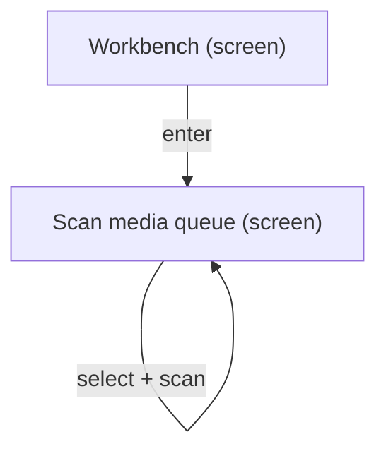
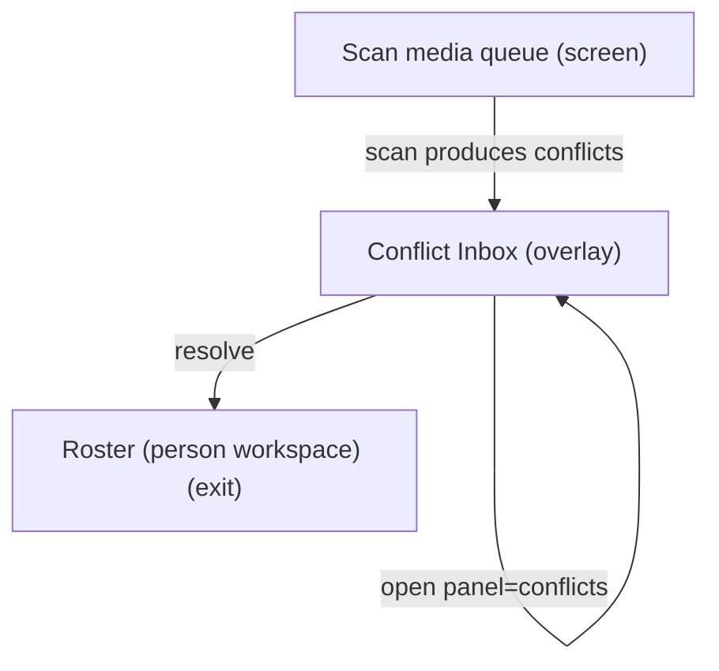
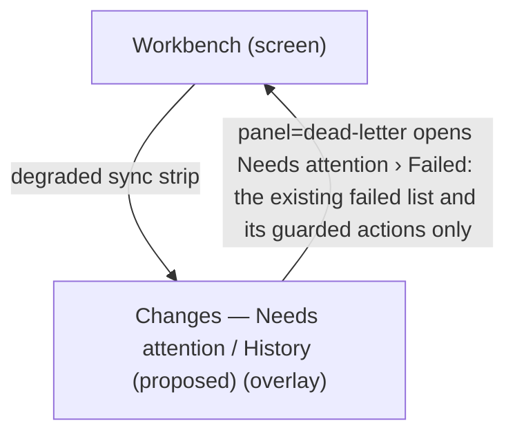
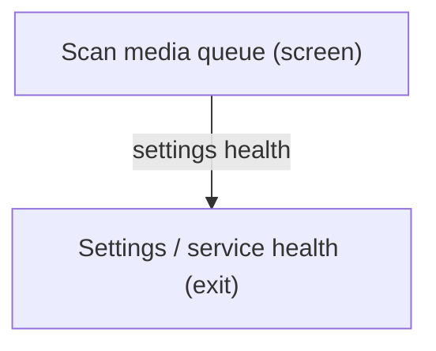
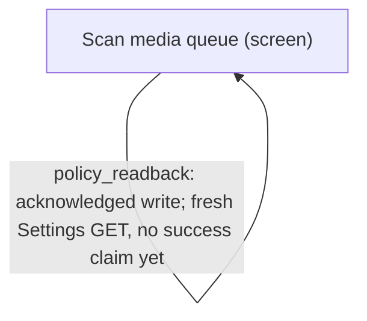
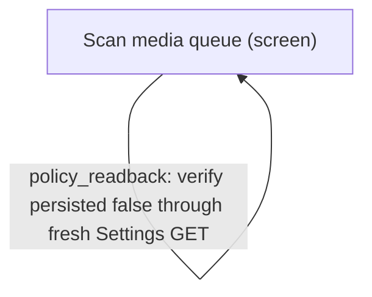
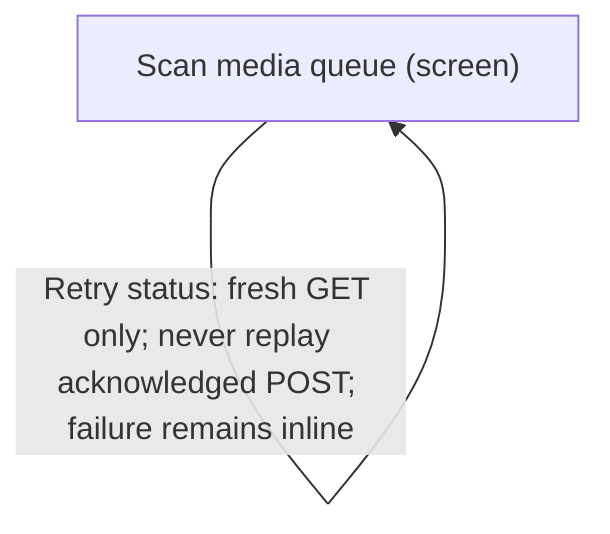
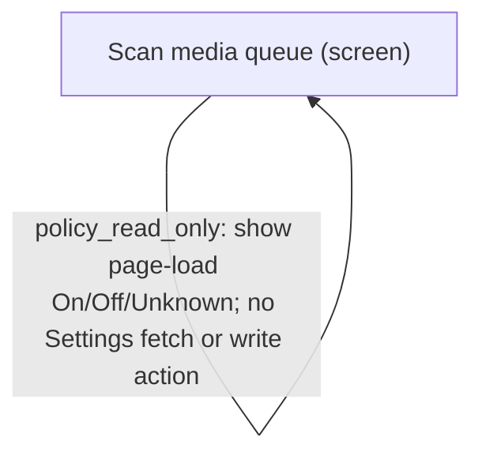

# UX Map — workbench-operator-loop

**Product:** `prototype-wp-alt-context`
**Source fixture:** `apps/prototype-wp-alt-context/js/admin/pages/WorkbenchPage.tsx`

## Goals
- Six ACX submenus are MECE and frequency-ordered (NAV-05/NAV-06): Overview orients; Review Queue is the one home to name a person from a photo (highest-frequency demo task); People manages named people only; Description Runs is the one home to see what the describer did; Data Retention is keep/delete/export policy (not description history); Settings configures the service (rare, last). WordPress parent slug stays Overview.
- One primary action per screen (NAV-01), reachable from zero state (rg-003); other CTAs are secondary.
- Operator clears media queue via Scan and resolves identity conflicts without losing place
- Decompose Workbench UI tasks from screens/zones/states/flows instead of inventing IA mid-plan
- WBRC-1 proposed interaction contract, not evidence of implemented or live-accepted UI. Canon v0.26.2: policy is site-wide; connection health, enabled policy and completed inference are separate facts (CARD-12 / Principle 10; [CLM-03] The policy is a contract, bootstrap practice label).
- Keep the policy beside scan actions: [NAV-06] Frequency elevates chrome, Designing Interfaces, 3rd ed. + Microinteractions, ch. 2. Enable and Disable occupy the same secondary control position: [SECD-08] Make the safe path the easy path, Security Engineering.
- Cold-start policy remains false until affirmative opt-in: [SECD-12] Biometric opt-in default, Face Recognition Technology (Compulsory Visibility), ch. 2. A missing/malformed page-load snapshot is Unknown, never silently Off. recognitionPolicy.enabled and canManage are bootstrap hints, not a second store or authorization grant.
- Confirm only after field acknowledgement and fresh validated settings readback: [FORM-08] Echo-back stored interpretation, Pattern Languages of Program Design, ch. 10. Keep local persistent actionable errors: [FORM-05] Inline actionable errors, Designing Interfaces, 3rd ed. No modal or confirm tab and no repeated opt-in prompt after a persisted choice.
- Producer contract verified from current bytes: RecognitionPolicy::DEFAULT=false; Settings GET requires boolean recognition_enabled (fetchSettings rejects missing/nonboolean); Settings POST may return HTTP 200 with result=error/partial and failed fields. Require result=ok, saved containing recognition_enabled and no matching failed field; HTTP success alone never confirms persistence.
- Send only {recognition_enabled: desiredBoolean}, never URL, api_key or allow_person_names. Share queryKeys.settings.all with SettingsPage; reconcile through fresh Settings GET. After an acknowledged write, failed/malformed/mismatched readback permits verification reads only; never replay the write. Unknown/rejected state also recovers through Settings GET.
- Policy toggle submits no media, starts no scan/GPU, deletes no identities and cancels no accepted jobs. Existing manage_options server enforcement remains authoritative; permission denial removes writes and explains administrator access. Nonadmins see only the page-load snapshot (On/Off/Unknown) with an administrator explanation and no settings fetch/write action.
- UXREC-1 design proposal (target contract, not current source): the Changes panel opens on Needs attention, which defaults to Failed and renders only the existing failed list; Pending and Conflict render only that status's server-filtered timeline; History renders the existing all/status timeline with existing guarded per-row Retry/Discard only on failed rows, once per view. Retry excludes terminal failures; Discard keeps Confirm discard. Bulk Retry/Discard stay attention_failed only, with existing confirmation, capability and age/clock guards preserved as applicable. [NAV-19] Keep related work adjacent, Source: About Face, ch. 12 (Canon v0.26.2, https://github.com/darce/heuristics-canon): act beside the inspected failed row instead of switching views to find it again. Every count is the server total of the one query on screen; there is no combined attention total. This slice improves classification and navigation and removes duplicate presentation; it clears no records, so old failed rows (including the four July rows) stay failed attention until existing reconciliation or an operator action changes them. Preserve all audit records, reconciliation and existing naming-policy controls. See docs/assessments/current/UXREC-1-ux-inventory.md.

## Jobs
- `job-clear-queue` — Clear media queue (scan / describe)
- `job-resolve-conflicts` — Resolve identity conflicts
- `job-recover-sync` — Recover from sync / dead-letter failures
- `job-assign-people` — Assign people (exit to Roster)
- `job-recognition-policy` — Inspect or explicitly change the site-wide recognition policy without running scan

## Code references
- `screen:workbench-shell` — `apps/prototype-wp-alt-context/js/admin/pages/WorkbenchPage.tsx`
- `screen:workbench-scan` — `apps/prototype-wp-alt-context/js/admin/pages/workbench/ScanTabContent.tsx`
- `screen:workbench-conflicts` — `apps/prototype-wp-alt-context/js/admin/pages/workbench/ConflictInbox.tsx`
- `screen:workbench-dead-letter` — `apps/prototype-wp-alt-context/js/admin/pages/workbench/DeadLetterPanel.tsx`
- `screen:workbench-review-panel` — `apps/prototype-wp-alt-context/js/admin/pages/workbench/identity-clusters/ClusterReviewPanel.tsx`
- `screen:exit-roster` — `apps/prototype-wp-alt-context/js/admin/pages/RosterPage.tsx`
- `screen:exit-settings` — `apps/prototype-wp-alt-context/js/admin/pages/SettingsPage.tsx`

## Screens
| id | kind | route | title |
| --- | --- | --- | --- |
| `workbench-shell` | screen | `#/workbench` | Workbench |
| `workbench-scan` | screen | `#/workbench?tab=scan` | Scan media queue |
| `workbench-conflicts` | overlay | `#/workbench?panel=conflicts` | Conflict Inbox |
| `workbench-dead-letter` | overlay | `#/workbench?panel=dead-letter` | Changes — Needs attention / History (proposed) |
| `workbench-review-panel` | screen | `#/workbench?tab=scan&panel=review&cluster=` | Review these faces |
| `exit-roster` | exit | `#/roster` | Roster (person workspace) |
| `exit-settings` | exit | `#/settings` | Settings / service health |

### Workbench (`workbench-shell`)

Purpose: Operator surface for media queue scan, job pipeline, sync health, and review overlays

url_params: `tab`, `panel`, `advanced`, `status`, `media`, `rq`, `queue`, `face`, `cluster`

wp_page: `alt-context-workbench`
job_entry: true
deep_link: true
primary_action_id: `act-open-scan`
code_ref: `apps/prototype-wp-alt-context/js/admin/pages/WorkbenchPage.tsx`

| zone id | label | role | states |
| --- | --- | --- | --- |
| `z-tabs` | Workbench steps tabs | nav | default |
| `z-sync` | Sync / projection status strip | status | default, loading, error, degraded |
| `z-overlay-host` | Overlay host (conflicts \| dead-letter) | other | default, empty |
| `z-main-tab` | Active tab content (Scan) | content | default, loading, empty, error |
| `z-advanced` | Advanced drawer | form | default, empty |

```
+------------------------------------------------------------+
| Workbench  [screen]  #/workbench                           |
| Operator surface for media queue scan, job pipeline, sync\ |
|    health, and review overlays                             |
+------------------------------------------------------------+
| ZONES                                                      |
|   - Workbench steps tabs (nav) states=[default]            |
|   - Sync / projection status strip (status) states=[defau\ |
|   lt,loading,error,degraded]                               |
|   - Overlay host (conflicts | dead-letter) (other) states\ |
|   =[default,empty]                                         |
|   - Active tab content (Scan) (content) states=[default,l\ |
|   oading,empty,error]                                      |
|   - Advanced drawer (form) states=[default,empty]          |
+------------------------------------------------------------+
| ACTIONS                                                    |
|   [PRIMARY] Open Scan -> workbench-scan                    |
|   [secondary] Open Conflict Inbox -> workbench-conflicts   |
|   [secondary] Open Failed Sync Queue -> workbench-dead-le\ |
|   tter                                                     |
|   [secondary] Retry projection sync -> projection (costly\ |
|   ,preview)                                                |
+------------------------------------------------------------+
| states: default | loading | error | degraded | offline     |
+------------------------------------------------------------+
```

### Scan media queue (`workbench-scan`)

Purpose: Filter and select library media; run scan faces / describe pipeline (default also covers the reviewing state: a face group loaded in the review panel)

url_params: `tab`, `status`, `media`, `s`, `p`, `perPage`, `rq`, `panel`, `cluster`

wp_page: —
job_entry: true
deep_link: true
primary_action_id: `act-scan-selected`
code_ref: `apps/prototype-wp-alt-context/js/admin/pages/workbench/ScanTabContent.tsx`

Action states: policy_off, policy_on, policy_unknown, policy_saving, policy_readback, policy_readback_error, policy_permission_denied, policy_read_only, policy_rejected

| zone id | label | role | states |
| --- | --- | --- | --- |
| `z-review-queue` | Review queue header / count with kind+band filter chips, card-at-a-time (rq= URL is the single owner of chip state; empty covers both a filter-empty queue and a fully drained one) | queue | default, loading, empty, error, first_time, edge_input |
| `z-review-panel` | Face-group review panel (panel=review&cluster=) | ai_review | default, loading, empty, error, first_time, edge_input |
| `z-filters` | Status / search filters | form | default, loading, error |
| `z-media-queue` | Media selection table | queue | default, loading, empty, error, first_time, edge_input |
| `z-job-cta` | Scan / analyze CTAs + job progress | job | default, loading, error |
| `z-recognition-policy` | Facial recognition: On / Off / Unknown; site-wide policy beside scan actions. Same-position secondary Enable (Off) / Disable (On); loading = saving or verifying (mutation unavailable); error = rejected write or readback failure with inline Retry status; degraded = unknown, permission denied or read-only snapshot with administrator explanation. On confirms policy only, not connection or inference. | form | default, loading, error, degraded |
| `z-identity-preview` | Identity / findings preview (AI-assisted; offline = recognition service unreachable; degraded = repair / reduced-capability mode; empty = zero evidence rows) | ai_review | default, empty, loading, error, degraded, offline |
| `z-review-suggestions-header` | Review Suggestions queue header / count (default also covers the filter-narrowed count; degraded = repair / reduced-capability mode) | status | default, loading, empty, error, degraded |
| `z-review-suggestions-group-card` | Top-of-queue group card + Name this person (NameFaceControl; default also covers an AI-suggested label and the open suggestions disclosure; loading = save in flight; degraded = read-only card; edge_input = missing or uncroppable face image) | ai_review | default, loading, error, degraded, edge_input |

```
+------------------------------------------------------------+
| Scan media queue  [screen]  #/workbench?tab=scan           |
| Filter and select library media; run scan faces / describ\ |
|   e pipeline (default also covers the reviewing state: a \ |
|   face group loaded in the review panel)                   |
+------------------------------------------------------------+
| ZONES                                                      |
|   - Review queue header / count with kind+band filter chi\ |
|   ps, card-at-a-time (rq= URL is the single owner of chip\ |
|    state; empty covers both a filter-empty queue and a fu\ |
|   lly drained one) (queue) states=[default,loading,empty,\ |
|   error,first_time,edge_input]                             |
|   - Face-group review panel (panel=review&cluster=) (ai_r\ |
|   eview) states=[default,loading,empty,error,first_time,e\ |
|   dge_input]                                               |
|   - Status / search filters (form) states=[default,loadin\ |
|   g,error]                                                 |
|   - Media selection table (queue) states=[default,loading\ |
|   ,empty,error,first_time,edge_input]                      |
|   - Scan / analyze CTAs + job progress (job) states=[defa\ |
|   ult,loading,error]                                       |
|   - Facial recognition: On / Off / Unknown; site-wide pol\ |
|   icy beside scan actions. Same-position secondary Enable\ |
|    (Off) / Disable (On); loading = saving or verifying (m\ |
|   utation unavailable); error = rejected write or readbac\ |
|   k failure with inline Retry status; degraded = unknown,\ |
|    permission denied or read-only snapshot with administr\ |
|   ator explanation. On confirms policy only, not connecti\ |
|   on or inference. (form) states=[default,loading,error,d\ |
|   egraded]                                                 |
|   - Identity / findings preview (AI-assisted; offline = r\ |
|   ecognition service unreachable; degraded = repair / red\ |
|   uced-capability mode; empty = zero evidence rows) (ai_r\ |
|   eview) states=[default,empty,loading,error,degraded,off\ |
|   line]                                                    |
|   - Review Suggestions queue header / count (default also\ |
|    covers the filter-narrowed count; degraded = repair / \ |
|   reduced-capability mode) (status) states=[default,loadi\ |
|   ng,empty,error,degraded]                                 |
|   - Top-of-queue group card + Name this person (NameFaceC\ |
|   ontrol; default also covers an AI-suggested label and t\ |
|   he open suggestions disclosure; loading = save in fligh\ |
|   t; degraded = read-only card; edge_input = missing or u\ |
|   ncroppable face image) (ai_review) states=[default,load\ |
|   ing,error,degraded,edge_input]                           |
+------------------------------------------------------------+
| ACTIONS                                                    |
| when policy_off                                            |
|   [PRIMARY] Scan selected media                            |
|   [secondary] Go to Roster                                 |
|   [secondary] Enable facial recognition                    |
| when policy_on                                             |
|   [PRIMARY] Scan selected media                            |
|   [secondary] Go to Roster                                 |
|   [secondary] Disable facial recognition                   |
| when policy_unknown                                        |
|   [PRIMARY] Scan selected media                            |
|   [secondary] Go to Roster                                 |
|   [secondary] Retry status (read only)                     |
| when policy_saving                                         |
|   [PRIMARY] Scan selected media                            |
|   [secondary] Go to Roster                                 |
| when policy_readback                                       |
|   [PRIMARY] Scan selected media                            |
|   [secondary] Go to Roster                                 |
| when policy_readback_error                                 |
|   [PRIMARY] Scan selected media                            |
|   [secondary] Go to Roster                                 |
|   [secondary] Retry status (read only)                     |
| when policy_permission_denied                              |
|   [PRIMARY] Scan selected media                            |
|   [secondary] Go to Roster                                 |
| when policy_read_only                                      |
|   [PRIMARY] Scan selected media                            |
|   [secondary] Go to Roster                                 |
| when policy_rejected                                       |
|   [PRIMARY] Scan selected media                            |
|   [secondary] Go to Roster                                 |
|   [secondary] Retry status (read only)                     |
+------------------------------------------------------------+
| states: default | loading | empty | error | first_time     |
| states+: edge_input | degraded                             |
|   edge_input | degraded                                    |
+------------------------------------------------------------+
```

### Conflict Inbox (`workbench-conflicts`)

Purpose: Review identity conflicts; commit human judgment with evidence

url_params: `panel`

wp_page: —
job_entry: false
deep_link: true
primary_action_id: `act-resolve-conflict`
code_ref: `apps/prototype-wp-alt-context/js/admin/pages/workbench/ConflictInbox.tsx`

| zone id | label | role | states |
| --- | --- | --- | --- |
| `z-conflict-list` | Conflict list | queue | default, loading, empty, error |
| `z-conflict-detail` | Conflict detail / candidates | forced_choice | default, loading, empty, error |
| `z-conflict-actions` | Resolve / defer actions | form | default, loading, empty, error |

```
+------------------------------------------------------------+
| Conflict Inbox  [overlay]  #/workbench?panel=conflicts     |
| Review identity conflicts; commit human judgment with evi\ |
|   dence                                                    |
+------------------------------------------------------------+
| ZONES                                                      |
|   - Conflict list (queue) states=[default,loading,empty,e\ |
|   rror]                                                    |
|   - Conflict detail / candidates (forced_choice) states=[\ |
|   default,loading,empty,error]                             |
|   - Resolve / defer actions (form) states=[default,loadin\ |
|   g,empty,error]                                           |
+------------------------------------------------------------+
| ACTIONS                                                    |
|   [PRIMARY] Resolve conflict -> identity-store (costly,pr\ |
|   eview)                                                   |
+------------------------------------------------------------+
| states: default | loading | empty | error                  |
+------------------------------------------------------------+
```

### Changes — Needs attention / History (proposed) (`workbench-dead-letter`)

Purpose: UXREC-1 proposed. Current source starts with timelineStatus all and renders the failed list and a second all-status timeline together, so a failed row can appear twice with two action sets. Target: one list per view. Needs attention › Failed (default) renders only the existing failed list; Needs attention › Pending or Conflict renders only the server-filtered timeline for that status; History renders the existing timeline for All or one status, retaining guarded per-row Retry/Discard only on failed rows, once per view. Retry excludes terminal failures; bulk controls stay in Failed attention only. Switching views or filters is a read and never discards, retries or reconciles rows. No combined attention total, no locally filtered page presented as a global total, no age-only hiding.

url_params: `panel`

wp_page: —
job_entry: false
deep_link: true
primary_action_id: `act-retry-dead-letter`
code_ref: `apps/prototype-wp-alt-context/js/admin/pages/workbench/DeadLetterPanel.tsx`

Action states: attention_failed, attention_pending, attention_conflict, history

| zone id | label | role | states |
| --- | --- | --- | --- |
| `z-dl-attention-choice` | Needs attention status choice: Failed (default), Pending or Conflict as pressed-state buttons. Each choice is its own server query with its own total; no sum across them. The existing topology-command summary counts topology commands, not these rows, and is never presented as an attention total. | nav | default, loading, error |
| `z-dl-list` | Failed view: the existing failed list only (failed-changes query, 20 per page, its own offset, Showing a–b of N failed changes from that query's server total). Rows keep operation, entity, attempts, age, last attempt, error and payload summary. Old failed rows stay listed until existing reconciliation or an operator Retry or Discard changes their status. No failed timeline is rendered beside it. | queue | default, loading, empty, error |
| `z-dl-actions` | Failed attention: existing row Retry only on non-terminal failed rows and row Discard with Confirm discard. Bulk Retry all failed (N) and Discard eligible failed changes older than 7 days stay attention_failed only. Preserve capability and pending-mutation guards, bulk arm/confirm and bulk-discard age/clock eligibility. Retry reports queued, not recovered; failures stay inline. Pending and Conflict show no recovery controls; History retains only its failed-row actions. | form | default, loading, empty, error |
| `z-dl-status-timeline` | Pending or Conflict view: only the existing timeline query with that one status (10 per page, offset reset to 0 on each choice, Showing a–b of N from that status's server total). Rows are read-only; an empty result says no changes have that status. | queue | default, loading, empty, error |
| `z-dl-history` | History view: the existing timeline for All (default) or one of pending, acknowledged, conflict, failed, discarded; 10 per page, offset reset to 0 on each filter change, server total per filter. Existing guarded per-row Retry only on non-terminal failed rows and Discard with Confirm discard only on failed rows, once per view. Other statuses have no row recovery actions. Preserve capability and pending-mutation guards; no bulk controls and no delete-on-hide. | content | default, loading, empty, error |

```
+------------------------------------------------------------+
| Changes — Needs attention / History (proposed)  [overlay]\ |
|     #/workbench?panel=dead-letter                          |
| UXREC-1 proposed. Current source starts with timelineStat\ |
|   us all and renders the failed list and a second all-sta\ |
|   tus timeline together, so a failed row can appear twice\ |
|    with two action sets. Target: one list per view. Needs\ |
|    attention › Failed (default) renders only the existing\ |
|    failed list; Needs attention › Pending or Conflict ren\ |
|   ders only the server-filtered timeline for that status;\ |
|    History renders the existing timeline for All or one s\ |
|   tatus, retaining guarded per-row Retry/Discard only on \ |
|   failed rows, once per view. Retry excludes terminal fai\ |
|   lures; bulk controls stay in Failed attention only. Swi\ |
|   tching views or filters is a read and never discards, r\ |
|   etries or reconciles rows. No combined attention total,\ |
|    no locally filtered page presented as a global total, \ |
|   no age-only hiding.                                      |
+------------------------------------------------------------+
| ZONES                                                      |
|   - Needs attention status choice: Failed (default), Pend\ |
|   ing or Conflict as pressed-state buttons. Each choice i\ |
|   s its own server query with its own total; no sum acros\ |
|   s them. The existing topology-command summary counts to\ |
|   pology commands, not these rows, and is never presented\ |
|    as an attention total. (nav) states=[default,loading,e\ |
|   rror]                                                    |
|   - Failed view: the existing failed list only (failed-ch\ |
|   anges query, 20 per page, its own offset, Showing a–b o\ |
|   f N failed changes from that query's server total). Row\ |
|   s keep operation, entity, attempts, age, last attempt, \ |
|   error and payload summary. Old failed rows stay listed \ |
|   until existing reconciliation or an operator Retry or D\ |
|   iscard changes their status. No failed timeline is rend\ |
|   ered beside it. (queue) states=[default,loading,empty,e\ |
|   rror]                                                    |
|   - Failed attention: existing row Retry only on non-term\ |
|   inal failed rows and row Discard with Confirm discard. \ |
|   Bulk Retry all failed (N) and Discard eligible failed c\ |
|   hanges older than 7 days stay attention_failed only. Pr\ |
|   eserve capability and pending-mutation guards, bulk arm\ |
|   /confirm and bulk-discard age/clock eligibility. Retry \ |
|   reports queued, not recovered; failures stay inline. Pe\ |
|   nding and Conflict show no recovery controls; History r\ |
|   etains only its failed-row actions. (form) states=[defa\ |
|   ult,loading,empty,error]                                 |
|   - Pending or Conflict view: only the existing timeline \ |
|   query with that one status (10 per page, offset reset t\ |
|   o 0 on each choice, Showing a–b of N from that status's\ |
|    server total). Rows are read-only; an empty result say\ |
|   s no changes have that status. (queue) states=[default,\ |
|   loading,empty,error]                                     |
|   - History view: the existing timeline for All (default)\ |
|    or one of pending, acknowledged, conflict, failed, dis\ |
|   carded; 10 per page, offset reset to 0 on each filter c\ |
|   hange, server total per filter. Existing guarded per-ro\ |
|   w Retry only on non-terminal failed rows and Discard wi\ |
|   th Confirm discard only on failed rows, once per view. \ |
|   Other statuses have no row recovery actions. Preserve c\ |
|   apability and pending-mutation guards; no bulk controls\ |
|    and no delete-on-hide. (content) states=[default,loadi\ |
|   ng,empty,error]                                          |
+------------------------------------------------------------+
| ACTIONS                                                    |
| when attention_failed                                      |
|   [PRIMARY] Retry non-terminal failed op                   |
|   [destructive] Discard failed op (Confirm discard)        |
|   [secondary] Show Failed, Pending or Conflict (proposed)  |
|   [secondary] Show History (proposed)                      |
| when attention_pending                                     |
|   [secondary] Show Failed, Pending or Conflict (proposed)  |
|   [secondary] Show History (proposed)                      |
| when attention_conflict                                    |
|   [secondary] Show Failed, Pending or Conflict (proposed)  |
|   [secondary] Show History (proposed)                      |
| when history                                               |
|   [PRIMARY] Retry non-terminal failed op                   |
|   [destructive] Discard failed op (Confirm discard)        |
|   [secondary] Filter History by status (proposed)          |
|   [secondary] Show Needs attention (proposed)              |
+------------------------------------------------------------+
| states: default | loading | empty | error                  |
+------------------------------------------------------------+
```

### Review these faces (`workbench-review-panel`)

Purpose: Review the faces in one unnamed group; Back returns to Review Suggestions

url_params: `tab`, `panel`, `cluster`, `rq`

wp_page: —
job_entry: false
deep_link: true
primary_action_id: `act-review-back`
code_ref: `apps/prototype-wp-alt-context/js/admin/pages/workbench/identity-clusters/ClusterReviewPanel.tsx`

| zone id | label | role | states |
| --- | --- | --- | --- |
| `z-review-header` | Header + Back | nav | default |
| `z-review-faces` | Faces grid | ai_review | default, loading, error, empty |

```
+------------------------------------------------------------+
| Review these faces  [screen]  #/workbench?tab=scan&panel=\ |
|   review&cluster=                                          |
| Review the faces in one unnamed group; Back returns to Re\ |
|   view Suggestions                                         |
+------------------------------------------------------------+
| ZONES                                                      |
|   - Header + Back (nav) states=[default]                   |
|   - Faces grid (ai_review) states=[default,loading,error,\ |
|   empty]                                                   |
+------------------------------------------------------------+
| ACTIONS                                                    |
|   [PRIMARY] Back to Review Suggestions -> workbench-scan   |
+------------------------------------------------------------+
| states: default | loading | error | empty                  |
+------------------------------------------------------------+
```

### Roster (person workspace) (`exit-roster`)

Purpose: Manage named people after dashboard identity guidance. Unnamed faces are named in Review Queue, not here (NAV-05).

url_params: `personFilter`, `person`

wp_page: `alt-context-roster`
job_entry: true
deep_link: true
primary_action_id: —
code_ref: `apps/prototype-wp-alt-context/js/admin/pages/RosterPage.tsx`

| zone id | label | role | states |
| --- | --- | --- | --- |
| `z-roster-main` | Entries / clusters workspace | content | default, empty |

```
+------------------------------------------------------------+
| Roster (person workspace)  [exit]  #/roster                |
| Manage named people after dashboard identity guidance. Un\ |
|   named faces are named in Review Queue, not here (NAV-05\ |
|   ).                                                       |
+------------------------------------------------------------+
| ZONES                                                      |
|   - Entries / clusters workspace (content) states=[defaul\ |
|   t,empty]                                                 |
+------------------------------------------------------------+
| states: default | loading | empty | error                  |
+------------------------------------------------------------+
```

### Settings / service health (`exit-settings`)

Purpose: Configure recognition target and connection health

wp_page: `alt-context-settings`
job_entry: false
deep_link: true
primary_action_id: —
code_ref: `apps/prototype-wp-alt-context/js/admin/pages/SettingsPage.tsx`

| zone id | label | role | states |
| --- | --- | --- | --- |
| `z-settings-form` | Settings form + test connection | form | default, loading, error |

```
+------------------------------------------------------------+
| Settings / service health  [exit]  #/settings              |
| Configure recognition target and connection health         |
+------------------------------------------------------------+
| ZONES                                                      |
|   - Settings form + test connection (form) states=[defaul\ |
|   t,loading,error]                                         |
+------------------------------------------------------------+
| states: default | error                                    |
+------------------------------------------------------------+
```

## Operator interaction contract

Deep-link param SSOT: `js/admin/navigation/appLinks.ts` (`APP_LINK_PARAMS`).

The Review Suggestions header announces `position: 1 of N on this page`. The top group card reports `N of M faces shown` and presents `Is this <name>? Yes/No` when a suggested label is available. While a save is in flight, `busy disables actions`; in the empty-representative edge case, `zero reps still render (Avatar, not empty)`.

Component pointers:

- `apps/prototype-wp-alt-context/js/admin/pages/workbench/identity-clusters/WorkbenchFindingsPanel.tsx`
- `apps/prototype-wp-alt-context/js/admin/pages/workbench/identity-clusters/TopClusterCard.tsx`

## Actions

| id | verb | target | hierarchy | costly | irreversible | preview required | screen id | when (recovery state) |
| --- | --- | --- | --- | --- | --- | --- | --- | --- |
| `act-open-scan` | Open Scan | `workbench-scan` | primary | no | no | no | `workbench-shell` | always |
| `act-scan-selected` | Scan selected media | `job-pipeline` | primary | yes | no | yes | `workbench-scan` | always |
| `act-open-conflicts` | Open Conflict Inbox | `workbench-conflicts` | secondary | no | no | no | `workbench-shell` | always |
| `act-open-dead-letter` | Open Failed Sync Queue | `workbench-dead-letter` | secondary | no | no | no | `workbench-shell` | always |
| `act-resolve-conflict` | Resolve conflict | `identity-store` | primary | yes | no | yes | `workbench-conflicts` | always |
| `act-retry-dead-letter` | Retry non-terminal failed op | `sync` | primary | yes | no | yes | `workbench-dead-letter` | attention_failed, history |
| `act-discard-dead-letter` | Discard failed op (Confirm discard) | `sync` | destructive | yes | yes | yes | `workbench-dead-letter` | attention_failed, history |
| `act-review-back` | Back to Review Suggestions | `workbench-scan` | primary | no | no | no | `workbench-review-panel` | always |
| `act-goto-roster` | Go to Roster | `exit-roster` | secondary | no | no | no | `workbench-scan` | always |
| `act-retry-projection` | Retry projection sync | `projection` | secondary | yes | no | yes | `workbench-shell` | always |
| `act-enable-recognition` | Enable facial recognition | `recognition-policy-settings` | secondary | no | no | no | `workbench-scan` | policy_off |
| `act-disable-recognition` | Disable facial recognition | `recognition-policy-settings` | secondary | no | no | no | `workbench-scan` | policy_on |
| `act-retry-policy-read` | Retry status (read only) | `recognition-policy-settings` | secondary | no | no | no | `workbench-scan` | policy_unknown, policy_readback_error, policy_rejected |
| `act-choose-attention-status` | Show Failed, Pending or Conflict (proposed) | `workbench-dead-letter` | secondary | no | no | no | `workbench-dead-letter` | attention_failed, attention_pending, attention_conflict |
| `act-view-audit-history` | Show History (proposed) | `workbench-dead-letter` | secondary | no | no | no | `workbench-dead-letter` | attention_failed, attention_pending, attention_conflict |
| `act-filter-history-status` | Filter History by status (proposed) | `workbench-dead-letter` | secondary | no | no | no | `workbench-dead-letter` | history |
| `act-view-current-attention` | Show Needs attention (proposed) | `workbench-dead-letter` | secondary | no | no | no | `workbench-dead-letter` | history |

## Flows
### Select media → scan → continue (`flow-scan-happy`)

```
flow: Select media → scan → continue (flow-scan-happy) job=jo\
  b-clear-queue
  1. Workbench [workbench-shell]
     --enter-->
  2. Scan media queue [workbench-scan]
     --select + scan-->
  3. Scan media queue [workbench-scan] (visit 2)
```



### Scan → conflict overlay → resolve → roster if needed (`flow-scan-to-conflict`)

```
flow: Scan → conflict overlay → resolve → roster if needed (f\
  low-scan-to-conflict) job=job-resolve-conflicts
  1. Scan media queue [workbench-scan]
     --scan produces conflicts-->
  2. Conflict Inbox [workbench-conflicts]
     --open panel=conflicts-->
  3. Conflict Inbox [workbench-conflicts] (visit 2)
     --resolve-->
  4. Roster (person workspace) [exit-roster]
```



### Sync failure → dead letter → retry/discard (`flow-dead-letter-recover`)

```
flow: Sync failure → dead letter → retry/discard (flow-dead-l\
  etter-recover) job=job-recover-sync
  1. Workbench [workbench-shell]
     --degraded sync strip-->
  2. Changes — Needs attention / History (proposed) [workbenc\
  h-dead-letter]
     --panel=dead-letter opens Needs attention › Failed: the \
  existing failed list and its guarded actions only-->
  3. Workbench [workbench-shell] (visit 2)
```



### Needs attention › Failed → Pending or Conflict → History → back to Needs attention (`flow-changes-attention-history`)

```
flow: Needs attention › Failed → Pending or Conflict → Histor\
  y → back to Needs attention (flow-changes-attention-history\
  ) job=job-recover-sync
  1. Changes — Needs attention / History (proposed) [workbenc\
  h-dead-letter]
     --attention_failed: existing failed list, 20 per page wi\
  th its own offset and server total; old failed rows stay un\
  til reconciliation or operator action-->
  2. Changes — Needs attention / History (proposed) [workbenc\
  h-dead-letter] (visit 2)
     --attention_pending or attention_conflict: server-filter\
  ed timeline for that one status only, offset 0, read-only r\
  ows-->
  3. Changes — Needs attention / History (proposed) [workbenc\
  h-dead-letter] (visit 3)
     --history: existing timeline, All or one status, 10 per \
  page; guarded row Retry/Discard only on failed rows, once p\
  er view (Retry excludes terminal failures; Discard requires\
   confirmation); no bulk controls-->
  4. Changes — Needs attention / History (proposed) [workbenc\
  h-dead-letter] (visit 4)
```

```mermaid
flowchart TD
  %% flow: Needs attention › Failed → Pending or Conflict → History → back to Needs attention job=job-recover-sync
  %% steps: [{"screen_id":"workbench-dead-letter","branch_label":"attention_failed: existing failed list, 20 per page with its own offset and server total; old failed rows stay until reconciliation or operator action"},{"screen_id":"workbench-dead-letter","branch_label":"attention_pending or attention_conflict: server-filtered timeline for that one status only, offset 0, read-only rows"},{"screen_id":"workbench-dead-letter","branch_label":"history: existing timeline, All or one status, 10 per page; guarded row Retry/Discard only on failed rows, once per view (Retry excludes terminal failures; Discard requires confirmation); no bulk controls"},{"screen_id":"workbench-dead-letter","branch_label":"Show Needs attention returns to the failed list; no view switch mutates or reconciles rows"}]
  n_workbench_dead_letter["Changes — Needs attention / History (proposed) (overlay)"]
  n_workbench_dead_letter -->|attention_failed: existing failed list, 20 per page with its own offset and server total; old failed rows stay until reconciliation or operator action| n_workbench_dead_letter
  n_workbench_dead_letter -->|attention_pending or attention_conflict: server-filtered timeline for that one status only, offset 0, read-only rows| n_workbench_dead_letter
  n_workbench_dead_letter -->|history: existing timeline, All or one status, 10 per page; guarded row Retry/Discard only on failed rows, once per view (Retry excludes terminal failures; Discard requires confirmation); no bulk controls| n_workbench_dead_letter
```

### Scan → settings health (`flow-scan-to-settings`)

```
flow: Scan → settings health (flow-scan-to-settings) job=job-\
  clear-queue
  1. Scan media queue [workbench-scan]
     --settings health-->
  2. Settings / service health [exit-settings]
```



### Off -> explicit Enable -> acknowledgement -> readback -> confirmed On (`flow-policy-enable`)

```
flow: Off -> explicit Enable -> acknowledgement -> readback -\
  > confirmed On (flow-policy-enable) job=job-recognition-pol\
  icy
  1. Scan media queue [workbench-scan]
     --policy_off: explicit secondary Enable sends only recog\
  nition_enabled=true-->
  2. Scan media queue [workbench-scan] (visit 2)
     --policy_saving: prevent further mutation; HTTP200 field\
   failure goes to policy_rejected-->
  3. Scan media queue [workbench-scan] (visit 3)
     --policy_readback: acknowledged write; fresh Settings GE\
  T, no success claim yet-->
  4. Scan media queue [workbench-scan] (visit 4)
```



### On -> explicit Disable -> acknowledgement -> readback -> confirmed Off (`flow-policy-disable`)

```
flow: On -> explicit Disable -> acknowledgement -> readback -\
  > confirmed Off (flow-policy-disable) job=job-recognition-p\
  olicy
  1. Scan media queue [workbench-scan]
     --policy_on: explicit secondary Disable sends only recog\
  nition_enabled=false-->
  2. Scan media queue [workbench-scan] (visit 2)
     --policy_saving: no further mutation; no identity deleti\
  on or job cancellation-->
  3. Scan media queue [workbench-scan] (visit 3)
     --policy_readback: verify persisted false through fresh \
  Settings GET-->
  4. Scan media queue [workbench-scan] (visit 4)
```



### Unknown / rejected / failed readback -> Retry status reads only (`flow-policy-recover`)

```
flow: Unknown / rejected / failed readback -> Retry status re\
  ads only (flow-policy-recover) job=job-recognition-policy
  1. Scan media queue [workbench-scan]
     --policy_unknown: absent or malformed bootstrap; no togg\
  le; admin may Retry status-->
  2. Scan media queue [workbench-scan] (visit 2)
     --policy_rejected: HTTP failure or HTTP200 result/failed\
  /saved field failure; inline error; Retry status GET before\
   another explicit choice-->
  3. Scan media queue [workbench-scan] (visit 3)
     --policy_readback_error: acknowledged write but failed/m\
  alformed/mismatched readback; no toggle or saved claim-->
  4. Scan media queue [workbench-scan] (visit 4)
     --Retry status: fresh GET only; never replay acknowledge\
  d POST; failure remains inline-->
  5. Scan media queue [workbench-scan] (visit 5)
```



### Read-only snapshot or permission denial -> administrator explanation (`flow-policy-read-only`)

```
flow: Read-only snapshot or permission denial -> administrato\
  r explanation (flow-policy-read-only) job=job-recognition-p\
  olicy
  1. Scan media queue [workbench-scan]
     --policy_read_only: show page-load On/Off/Unknown; no Se\
  ttings fetch or write action-->
  2. Scan media queue [workbench-scan] (visit 2)
```



## Open questions
- Should Scan CTAs require selection count preview on the same surface before start? ([INT-07])
- Conflict shortlist max_candidates=5 — confirm product policy vs model top-k
- Does empty media queue show first_time guidance or empty-only copy?

## Suggested task-slice decomposition (from map)

1. **Scan queue empty/first-time** — design empty + first_time states on `z-media-queue` / CTAs
2. **Scan costly action preview** — `act-scan-selected` requires preview_required surface
3. **Conflict forced-choice bound** — `z-conflict-detail` max_candidates=5 + evidence
4. **Dead-letter discard confirm** — destructive + irreversible path
5. **Deep-link parity** — panel/tab/status round-trip via `appLinks` ([NAV-11])
6. UXREC-1 TIMELINE proposed: replace the INITIAL_STATE timelineStatus 'all' default and the always-rendered second timeline in DeadLetterPanel with Needs attention (Failed = existing failed list only; Pending or Conflict = server-filtered timeline only) and History (existing all/status timeline with guarded row Retry/Discard only on failed rows, once per view), keeping deadLetterPanelReducer paging and the handleTimelineStatusChange offset reset. Bulk controls stay attention_failed only; preserve confirmation, capability, pending-mutation and bulk-discard age/clock guards. Proposed fixtures cover old failed rows, genuine pending and conflict rows, History failed rows with non-terminal-only Retry and confirmed Discard, and acknowledged/discarded history with no recovery actions. Do not delete history, hide by age, or repeat integrated DW3-UX0924-04 reconciliation.

## Domain state mapping

| domain state(s) | canonical state |
| --- | --- |
| `unavailable` | `offline` |
| `repair`, `read_only` | `degraded` |
| `zero_evidence` | `empty` |
| `busy` | `loading` |
| `filtered`, `suggested_label` | `default` |
| `missing_image` | `edge_input` |
| `policy_on`, `policy_off` | `default` |
| `policy_unknown`, `policy_permission_denied`, `policy_read_only` | `degraded` |
| `policy_saving`, `policy_readback` | `loading` |
| `policy_readback_error`, `policy_rejected` | `error` |

## Parity index

Machine-checked by `js/admin/__tests__/uxmap-parity.test.ts` and
`js/admin/__tests__/uxmap-render-parity.test.ts`: every id, state, and verbatim label
below must exist in the sibling `.uxmap.json`, and no `z-*`/`act-*` id may appear here
that the JSON does not define. Regenerate with `docs/ux-maps/render_ux_maps.py` — never
hand-edit one side.

Zone ids: z-tabs z-sync z-overlay-host z-main-tab z-advanced z-review-queue z-review-panel z-filters z-media-queue z-job-cta z-recognition-policy z-identity-preview z-review-suggestions-header z-review-suggestions-group-card z-conflict-list z-conflict-detail z-conflict-actions z-dl-attention-choice z-dl-list z-dl-actions z-dl-status-timeline z-dl-history z-review-header z-review-faces z-roster-main z-settings-form

Action ids: act-open-scan act-scan-selected act-open-conflicts act-open-dead-letter act-resolve-conflict act-retry-dead-letter act-discard-dead-letter act-review-back act-goto-roster act-retry-projection act-enable-recognition act-disable-recognition act-retry-policy-read act-choose-attention-status act-view-audit-history act-filter-history-status act-view-current-attention

Zone labels (verbatim; the tables above escape `|` for markdown, this list does not):

- Workbench steps tabs
- Sync / projection status strip
- Overlay host (conflicts | dead-letter)
- Active tab content (Scan)
- Advanced drawer
- Review queue header / count with kind+band filter chips, card-at-a-time (rq= URL is the single owner of chip state; empty covers both a filter-empty queue and a fully drained one)
- Face-group review panel (panel=review&cluster=)
- Status / search filters
- Media selection table
- Scan / analyze CTAs + job progress
- Facial recognition: On / Off / Unknown; site-wide policy beside scan actions. Same-position secondary Enable (Off) / Disable (On); loading = saving or verifying (mutation unavailable); error = rejected write or readback failure with inline Retry status; degraded = unknown, permission denied or read-only snapshot with administrator explanation. On confirms policy only, not connection or inference.
- Identity / findings preview (AI-assisted; offline = recognition service unreachable; degraded = repair / reduced-capability mode; empty = zero evidence rows)
- Review Suggestions queue header / count (default also covers the filter-narrowed count; degraded = repair / reduced-capability mode)
- Top-of-queue group card + Name this person (NameFaceControl; default also covers an AI-suggested label and the open suggestions disclosure; loading = save in flight; degraded = read-only card; edge_input = missing or uncroppable face image)
- Conflict list
- Conflict detail / candidates
- Resolve / defer actions
- Needs attention status choice: Failed (default), Pending or Conflict as pressed-state buttons. Each choice is its own server query with its own total; no sum across them. The existing topology-command summary counts topology commands, not these rows, and is never presented as an attention total.
- Failed view: the existing failed list only (failed-changes query, 20 per page, its own offset, Showing a–b of N failed changes from that query's server total). Rows keep operation, entity, attempts, age, last attempt, error and payload summary. Old failed rows stay listed until existing reconciliation or an operator Retry or Discard changes their status. No failed timeline is rendered beside it.
- Failed attention: existing row Retry only on non-terminal failed rows and row Discard with Confirm discard. Bulk Retry all failed (N) and Discard eligible failed changes older than 7 days stay attention_failed only. Preserve capability and pending-mutation guards, bulk arm/confirm and bulk-discard age/clock eligibility. Retry reports queued, not recovered; failures stay inline. Pending and Conflict show no recovery controls; History retains only its failed-row actions.
- Pending or Conflict view: only the existing timeline query with that one status (10 per page, offset reset to 0 on each choice, Showing a–b of N from that status's server total). Rows are read-only; an empty result says no changes have that status.
- History view: the existing timeline for All (default) or one of pending, acknowledged, conflict, failed, discarded; 10 per page, offset reset to 0 on each filter change, server total per filter. Existing guarded per-row Retry only on non-terminal failed rows and Discard with Confirm discard only on failed rows, once per view. Other statuses have no row recovery actions. Preserve capability and pending-mutation guards; no bulk controls and no delete-on-hide.
- Header + Back
- Faces grid
- Entries / clusters workspace
- Settings form + test connection

States (all zones and screens): default loading error degraded offline empty first_time edge_input

## Not doing
- Resurrect confirm tab (E21-10)
- Pixel/token design in this map
- Attachment-edit SPA (separate map_ref later)
- REST sequence diagrams (see docs/workbench-data-flow.mmd)
