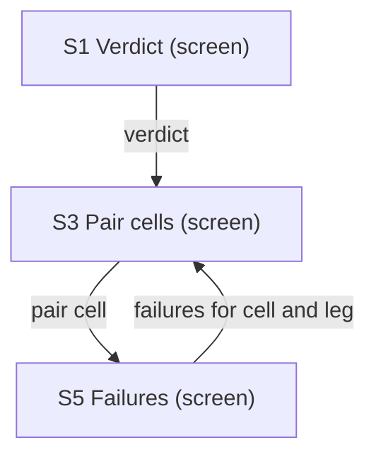
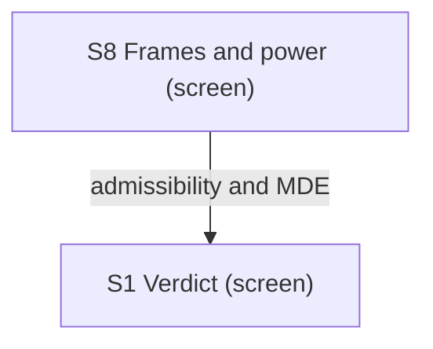
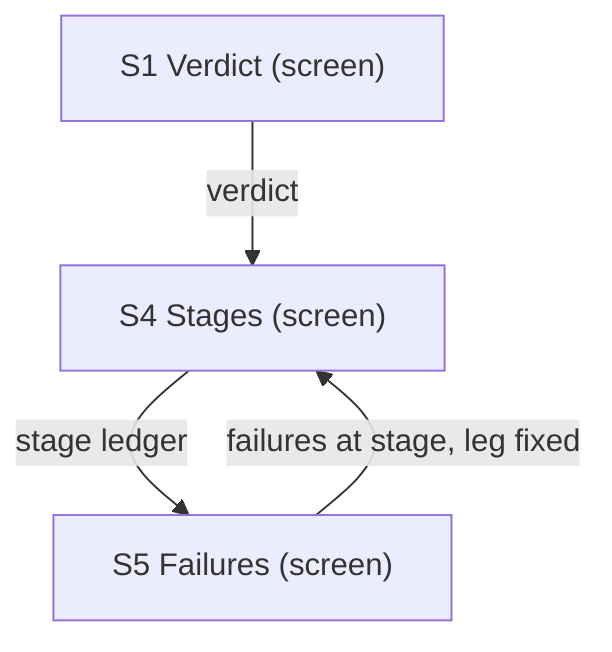
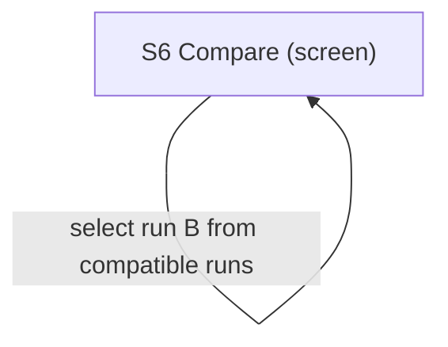
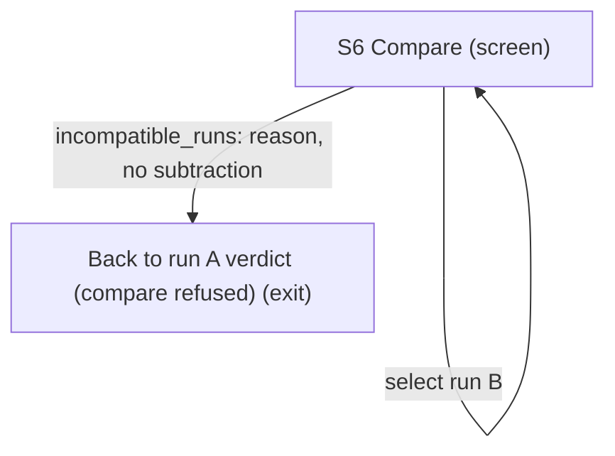
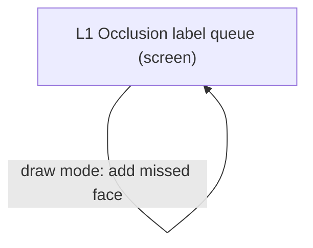

# UX Map — fir-bench

**Product:** `FIRBENCH-1 benchmark tool: static private FIR bench report (S1 to S8) and the occlusion label queue (L1)`
**Source fixture:** `docs/tasks/firdv/FIRBENCH-1-fir-benchmark-tool-task-plan.md#screens-ux-map-seeds-values-are-placeholders`

## Goals
- Every verdict shows its admissibility, n_eff, MDE and interval. A result that is unratified, inconclusive or unresolvable names no winner.
- An operator can find where faces are lost, from the verdict to the stage, then to the failing faces, without losing sort, filter or position.
- Incompatible runs are refused with a reason before any difference is computed.
- The label queue shows the annotator only what labelling from pixels needs, and no internal item role.

## Jobs
- `decide-model-change` — Decide whether a model change is real
- `find-lost-faces` — Find where faces are lost
- `compare-two-runs` — Compare two runs
- `label-occlusion-pixels` — Label occlusion from pixels

## Screens
| id | kind | route | title |
| --- | --- | --- | --- |
| `s1-verdict` | screen | `report/index.html (static file, no network)` | S1 Verdict |
| `s2-curves` | screen | `report/index.html (static file, no network)` | S2 Operating curves |
| `s3-pair-cells` | screen | `report/index.html (static file, no network)` | S3 Pair cells |
| `s4-stages` | screen | `report/index.html (static file, no network)` | S4 Stages |
| `s5-failures` | screen | `report/index.html (static file, no network)` | S5 Failures |
| `s6-compare` | screen | `report/index.html (static file, no network)` | S6 Compare |
| `s7-clusters` | screen | `report/index.html (static file, no network)` | S7 Clusters |
| `s8-frames-power` | screen | `report/index.html (static file, no network)` | S8 Frames and power |
| `l1-label-queue` | screen | `local single-file HTML (private output path)` | L1 Occlusion label queue |
| `exit-compare-refused` | exit | `report/index.html (static file, no network)` | Back to run A verdict (compare refused) |

## Code references
- `screen:s1-verdict` — `apps/prototype-description-service/scripts/eval_harness/firbench_report.py`
- `screen:s2-curves` — `apps/prototype-description-service/scripts/eval_harness/firbench_report.py`
- `screen:s3-pair-cells` — `apps/prototype-description-service/scripts/eval_harness/firbench_report.py`
- `screen:s4-stages` — `apps/prototype-description-service/scripts/eval_harness/firbench_report.py`
- `screen:s5-failures` — `apps/prototype-description-service/scripts/eval_harness/firbench_report.py`
- `screen:s6-compare` — `apps/prototype-description-service/scripts/eval_harness/firbench_report.py`
- `screen:s7-clusters` — `apps/prototype-description-service/scripts/eval_harness/firbench_report.py`
- `screen:s8-frames-power` — `apps/prototype-description-service/scripts/eval_harness/firbench_report.py`
- `screen:l1-label-queue` — `benchmarks/tools/fir_occ_label_queue.py`
- `screen:exit-compare-refused` — `apps/prototype-description-service/scripts/eval_harness/firbench_report.py`

### S1 Verdict (`s1-verdict`)

```
+------------------------------------------------------------+
| S1 Verdict  [screen]  report/index.html (static file, no \ |
|   network)                                                 |
| Answers whether the model change is real at the primary p\ |
|   oint (FNIR at FPIR 0.01, end to end, misses count). Sho\ |
|   ws the verdict only with its admissibility, n_eff, MDE \ |
|   and interval. Bench states: unratified and inconclusive\ |
|    are degraded; unresolvable_fpir is degraded and its ve\ |
|   rdict reason is primary_fpir_unresolvable. None of them\ |
|    names a winner.                                         |
+------------------------------------------------------------+
| ZONES                                                      |
|   - Verdict line: question, paired difference Δ(B−A) or p\ |
|   er-leg state with its interval, PSU n_eff and deff. sup\ |
|   erior ✓ and non-inferior ✓ name a winner only when rati\ |
|   fied and sealed. inconclusive ○ (degraded) prints INCON\ |
|   CLUSIVE and the InconclusiveReason value verbatim (prim\ |
|   ary_fpir_unresolvable, required_guardrail_unscored, mar\ |
|   gin_unreachable_mde_gt_delta, non_confirmatory_frame or\ |
|    insufficient_independent_psus). unratified ○ (degraded\ |
|   ) prints the numbers and 'unratified: no verdict'. unre\ |
|   solvable_fpir ○ (degraded) prints primary_fpir_unresolv\ |
|   able and names no winner. A hypothesis not reached prin\ |
|   ts 'not evaluated'. Serves VIZ-23, WRIT-81. (status) st\ |
|   ates=[default,degraded,error]                            |
|   - Admissibility line: frame id and tag (diagnostic, dev\ |
|   elopment or confirmatory), frame-inspected flag, n_eff,\ |
|    deff, and MDE per step. Every number carries its frame\ |
|   's tag. Serves VIZ-23. (content) states=[default,empty,\ |
|   error]                                                   |
|   - FNIR at FPIR 0.01 per leg (SF-128, AF-512, and the IF\ |
|    judge row) as a dot-range with its interval and the fr\ |
|   ozen τ. Range frame on the value axis; each leg labelle\ |
|   d directly, not by legend. Serves VIZ-35, VIZ-40. (cont\ |
|   ent) states=[default,empty,error]                        |
|   - Exact-lookup table: per leg FNIR at FPIR 0.01, FPIR m\ |
|   easured with its UCL, frozen τ, and stage counts. Same \ |
|   numbers as the range. Unratified rows show numbers with\ |
|    'unratified: no verdict' (degraded). Serves VIZ-32. (c\ |
|   ontent) states=[default,degraded,empty,error]            |
|   - Guardrail veto table: false names per 1k mentions, wo\ |
|   rst pair-cell FNIR floor, worst cohort FPIR, p95 ms per\ |
|    face. Each row shows its rule (≤ sealed, floor or budg\ |
|   et) and a mark: ✓ pass, ✗ veto, ○ unscored or unresolva\ |
|   ble (cohort n_eff under 3/FPIR). A null or unscored vet\ |
|   o is inconclusive with required_guardrail_unscored (deg\ |
|   raded). Serves INT-22, VIZ-32. (status) states=[default\ |
|   ,degraded,empty,error]                                   |
|   - Tabs: Curves, Pair cells, Stages, Failures, Clusters,\ |
|    Compare, Frames and power. Each tab is a keyboard-reac\ |
|   hable anchor after a skip link. Switching tabs keeps th\ |
|   e run. Serves INT-25. (nav) states=[default]             |
+------------------------------------------------------------+
| ACTIONS                                                    |
|   [PRIMARY] Open pair cells -> s3-pair-cells               |
+------------------------------------------------------------+
| states: default | degraded | empty | error                 |
+------------------------------------------------------------+
```

### S2 Operating curves (`s2-curves`)

```
+------------------------------------------------------------+
| S2 Operating curves  [screen]  report/index.html (static \ |
|   file, no network)                                        |
| FNIR against FPIR on a log scale for each leg, with τ fro\ |
|   zen on calibration folds and the test set read once. Be\ |
|   nch states: unresolvable_fpir is degraded, for the regi\ |
|   on below 3/n_eff; unratified is degraded, with numbers \ |
|   only and no winner.                                      |
+------------------------------------------------------------+
| ZONES                                                      |
|   - Operating curves per leg on a log FPIR axis with a ra\ |
|   nge frame and a direct label on each curve. Points belo\ |
|   w 3/n_eff are shaded (░) and marked ○ unresolvable, and\ |
|    no FNIR claim is drawn inside that region (degraded). \ |
|   A curve with no data reads 'no data' (empty). Serves VI\ |
|   Z-35, VIZ-40, VIZ-27. (content) states=[default,degrade\ |
|   d,empty,error]                                           |
|   - At-τ table: per leg FNIR, FPIR measured with its UCL,\ |
|    false accepts as an integer over non-mated source unit\ |
|   s, and the gallery identity count. Same numbers as the \ |
|   τ marker on the curve. Serves VIZ-32, INT-22. (content)\ |
|    states=[default,degraded,empty,error]                   |
|   - Explore τ is a mode. A banner reads 'exploring τ: not\ |
|   hing is saved'. Dev frames only; sealed frames are read\ |
|   -only. Leaving the mode restores the frozen τ and its v\ |
|   alues. Serves INT-23, INT-21. (form) states=[default,de\ |
|   graded]                                                  |
+------------------------------------------------------------+
| ACTIONS                                                    |
|   [secondary] Explore τ (dev frames only) -> s2-curves     |
+------------------------------------------------------------+
| states: default | degraded | empty | error                 |
+------------------------------------------------------------+
```

### S3 Pair cells (`s3-pair-cells`)

```
+------------------------------------------------------------+
| S3 Pair cells  [screen]  report/index.html (static file, \ |
|   no network)                                              |
| Query by enrolled occluder cell, with FNIR at τ per leg a\ |
|   nd the faces, identities and PSUs in each cell. Bench s\ |
|   tates: unratified shows the cell numbers with 'unratifi\ |
|   ed: no verdict' (degraded). An empty cell is 'collect',\ |
|    not an error.                                           |
+------------------------------------------------------------+
| ZONES                                                      |
|   - Query by enrolled grid: FNIR at τ per leg (SF-128, AF\ |
|   -512) with n faces, identities and PSUs per cell. Real \ |
|   and synthetic occlusion sit in separate panes. A cell w\ |
|   ith fewer than 30 independent units reads 'not scored'.\ |
|    An empty cell reads '○ no data → collect'. Serves EVAL\ |
|   -20, VIZ-32. (content) states=[default,degraded,empty,e\ |
|   rror]                                                    |
|   - Cell to failures for that cell and leg. Returning fro\ |
|   m failures restores this grid with sort, scroll and fil\ |
|   ter kept. Serves INT-25. (nav) states=[default]          |
+------------------------------------------------------------+
| ACTIONS                                                    |
|   [PRIMARY] Open failures for this cell and leg -> s5-fai\ |
|   lures                                                    |
+------------------------------------------------------------+
| states: default | degraded | empty | error                 |
+------------------------------------------------------------+
```

### S4 Stages (`s4-stages`)

```
+------------------------------------------------------------+
| S4 Stages  [screen]  report/index.html (static file, no n\ |
|   etwork)                                                  |
| Where each GT face ended in the end-to-end ledger, per le\ |
|   g, with the joint gaps against native. Rows are SearchS\ |
|   tage values. Bench states: unratified shows the rows an\ |
|   d gaps with 'unratified: no verdict' (degraded). The ju\ |
|   dge row shows no arm deltas.                             |
+------------------------------------------------------------+
| ZONES                                                      |
|   - Stage waterfall as a table, in order: GT faces (exhau\ |
|   stive frame only), detected (IoU ≥ 0.50, one-to-one), a\ |
|   ligned, top-1 correct identity, accepted at τ with the \ |
|   correct name. The fused leg has no unaligned row. Unava\ |
|   ilable arm counts sit in their own arm_availability col\ |
|   umn, never as a stage. Serves VIZ-32, VIZ-23. (content)\ |
|    states=[default,degraded,empty,error]                   |
|   - Joint gaps against native with paired PSU intervals f\ |
|   or gt_crop_redetect and cached_yunet_landmark_replay, o\ |
|   ne row each, with the unavailable face count per arm. N\ |
|   o shares are apportioned: these are joint intervention \ |
|   gaps, not causal effects. Serves VIZ-23, VIZ-32. (conte\ |
|   nt) states=[default,degraded,empty,error]                |
|   - A stage row opens failures filtered to that stage, wi\ |
|   th the leg fixed. Back returns to this ledger. Serves I\ |
|   NT-25. (nav) states=[default]                            |
+------------------------------------------------------------+
| ACTIONS                                                    |
|   [PRIMARY] Open failures for this stage -> s5-failures    |
+------------------------------------------------------------+
| states: default | degraded | empty | error                 |
+------------------------------------------------------------+
```

### S5 Failures (`s5-failures`)

```
+------------------------------------------------------------+
| S5 Failures  [screen]  report/index.html (static file, no\ |
|    network)                                                |
| Failures for one query cell and one leg, with the selecti\ |
|   on pool stated before any face. Stage labels are FaceOu\ |
|   tcome and SearchStage values. Bench states: unratified \ |
|   shows counts with 'unratified: no verdict' (degraded). \ |
|   No failure in the cell is empty, not an error.           |
+------------------------------------------------------------+
| ZONES                                                      |
|   - Selection pool, before any row: reuse the exhaustive \ |
|   frame inventory's overall image count and GT-face count\ |
|   , including existing mated/non-mated face counts and ex\ |
|   plicit unresolved identities. The source pool is fixed \ |
|   independently of detections; background source units ar\ |
|   e counted separately, never as GT faces. Show eligible \ |
|   images/faces after the current frame, sampling arm, que\ |
|   ry/enrolled cell, leg, stage and outcome filters; selec\ |
|   ted distinct images/faces in the displayed rows; and im\ |
|   ages actually shown as crops (0 when crops are off). El\ |
|   igible/selected GT-face counts exclude detector-only ro\ |
|   ws; report detection counts and represented background-\ |
|   unit counts separately. Display the active filters, sor\ |
|   t, offset, limit and omitted counts. Default: all eligi\ |
|   ble failure rows, no hidden cap, stable pseudonymous im\ |
|   age_id then face_id order; any changed sort or limit is\ |
|    disclosed. Missing exhaustive GT reads 'pool not estab\ |
|   lished'; it never implies admissible non-mated N. A sel\ |
|   ection is never shown without its pool. Serves [VIZ-41]\ |
|    Reveal the image-selection pool (Visual Explanations, \ |
|   ch. 1). (content) states=[default,empty,error]           |
|   - Outcome counts table: missed, unaligned, wrong_identi\ |
|   ty, rejected, false_accept. Each count is exact, and a \ |
|   nonzero row is marked ✗. Serves VIZ-32. (content) state\ |
|   s=[default,degraded,empty,error]                         |
|   - Failure table, one row per failing face: SearchStage \ |
|   reached, top-1 identity as a pseudonym, its score again\ |
|   st τ, and its result on each other leg. Each row explic\ |
|   itly identifies its selected image_id and face_id with \ |
|   stable pseudonymous aliases; background detections iden\ |
|   tify their pseudonymous background source unit separate\ |
|   ly. Repeated faces from one image do not inflate the di\ |
|   stinct-image count. Sort and filter controls are kept o\ |
|   n return from pair cells. Only pseudonyms appear. Selec\ |
|   tion identities reconcile with pool-accounting. Serves \ |
|   VIZ-32, INT-25 and [VIZ-41] Reveal the image-selection \ |
|   pool (Visual Explanations, ch. 1). (content) states=[de\ |
|   fault,empty,error]                                       |
|   - Face crop, shown only when the run was written with i\ |
|   nclude_crops. The output stays under benchmarks/private\ |
|   . Without it the zone reads 'crop off' (empty). Each di\ |
|   splayed crop carries the same pseudonymous image_id and\ |
|    face_id as its failure row and links back to pool-acco\ |
|   unting; shown-image counts count distinct images, with \ |
|   selected face/crop counts separate. Serves VIZ-23 and [\ |
|   VIZ-41] Reveal the image-selection pool (Visual Explana\ |
|   tions, ch. 1). (content) states=[default,empty]          |
|   - Back to pair cells or to the stage ledger, whichever \ |
|   opened this view. Sort and filter are kept. Serves INT-\ |
|   25. (nav) states=[default]                               |
+------------------------------------------------------------+
| ACTIONS                                                    |
|   [secondary] Back to pair cells -> s3-pair-cells          |
|   [secondary] Back to stage ledger -> s4-stages            |
+------------------------------------------------------------+
| states: default | degraded | empty | error                 |
+------------------------------------------------------------+
```

### S6 Compare (`s6-compare`)

```
+------------------------------------------------------------+
| S6 Compare  [screen]  report/index.html (static file, no \ |
|   network)                                                 |
| Compares run B with a baseline run A on the same frame. O\ |
|   nly compatible runs can be compared. An incompatible pa\ |
|   ir is refused with its reason and no difference is comp\ |
|   uted. Bench states: incompatible_runs is error (reason \ |
|   shown, no subtraction, exit to run A). unratified is de\ |
|   graded: numbers for A and B, 'unratified: no verdict', \ |
|   never a ▼ winner.                                        |
+------------------------------------------------------------+
| ZONES                                                      |
|   - Compatibility checks: frame, scorer boundary semantic\ |
|   s, OpenCV and ORT versions, leg contracts. Each shows ✓\ |
|    or ✗ with its reason. A changed leg contract is listed\ |
|    as expected or unexpected. The run B picker offers onl\ |
|   y runs that pass these checks. incompatible_runs is err\ |
|   or: the reason is printed and no metric row shows. Serv\ |
|   es INT-22, FORM-11. (status) states=[default,error]      |
|   - Metric table: A, B and Δ with a paired interval, and \ |
|   a moved mark: ▼ better, ▲ worse, ○ no change or unscore\ |
|   d. The worst pair cell appears with its observation-lev\ |
|   el cells beside it, not only the aggregate. Unratified \ |
|   rows show numbers with 'unratified: no verdict' (degrad\ |
|   ed). Serves VIZ-32, EXP-31. (content) states=[default,d\ |
|   egraded,empty,error]                                     |
|   - History sparkline of AF FNIR over dated runs, latest \ |
|   value labelled. It states its baseline, units, window a\ |
|   nd actual dates. Serves VIZ-24. (content) states=[defau\ |
|   lt,empty,error]                                          |
|   - τ spread over the calibration folds and the FNIR rang\ |
|   e each τ gives, shown beside the single frozen τ the ve\ |
|   rdict uses. Serves EXP-30. (content) states=[default,em\ |
|   pty]                                                     |
|   - Refusal reason for incompatible_runs, naming the firs\ |
|   t failing check. The exit to run A's verdict is the onl\ |
|   y way out. Serves INT-24. (status) states=[error]        |
+------------------------------------------------------------+
| ACTIONS                                                    |
|   [PRIMARY] Select run B (compatible runs only) -> s6-com\ |
|   pare                                                     |
|   [secondary] Back to run A verdict -> exit-compare-refus\ |
|   ed                                                       |
+------------------------------------------------------------+
| states: default | degraded | empty | error                 |
+------------------------------------------------------------+
```

### S7 Clusters (`s7-clusters`)

```
+------------------------------------------------------------+
| S7 Clusters  [screen]  report/index.html (static file, no\ |
|    network)                                                |
| Clusters for each leg, in that leg's own space only. The \ |
|   projection is a diagnostic and never a metric map. Benc\ |
|   h states: projection_unavailable is degraded, and the t\ |
|   able alternative stays.                                  |
+------------------------------------------------------------+
| ZONES                                                      |
|   - Per-leg cluster table: pair P/R, B³ P/R, merges, frag\ |
|   ments, unknown-absorbed, order stability. Singletons st\ |
|   ay unassigned. Retained PCA components are shown with a\ |
|    variance-only spectrum and no loadings. Also show S4 B\ |
|   uild 3 chaining_check evidence: N = all eligible held-o\ |
|   ut named-face pairs independently verified as different\ |
|    identities, with usable vectors in this leg; D = those\ |
|    pairs linked by a cluster path; C = the subset linked \ |
|   through a third distinct verified identity. Label D/N '\ |
|   known-different path links' and C/N 'chaining_check', e\ |
|   ach with integer numerator, denominator and rate, plus \ |
|   held-out scope and exclusions. Read S4 clusters.json ev\ |
|   idence, never infer identity from co-assignment. N=0 re\ |
|   ads 'not evaluated: no eligible held-out different-iden\ |
|   tity pairs' (empty), missing evidence reads 'not evalua\ |
|   ted: chaining evidence unavailable', and malformed evid\ |
|   ence is error; none reads zero risk. Select a pair to i\ |
|   nspect its path in neighbour-table. Serves VIZ-32 and [\ |
|   GRPH-18] Never trust the transitive closure of a raw si\ |
|   milarity threshold (Introduction to Information Retriev\ |
|   al, § 17.2). (content) states=[default,empty,error]      |
|   - Average-linkage cosine dendrogram, cut at the product\ |
|   ion distance d = 1 − s, labelled with its cut or 'no pr\ |
|   oduction cut recorded'. The acceptance τ line is labell\ |
|   ed 'acceptance τ (not a cluster cut)' at d = 1 − τ. Dir\ |
|   ect labels. Serves VIZ-40. (content) states=[default,em\ |
|   pty,error]                                               |
|   - UMAP diagnostic projection, captioned 'diagnostic pro\ |
|   jection · distances not meaningful', with n_neighbors, \ |
|   min_dist and seed beside it. Claims are limited to loca\ |
|   l contiguity: no gap, density or axis claims. If the pr\ |
|   ojection cannot be drawn, projection_unavailable is deg\ |
|   raded and the neighbour table stays. Serves VIZ-18, VIZ\ |
|   -19. (content) states=[default,degraded,empty,error]     |
|   - Table alternative: select a face to list its nearest \ |
|   neighbours in the original leg space, with their scores\ |
|   . Distances come from that space, not from the projecti\ |
|   on. Inspect chaining pair opens a keyboard-reachable di\ |
|   sclosure here: pseudonymous endpoint image_id/face_id a\ |
|   nd independently verified different identity aliases, h\ |
|   eld-out fold, pair eligibility, and ordered path face/i\ |
|   mage/identity aliases with each edge score, production \ |
|   s threshold and link rule from S4. Mark the third ident\ |
|   ity explicitly; direct links are distinguished from thi\ |
|   rd-identity chaining. No real IDs, names or pixels. Clo\ |
|   sing the disclosure restores the selected pair, leg, so\ |
|   rt and position. This evidence remains available when p\ |
|   rojection_unavailable. Serves VIZ-18, VIZ-32, [INT-25] \ |
|   Map the handoffs (Microinteractions, ch. 6) and [GRPH-1\ |
|   8] Never trust the transitive closure of a raw similari\ |
|   ty threshold (Introduction to Information Retrieval, § \ |
|   17.2). (content) states=[default,empty,error]            |
+------------------------------------------------------------+
| ACTIONS                                                    |
|   [PRIMARY] Show nearest neighbours -> s7-clusters         |
|   [secondary] Inspect chaining pair and path -> s7-cluste\ |
|   rs                                                       |
+------------------------------------------------------------+
| states: default | degraded | empty | error                 |
+------------------------------------------------------------+
```

### S8 Frames and power (`s8-frames-power`)

```
+------------------------------------------------------------+
| S8 Frames and power  [screen]  report/index.html (static \ |
|   file, no network)                                        |
| What each frame can claim: units, identities, PSUs, deff,\ |
|    n_eff, admissibility tag and MDE per step. Shows decis\ |
|   ion-manifest status without a seal value unless the man\ |
|   ifest is ratified. Bench states: unratified is degraded\ |
|    and reads 'unratified: no seal shown'.                  |
+------------------------------------------------------------+
| ZONES                                                      |
|   - Frame table, one row per frame: units, identities, PS\ |
|   Us, deff, n_eff, admissible-as tag (diagnostic, develop\ |
|   ment or confirmatory), MDE per step. deff uses planning\ |
|    ICC 0.10 as delegated project policy, not observed ICC\ |
|   ; show sensitivity at 0.05/0.10/0.20. Show the global f\ |
|   loor of 50 independent PSUs separately from the pair-ce\ |
|   ll floor of 30; check the global floor before FPIR inte\ |
|   rvals. Floors do not establish power, MDE adequacy, res\ |
|   olvability or exhaustive GT. Golden-150 is marked verif\ |
|   ication-biased. A frame not yet acquired reads 'not acq\ |
|   uired' and claims nothing. Serves VIZ-32, VIZ-23. (cont\ |
|   ent) states=[default,empty,error]                        |
|   - Decision manifest status: ratified and sealed (date, \ |
|   short hash, count of dated disconfirmers), or unratifie\ |
|   d (degraded, 'unratified: no seal shown'). Delegated pr\ |
|   oject policy is declared before outcomes: k=5 identity/\ |
|   PSU-disjoint rotating folds (seed 2406466110), gallery \ |
|   seed 2468935812, paired cluster percentile bootstrap n_\ |
|   boot=10000 (seed 2429382368), label queue seed 33688039\ |
|   4. Policy is not ratification; measured frame/template \ |
|   hashes, actual timestamps, genuine observation referenc\ |
|   es and signatures stay unresolved until supplied. Queue\ |
|    tooling loads delegated gold/repeat shares 0.10/0.10, \ |
|   repeat agreement 0.90, Cohen kappa 0.80, independent-go\ |
|   ld accuracy 0.90, support >=20 gold decisions per annot\ |
|   ator and >=20 repeats per evaluated field; these remain\ |
|    hidden from L1. These are project QC defaults, not acc\ |
|   uracy guarantees; real imports require genuine observat\ |
|   ion reference and support. Serves INT-21. (status) stat\ |
|   es=[default,degraded,empty,error]                        |
+------------------------------------------------------------+
| ACTIONS                                                    |
|   [PRIMARY] Open verdict for this frame -> s1-verdict      |
+------------------------------------------------------------+
| states: default | degraded | empty | error                 |
+------------------------------------------------------------+
```

### L1 Occlusion label queue (`l1-label-queue`)

```
+------------------------------------------------------------+
| L1 Occlusion label queue  [screen]  local single-file HTM\ |
|   L (private output path)                                  |
| Single-file HTML that the operator labels from pixels, on\ |
|   e face box at a time. Captions, detector boxes and mode\ |
|   l names are never shown. The annotator sees position an\ |
|   d progress only. skipped_nonresponse is the only item s\ |
|   tate the annotator sees. Other item roles are internal \ |
|   and never rendered on this screen.                       |
+------------------------------------------------------------+
| ZONES                                                      |
|   - Full image with no detector boxes and no caption. Con\ |
|   firmed boxes appear only when the queue entry carries s\ |
|   how_confirmed_boxes. The header shows position and prog\ |
|   ress only. empty: the queue has no items. error: the im\ |
|   age fails to embed, and the item stays in the queue. Se\ |
|   rves FORM-11. (queue) states=[default,empty,error]       |
|   - Per face: a box mark ✓, and an occluder set chosen fr\ |
|   om m mask, s sunglasses, h hand, o object, x mixed, n n\ |
|   one, ? can't tell. Region controls for eyes, nose and m\ |
|   outh cycle through visible, occluded, out-of-frame and \ |
|   uncertain. Only these values can be entered. Every cont\ |
|   rol has a visible label and Tab reach. Serves FORM-11. \ |
|   (form) states=[default,error]                            |
|   - Add missed face is a mode. a enters it with a visible\ |
|    'drawing a box' banner. Enter commits the box. Esc can\ |
|   cels the draw and restores the item. u marks an unknown\ |
|    person in the same way. Serves INT-23. (form) states=[\ |
|   default]                                                 |
|   - Enter next, Esc undo, skip recorded as nonresponse. A\ |
|    skipped item shows ○ skipped, the only item state the \ |
|   annotator sees, and stays in the export. The loop ends \ |
|   at the last item or on an explicit export. Progress rea\ |
|   ds 'done n · skipped m'. Serves INT-24, PERC-10. (nav) \ |
|   states=[default]                                         |
|   - Export JSON writes the labelled items to the private \ |
|   output path. Nothing is imported here. A failed export \ |
|   keeps every label, shows the error and offers a retry. \ |
|   Serves INT-25. (status) states=[default,error]           |
+------------------------------------------------------------+
| ACTIONS                                                    |
|   [PRIMARY] Set occluder -> l1-label-queue                 |
|   [secondary] Add missed face -> l1-label-queue            |
|   [secondary] Export JSON -> l1-label-queue                |
|   [secondary] Next (Enter) -> l1-label-queue               |
|   [tertiary] Mark unknown person -> l1-label-queue         |
|   [tertiary] Skip (recorded as nonresponse) -> l1-label-q\ |
|   ueue                                                     |
|   [tertiary] Undo (Esc) -> l1-label-queue                  |
+------------------------------------------------------------+
| states: default | empty | error                            |
+------------------------------------------------------------+
```

### Back to run A verdict (compare refused) (`exit-compare-refused`)

```
+------------------------------------------------------------+
| Back to run A verdict (compare refused)  [exit]  report/i\ |
|   ndex.html (static file, no network)                      |
| The only exit from incompatible_runs on S6. Opens run A's\ |
|    S1 verdict, with no comparison shown. Intentional stat\ |
|   ic exit marker, with no independent content or asynchro\ |
|   nous work. S6 error/refusal-reason owns the refusal; ba\ |
|   ck-to-run-a hands off to s1-verdict, whose states own t\ |
|   he destination. It has no separate loading, empty or er\ |
|   ror screen. [RLSE-04] Undesigned state is a bug (practi\ |
|   ce label): screen-state trigger does not apply to this \ |
|   marker.                                                  |
+------------------------------------------------------------+
```

## Flows
### verdict → pair cell → failures → back (sort and filter kept, INT-25) (`verdict-to-failures`)

```
flow: verdict → pair cell → failures → back (sort and filter \
  kept, INT-25) (verdict-to-failures) job=decide-model-change
  1. S1 Verdict [s1-verdict]
     --verdict-->
  2. S3 Pair cells [s3-pair-cells]
     --pair cell-->
  3. S5 Failures [s5-failures]
     --failures for cell and leg-->
  4. S3 Pair cells [s3-pair-cells] (visit 2)
```



### frame inspected before the verdict; development evidence is not confirmatory (`frame-before-verdict`)

```
flow: frame inspected before the verdict; development evidenc\
  e is not confirmatory (frame-before-verdict) job=decide-mod\
  el-change
  1. S8 Frames and power [s8-frames-power]
     --admissibility and MDE-->
  2. S1 Verdict [s1-verdict]
```



### verdict → stage ledger → failures at the stage → back to ledger (`lost-faces`)

```
flow: verdict → stage ledger → failures at the stage → back t\
  o ledger (lost-faces) job=find-lost-faces
  1. S1 Verdict [s1-verdict]
     --verdict-->
  2. S4 Stages [s4-stages]
     --stage ledger-->
  3. S5 Failures [s5-failures]
     --failures at stage, leg fixed-->
  4. S4 Stages [s4-stages] (visit 2)
```



### compatible runs compare to a Δ with its interval (`compare-compatible`)

```
flow: compatible runs compare to a Δ with its interval (compa\
  re-compatible) job=compare-two-runs
  1. S6 Compare [s6-compare]
     --select run B from compatible runs-->
  2. S6 Compare [s6-compare] (visit 2)
```



### compare refused → reason → exit (INT-24) (`compare-refused-exit`)

```
flow: compare refused → reason → exit (INT-24) (compare-refus\
  ed-exit) job=compare-two-runs
  1. S6 Compare [s6-compare]
     --select run B-->
  2. S6 Compare [s6-compare] (visit 2)
     --incompatible_runs: reason, no subtraction-->
  3. Back to run A verdict (compare refused) [exit-compare-re\
  fused]
```



### label → add missed face → next (`label-add-missed-face`)

```
flow: label → add missed face → next (label-add-missed-face) \
  job=label-occlusion-pixels
  1. L1 Occlusion label queue [l1-label-queue]
     --item: occluder and regions-->
  2. L1 Occlusion label queue [l1-label-queue] (visit 2)
     --draw mode: add missed face-->
  3. L1 Occlusion label queue [l1-label-queue] (visit 3)
```



### skip is recorded as nonresponse, never dropped (`label-skip`)

```
flow: skip is recorded as nonresponse, never dropped (label-s\
  kip) job=label-occlusion-pixels
  1. L1 Occlusion label queue [l1-label-queue]
     --item-->
  2. L1 Occlusion label queue [l1-label-queue] (visit 2)
     --skipped (nonresponse)-->
  3. L1 Occlusion label queue [l1-label-queue] (visit 3)
```

```mermaid
flowchart TD
  %% flow: skip is recorded as nonresponse, never dropped job=label-occlusion-pixels
  n_l1_label_queue["L1 Occlusion label queue (screen)"]
  n_l1_label_queue -->|item| n_l1_label_queue
  n_l1_label_queue -->|skipped (nonresponse)| n_l1_label_queue
```

## Not doing
- A winner shown while a decision is unratified, inconclusive or unresolvable
- Confirmatory-frame acquisition, or any confirmatory-claim UI
- Label import from any screen; import stays a CLI step
- Real names, real pixels or private file contents in the map or its render
- A tenth screen; the nine seeds are the whole inventory
- Hand-written Markdown; the rendered .md comes from the canvas CLI
