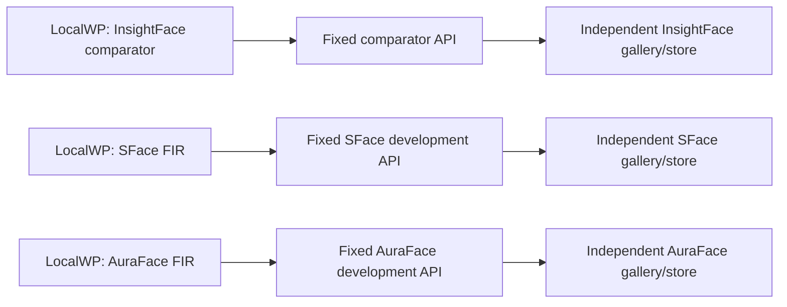

# Development-only FIR execution in the WordPress plugin

Date: 2026-10-23. Canon **v0.26.2**, resolved to `/Users/daniel/Development/heuristics-canon-v0.26.2`; all 53 manifest-listed SHA-256 digests verified. This assessment changes the execution UI, not model selection or the experiment's outcome.

## Decision

Keep the existing investigation architecture: **one LocalWP instance → one configured development API → one fixed model space and isolated recognition store/gallery**. Each instance runs its configured FIR pipeline. The UI provides **Developer tools → Run FIR pipeline (CPU)** beside the selected media. Its API target is read-only context. It never offers a model selector or changes the meaning of Describe.

Isolation includes the WordPress database and its face/cluster projections, the remote vector database, enrollment, caches/provenance and credentials/tenant scope. The source photos and independently assigned ground-truth identity labels may be common experiment inputs; embeddings, centroids, database/cluster identifiers and recognition outcomes are produced independently for each leg. Join comparisons by the frozen corpus manifest or image hash, not WordPress attachment IDs or model-generated cluster IDs.

This is the appropriate design for the investigation. It preserves each model's own weights, alignment/preprocessing, normalization and metric contract ([EMB-01], **One embedding space per comparison**, _Foundations of Vector Retrieval_, ch. 1). Equal vector dimensions do not establish compatible spaces: InsightFace 512D and AuraFace 512D remain separate. A checkpoint or preprocessing change within an instance also needs fresh/versioned enrollment, rather than retaining incompatible vectors under the old identity.

## Existing research and semantic prior art

The operator's [FIR report](../../../benchmarks/reports/fir-embeddings-dims-detectors-qa-20260723.html) retains its July filename but currently identifies itself as **v14, updated 2026-10-23**. Its [v12 model-space contract](../../../benchmarks/reports/fir-embeddings-dims-detectors-qa-20260723.html#v12-space), [activation gates](../../../benchmarks/reports/fir-embeddings-dims-detectors-qa-20260723.html#v12-gates) and [rollback](../../../benchmarks/reports/fir-embeddings-dims-detectors-qa-20260723.html#v12-rollback) explicitly require separate SFace 128D and AuraFace 512D stores, enrollment from source pixels, and no centroid import or implicit cross-model fallback. The report treats InsightFace as a third space. Dated activation statements are historical evidence, not a current deployment census. This UI neither activates a model nor certifies readiness.

WorkBay semantic retrieval returned `status=ok_with_results`, `embeddings_mode=verified`, model `gte-base-en-v1.5`. Cosine neighbors were treated as retrieval leads and corroborated through the underlying decisions and source files:

| Retrieved prior work                                           | Corroborated relevance                                                                                                                                             |
| -------------------------------------------------------------- | ------------------------------------------------------------------------------------------------------------------------------------------------------------------ |
| `FIR512-2`, documentation/recovered-evidence decisions         | Separate SFace 128D/AuraFace 512D stores, measured implementation parity distinguished from deployment and quality qualification.                                  |
| `GTMBURST-1`, “Latest operator reopens in-house model choice…” | Model choice remains undecided; compare isolated candidates and re-extract pixels. Historical implementation preference is not a measured winner.                  |
| `DEMOLAND-1`, finding `11311`                                  | The operative PHP endpoint constants can differ from stale standalone environment values. Gate the resolved effective target, honoring constant/filter precedence. |
| `DEMO-UX-1`, finding `10018`                                   | Explain the recognition task in terms of finding faces in photos. Keep the command distinct from description generation.                                           |
| `FIRBENCH-1`, finding `18875`                                  | Separate scored images, detection misses and detector-only boxes; keep denominators and provenance visible in actual benchmark reports.                            |

Current code corroborates the historical recognition-only workflow: `scanFaces` submits to `/recognition/analyze`; `AnalyzeMediaService` forwards only recognition analysis (multipart by default); `JobPipelineContext` owns scan progress, clustering/projection, cancellation and bounded waiting. Describe is a distinct subsequent callback in `MediaSelection`. The new command reuses the first path and never installs that Describe callback.

## UX alternatives and evidence

| Option                                                                 | Evaluation                                                                                                                                                                                                                             |
| ---------------------------------------------------------------------- | -------------------------------------------------------------------------------------------------------------------------------------------------------------------------------------------------------------------------------------- |
| **One-shot secondary command in Developer tools beside selection**     | Selected. Preserves shared media selection and nearby feedback without creating a remembered processing mode. A native disclosure provides a keyboard-accessible entry; the button stays focusable with an associated disabled reason. |
| Persistent recognition/description mode or a relabeled Describe button | Reject. The next familiar click would depend on remembered mode state. [INT-23], **Limit and mark modes**, _Microinteractions_, ch. 5, supports a one-command exception and restoration of prior context.                              |
| Model dropdown in the run UI                                           | Reject. The operator already selected one fixed model through each instance's API settings. A request-level choice would misrepresent the isolation boundary.                                                                          |
| Separate top-level FIR page                                            | Reject for this bounded action. It would duplicate selection and move execution away from the images. [NAV-19], **Keep related work adjacent**, _About Face_, ch. 12.                                                                  |

The original and distilled corpus were both inspected:

- _About Face_, ch. 11 “Differentiate between command and configuration,” printed pp. 262–263, and ch. 12 “Navigation between panes,” pp. 274–275: separate invocation from configuration, keep supporting work adjacent, and avoid crowding the primary task. Corpus: `distilled/interaction/about-face-4e-cooper.md` and `literature/extracted/interaction/about-face-4e-cooper.txt` in `/Users/daniel/Development/heuristics-canon-research`.
- _Microinteractions_, ch. 5 “Modes” and “Spring-Loaded and One-off Modes”: avoid unnecessary mode state, show entry/exit and restore prior context. Both `distilled/interaction/microinteractions-saffer.md` and the corresponding extracted original were read.
- Bruch, _Foundations of Vector Retrieval_, ch. 1, Definition 1.1: a query, collection and distance function define one retrieval problem. The local original and `distilled/ml-systems/bruch-vector-retrieval.md` were checked. Independent model spaces are a design application of that contract, not a claim that Bruch prescribes LocalWP deployments.
- Maze et al., _IARPA Janus Benchmark-C_, §2.3.4: detector misses count in end-to-end identification; extra detector false alarms must not improve the identification rate by inflating its denominator. Both `distilled/ml-systems/janus-benchmark-c.md` and `literature/extracted/ml-systems/janus-benchmark-c.txt` were read.
- Zeng et al., _A survey of face recognition techniques under occlusion_, §§I–II, IV, VI–VII: detection is a prerequisite; real occlusions and partial faces require explicit evaluation; spatial visibility and corresponding face parts matter. Both `distilled/ml-systems/occluded-face-recognition-survey.md` and the corresponding extracted original were read.

These are source-backed design judgments, not a usability study. No new inference run or model-quality measurement was performed. Canon principle 10 was checked against the server authorization boundary; principle 9 against the distinction between an endpoint label and recorded model/runtime provenance. Matching reasoning cards were inspected. `measurement-integrity` applies to the proposed independent population/denominator; the adaptation, runtime-fork, caption-generation and licensing cards have no new trigger in this UI change.

## Environment and execution contract

The server returns the read-only `development_face_scan_available` capability only for an administrator when WordPress reports `local` or `development`, the recognition source is the hosted service, and the **effective** URL is one of the three canonical development origins already mapped by `scripts/deploy/recognition-service.sh`:

| Development target                    | Purpose in the existing topology |
| ------------------------------------- | -------------------------------- |
| `https://dev.api.altcontext.com`      | Comparator development stack     |
| `https://fir.dev.api.altcontext.com`  | SFace FIR development stack      |
| `https://auraface.dev.altcontext.com` | AuraFace FIR development stack   |

A trailing slash is accepted. Production/demo/staging sites or targets, laptop APIs, unknown hosts, userinfo, alternate paths/ports and dev-looking suffixes are refused. The capability describes configured routing; it does not attest a live model revision. No deployment URLs, models, galleries, credentials or GPU controls are changed by this task.

Each explicit FIR request carries `development_faces_only: true`. PHP rechecks capability and environment **before** media processing or upstream I/O. Malformed markers are rejected. The normal recognition-enabled policy still applies; ordinary recognition used by Describe retains its existing route. [WP-03], **Gate admin with capabilities**, _WordPress Security APIs_, §capabilities, requires this server enforcement rather than relying on UI visibility.

The UI stays hidden for unknown/failed Settings responses and for anything other than literal capability `true`. Within development, empty selection, offline state, recognition off and an overlapping active operation hold the action with an explanation. A pending FIR run holds Describe, has visible status and uses the existing scan activity/recovery. Cancel becomes available once there are accepted job IDs. Completion says to inspect per-image outcomes; it does not claim every image succeeded or every face was detected. A rejected submission remains an error and never becomes an empty successful run. [INT-08], **Wait state and cancel**, _Designing Interfaces, 3rd ed._; [A11Y-21], **Announce status (4.1.3)**, _Web Content Accessibility Guidelines 2.2_, SC 4.1.3; [INT-22], **Explain the result**, _Microinteractions_, ch. 4.

The in-house FIR ORT session explicitly selects `CPUExecutionProvider`. Analysis does not enqueue description generation or GPU lifecycle intent. The comparator retains its API's fixed provider configuration; this command does not reconfigure models or execution providers.

## What decides AuraFace versus SFace

Use the same independently labeled source images and independently defined search population on each isolated stack. Enroll each gallery from pixels, calibrate each complete pipeline on validation data, freeze thresholds before held-out scoring, and preserve failures/abstentions. Keep real masks, sunglasses, hands/phones, partial faces, tiny faces, low light and clean faces as reported strata.

Report detection recall and false positives separately; report end-to-end identification with missed detections counted as misses ([EVAL-16], **Upstream failure counts against the end-to-end metric**, _IARPA Janus Benchmark-C_, § 2.3.4). Use a fixed independently defined non-mated population and false-positive operating target rather than allowing extra detector alarms to dilute the rate ([EVAL-19], **Do not let detector alarms dilute FPIR**, same source/locator). Retain model/weight, preprocessing, threshold, source-image and numeric-runtime provenance ([PROV-01], **Every output walks back to its evidence**, _Model Cards_ + _AI Engineering_).

The report's earlier Golden-150 detector comparison was withdrawn as recall evidence because its ground truth was predominantly generated by buffalo itself. Do not reuse that apparent detector gap as proof of occlusion performance. Manual face review supports diagnosis; the existing FIR benchmark harness and sealed comparison protocol support a model decision. More dimensions, successful enrollment or an attractive scatter plot do not choose the winner.

## Map and verification

The [focused UX map](../../../apps/prototype-wp-alt-context/docs/ux-maps/dev-face-recognition.uxmap.json) and its [rendered screen/flow inventory](../../../apps/prototype-wp-alt-context/docs/ux-maps/dev-face-recognition.md) cover selection/disclosure, run activity, empty/error/recovery and existing face review. The normal Describe action remains the media-selection primary; the FIR command is secondary.

Verification results are recorded in WorkBay under `DEVFIR-UX-1`. The advisory map tool uses `uxmap-critique/1` (its canary reports `canon_revision=resume-20260912`); this assessment uses the digest-verified Canon v0.26.2 rows above as current authority. An intentionally incomplete temporary map produced an RLSE-04 finding, confirming the engine was active. This is source/unit validation, not live VM model qualification or a comparative benchmark.

### Validation results

| Check                                                                | Result                                                                                                                                                                                                                                  |
| -------------------------------------------------------------------- | --------------------------------------------------------------------------------------------------------------------------------------------------------------------------------------------------------------------------------------- |
| Focused FIR UI, request batching and pipeline tests                  | **44 passed** across three Vitest files. Covers no description submission, per-batch marker propagation, no duplicate FIR/Describe submissions, rejected runs, strict capability visibility and existing waiter cancellation/deadlines. |
| Analysis controller, transport, endpoint resolver and Settings tests | **255 passed, 1,157 assertions**. Includes 19 explicit development-boundary/local-WP/allowed-target cases (73 assertions). DNS and HTTP are fixtures; no live API work.                                                                 |
| TypeScript                                                           | Passed.                                                                                                                                                                                                                                 |
| ESLint on changed production TypeScript files                        | Passed.                                                                                                                                                                                                                                 |
| PHP coding standards on the three changed production PHP files       | Passed.                                                                                                                                                                                                                                 |
| Production Vite build                                                | Passed; reports the existing large-chunk warning.                                                                                                                                                                                       |
| Focused UX-map validation/critique                                   | Valid; zero findings; all code references resolve. Canary triggers RLSE-04.                                                                                                                                                             |
| Whitespace diff check                                                | Passed.                                                                                                                                                                                                                                 |
| Repository-wide architecture gate                                    | Fails on both unchanged HEAD and the working tree with **64 errors / 45 warnings**. Reports match after numeric line/count normalization; this change adds no new finding.                                                              |
| Existing `uxmap-one-primary` gate                                    | Existing HEAD mismatch: `workbench-2pane-shell` declares `act-bulk-describe`, while the test's layout-host exemption requires null. The new focused map is not part of that owned-map list.                                             |

The broader nine-file Vitest pass initially reported 144 passing tests, the now-corrected async FIR test synchronization issue, and that pre-existing map mismatch. The final focused pass above is green. Model accuracy, VM readiness and real LocalWP browser acceptance were not measured by these unit/source checks.
