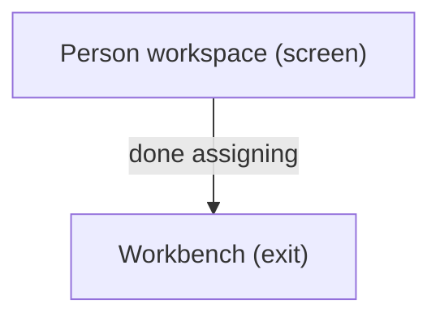
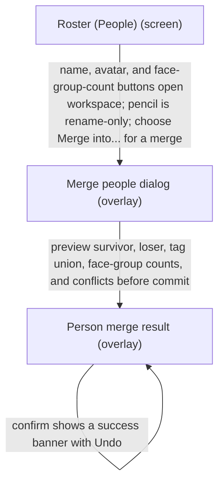

# UX Map — roster-people-audit-10033-proposal

**Product:** `prototype-wp-alt-context`
**Source fixture:** `apps/prototype-wp-alt-context/js/admin/pages/RosterPage.tsx`

## Goals
- NEXT-WAVE PROPOSAL: corrected audit map; native critique receipt and independent implementation review required. Source baseline7df0.0.40; no live-state acceptance claimed.
- Four ACX primary submenu homes are distinct: Overview orients; Review Queue owns recognizing people and reviewing descriptions beside images; People manages person identity and associated photos; Settings configures the service. Description Runs is removed in0.0.40; the legacy URL redirects to Workbench.
- One primary action per screen (NAV-01), reachable from zero state (rg-003); other CTAs are secondary.
- Operator manages named people and person workspace without losing roster place
- Name, avatar, and face-group-count buttons open the person workspace; the pencil is the only rename entry point.
- Preview a person merge with survivor, loser, tag union, face-group counts, and conflicts before confirming; keep the success banner reversible with Undo.
- Decompose Roster UI tasks from screens/zones/states/flows (people-first surface; clusters tab retired)

## Jobs
- `job-manage-person` — Open person workspace / manage entry
- `job-cluster-review` — Review face-group deep-link (shim)
- `job-merge-people` — Preview, confirm, and undo a person merge

## Screens
| id | kind | route | title |
| --- | --- | --- | --- |
| `roster-shell` | screen | `#/roster` | Roster (People) |
| `roster-person-workspace` | screen | `#/roster?person=` | Person workspace |
| `roster-cluster-drawer` | overlay | `#/roster?cluster=` | Face-group drawer (deep-link shim) |
| `roster-face-lightbox` | overlay | `#/roster?person= (in-panel dialog; no dedicated route)` | Face evidence lightbox |
| `exit-workbench` | exit | `#/workbench` | Workbench |
| `roster-person-merge-dialog` | overlay | `#/roster?person=&mergeInto=` | Merge people dialog |
| `roster-person-merge-success` | overlay | `#/roster?person=&mergeResult=` | Person merge result |

## Code references
- `screen:roster-shell` — `apps/prototype-wp-alt-context/js/admin/pages/RosterPage.tsx`
- `screen:roster-person-workspace` — `apps/prototype-wp-alt-context/js/admin/pages/roster/PersonWorkspacePanel.tsx`
- `screen:roster-cluster-drawer` — `apps/prototype-wp-alt-context/js/admin/pages/roster/ClusterDrawerPanel.tsx`
- `screen:roster-face-lightbox` — `apps/prototype-wp-alt-context/js/components/ui/FaceLightbox.tsx`
- `screen:exit-workbench` — `apps/prototype-wp-alt-context/js/admin/pages/WorkbenchPage.tsx`
- `screen:roster-person-merge-dialog` — `apps/prototype-wp-alt-context/js/admin/pages/roster/RosterEntriesTable.tsx`
- `screen:roster-person-merge-success` — `apps/prototype-wp-alt-context/js/admin/pages/roster/RosterEntriesTable.tsx`

### Roster (People) (`roster-shell`)

```
+------------------------------------------------------------+
| Roster (People)  [screen]  #/roster                        |
| People directory with legible evidence previews (prototyp\ |
|   e64–80px, verify density), explicit View photos/count b\ |
|   y stable person ID, distinct Edit person command.        |
+------------------------------------------------------------+
| ZONES                                                      |
|   - Roster entries table (name, avatar, and face-group-co\ |
|   unt buttons open person workspace; rename is pencil-onl\ |
|   y; Merge into... is a row action) (content) states=[def\ |
|   ault,loading,empty,error]                                |
|   - Unnamed faces CTA → Workbench review queue (content) \ |
|   states=[default,loading,empty]                           |
|   - Projection status gate notices (status) states=[defau\ |
|   lt,loading,error,degraded]                               |
|   - Person workspace host (other) states=[default,empty]   |
|   - Face-group drawer host (cluster= shim) (other) states\ |
|   =[default,empty,loading,error]                           |
+------------------------------------------------------------+
| ACTIONS                                                    |
|   [PRIMARY] Add Person -> roster-shell                     |
|   [secondary] Go to Workbench -> exit-workbench            |
|   [secondary] Open face-group drawer -> roster-cluster-dr\ |
|   awer                                                     |
|   [secondary] Open person workspace -> roster-person-work\ |
|   space                                                    |
|   [secondary] Open person workspace from avatar button ->\ |
|    roster-person-workspace                                 |
|   [secondary] Open person workspace from face-group-count\ |
|    button -> roster-person-workspace                       |
|   [secondary] Open person workspace from name button -> r\ |
|   oster-person-workspace                                   |
|   [secondary] Merge into... -> roster-person-merge-dialog  |
|   [secondary] Rename person via pencil -> roster-person-w\ |
|   orkspace (costly,preview)                                |
+------------------------------------------------------------+
| states: default | loading | empty | error | degraded | fi\ |
|   rst_time                                                 |
+------------------------------------------------------------+
```

### Person workspace (`roster-person-workspace`)

```
+------------------------------------------------------------+
| Person workspace  [screen]  #/roster?person=               |
| Reuse existing person workspace and paginated Photos coll\ |
|   ection; larger header evidence; distinguish rename pers\ |
|   on from correcting/reassigning one association. Show re\ |
|   ceipt/pending/undo with authoritative correction after \ |
|   reload.                                                  |
+------------------------------------------------------------+
| ZONES                                                      |
|   - Person header (content) states=[default,loading]       |
|   - Linked faces (ai_review) states=[default,loading,empt\ |
|   y,error,degraded]                                        |
|   - Cluster evidence thumbnails (cropped face crop; raw m\ |
|   edia fallback for uncroppable bbox; labelled visible no\ |
|   -image state) (ai_review) states=[default,loading,empty\ |
|   ,error,degraded]                                         |
|   - Save / assign / open queue (form) states=[default,loa\ |
|   ding,empty,error,degraded]                               |
+------------------------------------------------------------+
| ACTIONS                                                    |
|   [PRIMARY] Save person changes -> roster-person-workspac\ |
|   e (costly,preview)                                       |
|   [secondary] Open evidence lightbox -> roster-face-light\ |
|   box                                                      |
+------------------------------------------------------------+
| states: default | loading | empty | error | degraded       |
+------------------------------------------------------------+
```

### Face-group drawer (deep-link shim) (`roster-cluster-drawer`)

```
+------------------------------------------------------------+
| Face-group drawer (deep-link shim)  [overlay]  #/roster?c\ |
|   luster=                                                  |
| Person-first face-group sample drawer (clusters tab retir\ |
|   ed; cluster= shim opens drawer)                          |
+------------------------------------------------------------+
| ZONES                                                      |
|   - Sample faces (forced_choice) states=[default,loading,\ |
|   empty,error]                                             |
|   - Assign / dismiss drawer (form) states=[default,loadin\ |
|   g,empty,error]                                           |
+------------------------------------------------------------+
| ACTIONS                                                    |
|   [PRIMARY] Assign face group to person -> person (costly\ |
|   ,preview)                                                |
+------------------------------------------------------------+
| states: default | loading | empty | error                  |
+------------------------------------------------------------+
```

### Face evidence lightbox (`roster-face-lightbox`)

```
+------------------------------------------------------------+
| Face evidence lightbox  [overlay]  #/roster?person= (in-p\ |
|   anel dialog; no dedicated route)                         |
| Full-size face/media evidence dialog opened from workspac\ |
|   e evidence thumbnails; closes via dialog affordance and\ |
|    resets when the selected person identity changes        |
+------------------------------------------------------------+
| ZONES                                                      |
|   - Enlarged evidence media with accessible ordinal name \ |
|   (ai_review) states=[default,error]                       |
|   - Close affordance (form) states=[default,error]         |
+------------------------------------------------------------+
| ACTIONS                                                    |
|   [PRIMARY] Close lightbox -> roster-person-workspace      |
+------------------------------------------------------------+
| states: default | error                                    |
+------------------------------------------------------------+
```

### Workbench (`exit-workbench`)

```
+------------------------------------------------------------+
| Workbench  [exit]  #/workbench                             |
| Return to media queue / scan after assignment              |
+------------------------------------------------------------+
| ZONES                                                      |
|   - Workbench entry (nav) states=[default]                 |
+------------------------------------------------------------+
| states: default | loading | error                          |
+------------------------------------------------------------+
```

### Merge people dialog (`roster-person-merge-dialog`)

```
+------------------------------------------------------------+
| Merge people dialog  [overlay]  #/roster?person=&mergeInt\ |
|   o=                                                       |
| PersonMergeDialog previews the survivor, loser, tag union\ |
|   , face-group counts, and conflicts before the operator \ |
|   confirms a reversible merge. Action lifecycle states: r\ |
|   eady, preview_ready, conflict, committing.               |
+------------------------------------------------------------+
| ZONES                                                      |
|   - Merge preview (survivor, loser, tag union, face-group\ |
|    counts, and conflicts) The selected survivor and loser\ |
|    are the two compared people; if choosing a different s\ |
|   urvivor, selection is separately bounded. (forced_choic\ |
|   e) states=[default,loading,error,degraded]               |
|   - Confirm merge only after the preview is current; canc\ |
|   el leaves both people unchanged (form) states=[default,\ |
|   loading,error]                                           |
|   - Conflict details (tag or face-group conflict blocks a\ |
|   n unreviewed commit) (status) states=[default,error,deg\ |
|   raded]                                                   |
+------------------------------------------------------------+
| ACTIONS                                                    |
|   [PRIMARY] Confirm person merge (available only in previ\ |
|   ew_ready) -> roster-person-merge-success (costly,previe\ |
|   w)                                                       |
|   [secondary] Cancel merge (available only in ready, prev\ |
|   iew_ready, conflict) -> roster-shell                     |
|   [secondary] Preview person merge (available only in rea\ |
|   dy) -> roster-person-merge-dialog                        |
|   [secondary] Retry merge preview (available only in conf\ |
|   lict) -> roster-person-merge-dialog                      |
+------------------------------------------------------------+
| states: default | loading | error | degraded               |
+------------------------------------------------------------+
```

### Person merge result (`roster-person-merge-success`)

```
+------------------------------------------------------------+
| Person merge result  [overlay]  #/roster?person=&mergeRes\ |
|   ult=                                                     |
| Success banner confirms the person merge and offers Undo;\ |
|    the undone state restores the prior survivor, loser, t\ |
|   ags, and face-group bindings. Action lifecycle states: \ |
|   success, undoing, undone, error.                         |
+------------------------------------------------------------+
| ZONES                                                      |
|   - Success banner (people merged) with Undo (status) sta\ |
|   tes=[default,loading,error]                              |
|   - Undo merge restores the prior person and face-group b\ |
|   indings Intended pre-commit receipt preview names the p\ |
|   rior people and bindings that Undo restores. Source pre\ |
|   sence must be verified separately; this map does not es\ |
|   tablish runtime acceptance. (form) states=[default,load\ |
|   ing,error]                                               |
|   - Undone state (original people, tags, and face-group c\ |
|   ounts are visible again) (content) states=[default,erro\ |
|   r,degraded]                                              |
+------------------------------------------------------------+
| ACTIONS                                                    |
|   [secondary] Undo merge (available only in success) -> r\ |
|   oster-person-merge-success (costly,preview)              |
|   [tertiary] Close merge result (available only in succes\ |
|   s, undone, error) -> roster-shell                        |
+------------------------------------------------------------+
| states: default | loading | error | degraded               |
+------------------------------------------------------------+
```

## Flows
### Open face-group drawer → assign → person workspace (`flow-cluster-to-person`)

```
flow: Open face-group drawer → assign → person workspace (flo\
  w-cluster-to-person) job=job-cluster-review
  1. Roster (People) [roster-shell]
     --from entries/clusters-->
  2. Face-group drawer (deep-link shim) [roster-cluster-drawe\
  r]
     --cluster= drawer-->
  3. Person workspace [roster-person-workspace]
```



```mermaid
flowchart TD
  %% flow: Open face-group drawer → assign → person workspace job=job-cluster-review
  n_roster_shell["Roster (People) (screen)"]
  n_roster_cluster_drawer["Face-group drawer (deep-link shim) (overlay)"]
  n_roster_shell -->|from entries/clusters| n_roster_cluster_drawer
  n_roster_person_workspace["Person workspace (screen)"]
  n_roster_cluster_drawer -->|cluster= drawer| n_roster_person_workspace
```

### Roster → Workbench continue scan (`flow-return-workbench`)

```
flow: Roster → Workbench continue scan (flow-return-workbench\
  ) job=job-manage-person
  1. Person workspace [roster-person-workspace]
     --done assigning-->
  2. Workbench [exit-workbench]
```



### Roster row → preview person merge → confirm → Undo (`flow-person-merge-undo`)

```
flow: Roster row → preview person merge → confirm → Undo (flo\
  w-person-merge-undo) job=job-merge-people
  1. Roster (People) [roster-shell]
     --name, avatar, and face-group-count buttons open worksp\
  ace; pencil is rename-only; choose Merge into... for a merg\
  e-->
  2. Merge people dialog [roster-person-merge-dialog]
     --preview survivor, loser, tag union, face-group counts,\
   and conflicts before commit-->
  3. Person merge result [roster-person-merge-success]
     --confirm shows a success banner with Undo-->
  4. Person merge result [roster-person-merge-success] (visit\
   2)
```



## Open questions
- Is person workspace a route-owned screen or always an in-page panel? (modeled as deep-linkable screen with person=)
- Face-group drawer max_candidates=8 — confirm product top-k policy

## Not doing
- Resurrect Clusters tab surface (retired; cluster= drawer only)
- Dashboard map (separate map_ref later)
- Pixel/token design in this map
- REST sequence diagrams
