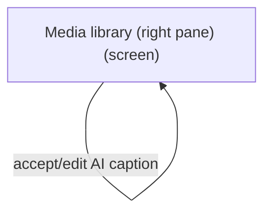
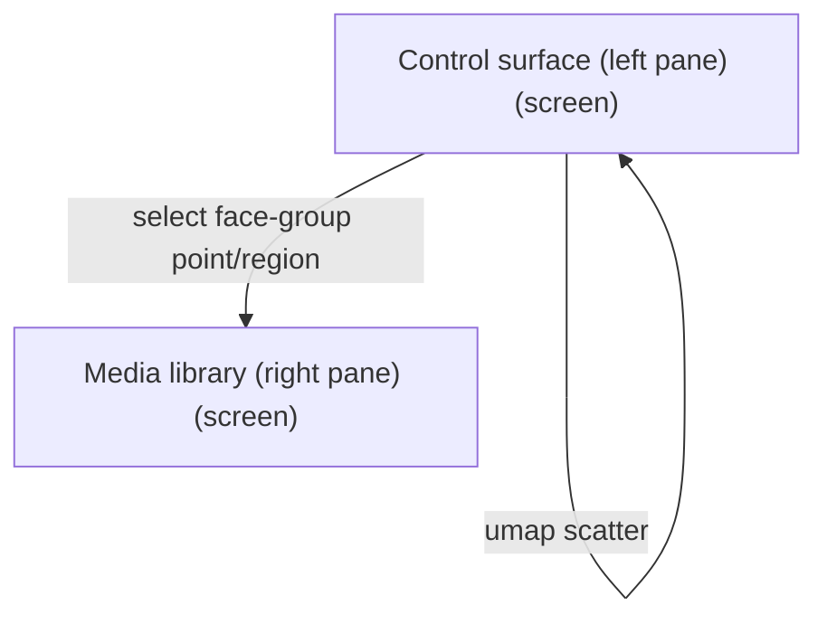
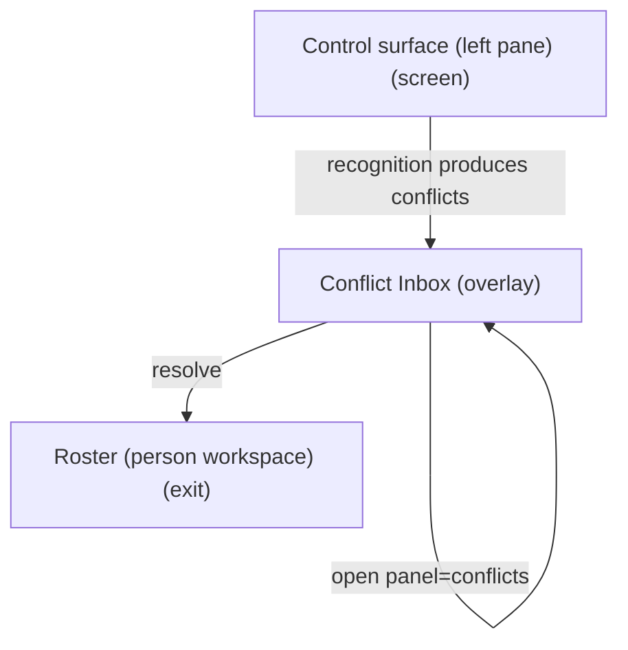
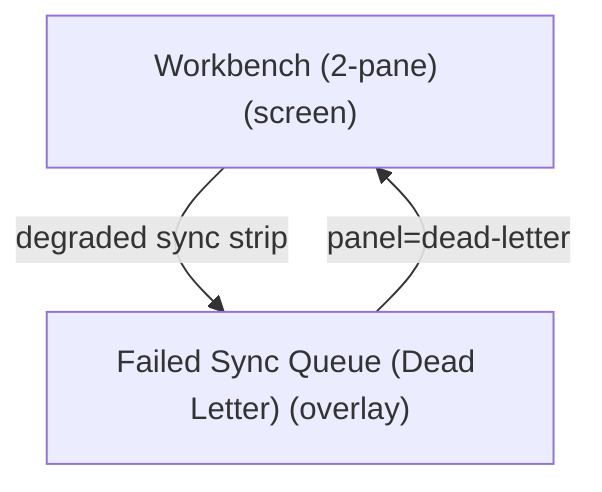

# UX Map — workbench-2pane-audit-10033-proposal

**Product:** `prototype-wp-alt-context`
**Source fixture:** `apps/prototype-wp-alt-context/js/admin/pages/WorkbenchPage.tsx`

## Goals
- NEXT-WAVE PROPOSAL: corrected audit map; native critique receipt and independent implementation review required. Source baseline7df0.0.40; no live-state acceptance claimed.
- Four ACX submenus have distinct goals: Overview orients; Review Queue owns recognizing people and reviewing/editing/approving descriptions beside each image; People manages named people; Settings configures the service. Previous description runs are choices within the image Alt text area. The retired Description Runs URL redirects to Workbench.
- One primary action according to existing review-surface ownership. The library action/status panel holds Describe beside selection and related progress; recognition is the global Settings toggle disclosed under Describe, not a second competing inference CTA.
- Operator runs the full recognize -> name -> curate loop and edits alt-text/descriptions without leaving one surface (control-left, library-right)
- Read face-group status at a glance in the control pane and act on the selection in the same viewport
- Decompose the 2-pane redesign from screens/zones/states/flows instead of inventing IA mid-plan

## Jobs
- `job-cluster-recognize` — Build & recognize face groups (refresh groups, run recognition)
- `job-name-curate` — Name & curate people (confirm/correct/merge/split, assign names)
- `job-caption-library` — Caption & describe media (alt-text + long description on library rows)
- `job-triage-sync` — Triage people conflicts / failed sync (overlays)

## Screens
| id | kind | route | title |
| --- | --- | --- | --- |
| `workbench-2pane-shell` | screen | `#/workbench` | Workbench (2-pane) |
| `workbench-control` | screen | `#/workbench` | Control surface (left pane) |
| `workbench-library` | screen | `#/workbench` | Media library (right pane) |
| `workbench-conflicts` | overlay | `#/workbench?panel=conflicts` | Conflict Inbox |
| `workbench-dead-letter` | overlay | `#/workbench?panel=dead-letter` | Failed Sync Queue (Dead Letter) |
| `exit-roster` | exit | `#/roster` | Roster (person workspace) |
| `exit-settings` | exit | `#/settings` | Settings / service health |

## Code references
- `screen:workbench-2pane-shell` — `apps/prototype-wp-alt-context/js/admin/pages/WorkbenchPage.tsx`
- `screen:workbench-control` — `apps/prototype-wp-alt-context/js/admin/pages/WorkbenchPage.tsx`
- `screen:workbench-library` — `apps/prototype-wp-alt-context/js/admin/pages/workbench/MediaSelection.tsx`
- `screen:workbench-conflicts` — `apps/prototype-wp-alt-context/js/admin/pages/workbench/ConflictInbox.tsx`
- `screen:workbench-dead-letter` — `apps/prototype-wp-alt-context/js/admin/pages/workbench/DeadLetterPanel.tsx`
- `screen:exit-roster` — `apps/prototype-wp-alt-context/js/admin/pages/RosterPage.tsx`
- `screen:exit-settings` — `apps/prototype-wp-alt-context/js/admin/pages/SettingsPage.tsx`

### Workbench (2-pane) (`workbench-2pane-shell`)

```
+------------------------------------------------------------+
| Workbench (2-pane)  [screen]  #/workbench                  |
| Two-pane operator surface: left control (face-group/recog\ |
|   nize/name/curate), right media library (alt-text + long\ |
|   -description). Overlays host conflicts and dead-letter.  |
+------------------------------------------------------------+
| ZONES                                                      |
|   - Workbench header + recognition endpoint (read-only st\ |
|   atus; server-resolved) + sync/projection status strip (\ |
|   status) states=[default,loading,error,degraded]          |
|   - Left pane host (control surface) (content) states=[de\ |
|   fault,loading,empty,error]                               |
|   - Pane divider / collapse-left control (other) states=[\ |
|   default]                                                 |
|   - Right pane host (media library) (content) states=[def\ |
|   ault,loading,empty,error]                                |
|   - Overlay host (conflicts | dead-letter) (other) states\ |
|   =[default,empty]                                         |
+------------------------------------------------------------+
| ACTIONS                                                    |
|   [PRIMARY] Describe N selected (footer primary; runs rec\ |
|   ognition first when the Settings toggle is ON, then des\ |
|   cription; disclosure states ON/OFF/unknown) -> job-pipe\ |
|   line (costly,preview)                                    |
|   [secondary] Open Conflict Inbox -> workbench-conflicts   |
|   [secondary] Open Failed Sync Queue -> workbench-dead-le\ |
|   tter                                                     |
+------------------------------------------------------------+
| states: default | loading | error | degraded | offline     |
+------------------------------------------------------------+
```

### Control surface (left pane) (`workbench-control`)

```
+------------------------------------------------------------+
| Control surface (left pane)  [screen]  #/workbench         |
| Current selected face-group context and actionable review\ |
|    queue; one empty-state action, collapsed irrelevant em\ |
|   pty sections, secondary scan control. Description lifec\ |
|   ycle status belongs with Describe.                       |
+------------------------------------------------------------+
| ZONES                                                      |
|   - Recognition endpoint + health (read-only: InsightFace\ |
|    :10010 interim; FIR when stable; target is server-reso\ |
|   lved via ACX_RECOGNITION_URL, no UI toggle per RECOG-1)\ |
|    (status) states=[default,loading,error,degraded]        |
|   - Face-group/recognition controls (run, refresh, thresh\ |
|   old) (job) states=[default,loading,error]                |
|   - Face-group status (scan/sync health; not a 2D scatter\ |
|   ) (status) states=[default,loading,empty,error,first_ti\ |
|   me,degraded]                                             |
|   - Face-group list / selection (size, confidence, unname\ |
|   d-first) + NameFaceControl (loading = in-flight name wr\ |
|   ite; the suggestions disclosure being open or closed is\ |
|    part of default). Twin-pending (an edge_input of defau\ |
|   lt) copy: Same person as <survivor label>? — Merge into\ |
|    <survivor label> / Not the same (chip on the unlabeled\ |
|    twin; decision persists on the labeled survivor; COG-0\ |
|   3 one decision per pair; DATA-14 single authority is th\ |
|   e survivor resolver). Actions merge_twin / keep_separat\ |
|   e are implemented in the list item — see code_ref. (que\ |
|   ue) states=[default,loading,empty,error,first_time,degr\ |
|   aded,edge_input]                                         |
|   - Name this person (NameFaceControl; confirm / correct \ |
|   / merge / split; forced-choice; loading = pending roste\ |
|   r write; error = roster write failed; edge_input = ambi\ |
|   guous candidate set or duplicate-name guard; default = \ |
|   overlay closed or suggestions open) (forced_choice) sta\ |
|   tes=[default,loading,error,edge_input]                   |
+------------------------------------------------------------+
| ACTIONS                                                    |
|   [PRIMARY] Run / refresh recognition + grouping -> job-p\ |
|   ipeline (costly,preview)                                 |
|   [secondary] Go to Roster -> exit-roster                  |
|   [secondary] Save name (NameFaceControl) -> identity-sto\ |
|   re (costly,preview)                                      |
|   [secondary] Select face group (list) -> workbench-libra\ |
|   ry                                                       |
|   [secondary] View / change recognition endpoint + recogn\ |
|   ition ON/OFF toggle (Settings; server-resolved endpoint\ |
|   ) -> exit-settings                                       |
|   [secondary] Keep twin separate -> identity-store         |
|   [DESTRUCTIVE] Merge / split / correct group -> identity\ |
|   -store (costly,preview)                                  |
|   [DESTRUCTIVE] Merge twin into labeled survivor -> ident\ |
|   ity-store                                                |
+------------------------------------------------------------+
| states: default | loading | empty | error | first_time | \ |
|   degraded                                                 |
+------------------------------------------------------------+
```

### Media library (right pane) (`workbench-library`)

```
+------------------------------------------------------------+
| Media library (right pane)  [screen]  #/workbench          |
| Library selection and one persistent Describe action, usa\ |
|   ge estimate, job-scoped progress/cancel/return in the s\ |
|   ame viewport; list may scroll without hiding action/sta\ |
|   tus or focused rows.                                     |
+------------------------------------------------------------+
| ZONES                                                      |
|   - Library filters (status, has-alt, has-description, fa\ |
|   ce group, search) (form) states=[default,loading,error]  |
|   - Media library table (thumb | title | status | alt-tex\ |
|   t | long description | people) (queue) states=[default,\ |
|   loading,empty,error,first_time,edge_input]               |
|   - Inline person naming (NameFaceControl) + alt-text / l\ |
|   ong-description editor (loading = pending save; the sug\ |
|   gestions disclosure being open or closed is part of def\ |
|   ault) (form) states=[default,loading,error,edge_input]   |
|   - AI name / caption suggestions (evidence-linked; edita\ |
|   ble before accept; loading = suggestion request in flig\ |
|   ht; the suggestions disclosure being open or closed is \ |
|   part of default) (ai_review) states=[default,loading,em\ |
|   pty,error]                                               |
|   - Persistent library action/status panel: ONE job CTA —\ |
|    'Describe N selected' (plain count, no plural switch; \ |
|   primary accent in select state; zero-state label 'Descr\ |
|   ibe selected', rg-003) with a recognition disclosure di\ |
|   rectly under it (aria-describedby): ON = names people i\ |
|   t knows while describing; OFF = descriptions only, chan\ |
|   ge in Settings; unknown = settings not loaded. MediaAna\ |
|   lyzeCta / 'Analyze selected' is deleted (L2c, WBUX-6) —\ |
|    Describe owns the scan trigger, so recognition is neve\ |
|   r a separate operator step (INT-05 one job entry; COG-0\ |
|   3 one decision: the global toggle). Four hold reasons k\ |
|   eep the primary focusable with aria-disabled="true" plu\ |
|   s an onClick no-op — never the HTML disabled attribute \ |
|   — and each contributes a reason id joined into aria-des\ |
|   cribedby: offline (empty/offline state), zero-selection\ |
|    (empty state), identifying (loading state, label 'Iden\ |
|   tifying people…'), settings-pending (loading state, lab\ |
|   el 'Loading settings…'). settings-unavailable is a fift\ |
|   h, hold-adjacent state and NOT a hold: when the recogni\ |
|   tion-settings query errors the hold is RELEASED, Descri\ |
|   be proceeds with recognition treated as off, and the di\ |
|   sclosure reads 'Recognition settings unavailable — desc\ |
|   ribing without identifying people · ~N credits' paired \ |
|   with an AlertTriangle icon so the degradation is never \ |
|   colour-alone (sr-004; degraded state; RLSE-05 the failu\ |
|   re is visible, never silent). A11Y contract for that no\ |
|   tice (WBUX6-W4-B-02): the disclosure text node stays th\ |
|   e aria-describedby target and is therefore only reachab\ |
|   le on focus, so the degraded copy is ALSO mirrored into\ |
|    a separate polite live region (role="status" aria-live\ |
|   ="polite") that is not the describedby target — one sur\ |
|   face to describe, one surface to announce, never the sa\ |
|   me node doing both (A11Y-21). A single Cancel control s\ |
|   pans the identifying and describing phases; its visible\ |
|    label is state-dependent, not a fixed string — identif\ |
|   ying = 'Cancel people identification', describing = 'Ca\ |
|   ncel describe run', in-flight cancel = 'Cancelling…' — \ |
|   and exactly one control matching /^Cancel / is rendered\ |
|    at a time. Run progress phases queued -> warming -> de\ |
|   scribing -> complete | failed | cancelled come from des\ |
|   cribeApi DESCRIBE_RUN_PHASE (single authority, sr-007) \ |
|   and render as loading (queued/warming/describing) or de\ |
|   fault (terminal). Done copy: ✔ N drafts ready to review\ |
|   [ · M failed]; Review drafts links to #/workbench?hasDr\ |
|   aft=1&run=<id>. Credit estimates describe selected imag\ |
|   es; zero selection prompts choosing images and does not\ |
|    imply a zero account balance. The panel remains visibl\ |
|   e with the active selection at desktop and narrow viewp\ |
|   orts; existing run progress and cancellation are colloc\ |
|   ated, while pagination remains separate. Balance/estima\ |
|   te stays explicitly unknown until a tenant-bound read c\ |
|   ontract is qualified. (job) states=[default,loading,emp\ |
|   ty,error,offline,degraded]                               |
|   - Alt text per image: latest generated draft on the nor\ |
|   mal media view, visible previous-description chooser wi\ |
|   th run/time provenance, edit and explicit approval usin\ |
|   g the existing correction contract. Older versions load\ |
|    in bounded pages; unavailable history is visible and r\ |
|   etryable. Choosing a version only previews it and never\ |
|    saves or starts inference. (ai_review) states=[default\ |
|   ,loading,empty,error]                                    |
+------------------------------------------------------------+
| ACTIONS                                                    |
|   [PRIMARY] Describe N selected (footer primary; runs rec\ |
|   ognition first when the Settings toggle is ON, then des\ |
|   cription; disclosure states ON/OFF/unknown) -> job-pipe\ |
|   line (costly,preview)                                    |
|   [secondary] Accept AI caption/description (editable) ->\ |
|    media-store (preview)                                   |
|   [secondary] Edit alt-text inline -> media-store          |
|   [secondary] Edit long description inline -> media-store  |
+------------------------------------------------------------+
| states: default | loading | empty | error | first_time | \ |
|   edge_input                                               |
+------------------------------------------------------------+
```

### Conflict Inbox (`workbench-conflicts`)

```
+------------------------------------------------------------+
| Conflict Inbox  [overlay]  #/workbench?panel=conflicts     |
| Review people conflicts; commit human judgment with evide\ |
|   nce                                                      |
+------------------------------------------------------------+
| ZONES                                                      |
|   - Conflict list (queue) states=[default,loading,empty,e\ |
|   rror]                                                    |
|   - Conflict detail / candidates (forced_choice) states=[\ |
|   default,loading,empty,error]                             |
|   - Resolve / defer actions (form) states=[default,loadin\ |
|   g,empty,error]                                           |
+------------------------------------------------------------+
| ACTIONS                                                    |
|   [PRIMARY] Resolve conflict -> identity-store (costly,pr\ |
|   eview)                                                   |
+------------------------------------------------------------+
| states: default | loading | empty | error                  |
+------------------------------------------------------------+
```

### Failed Sync Queue (Dead Letter) (`workbench-dead-letter`)

```
+------------------------------------------------------------+
| Failed Sync Queue (Dead Letter)  [overlay]  #/workbench?p\ |
|   anel=dead-letter                                         |
| Inspect failed sync ops; retry or discard                  |
+------------------------------------------------------------+
| ZONES                                                      |
|   - Dead-letter items (queue) states=[default,loading,emp\ |
|   ty,error]                                                |
|   - Retry / discard (form) states=[default,loading,empty,\ |
|   error]                                                   |
+------------------------------------------------------------+
| ACTIONS                                                    |
|   [PRIMARY] Retry failed op -> sync (costly,preview)       |
|   [DESTRUCTIVE] Discard failed op -> sync (costly,preview\ |
|   ,irreversible)                                           |
+------------------------------------------------------------+
| states: default | loading | empty | error                  |
+------------------------------------------------------------+
```

### Roster (person workspace) (`exit-roster`)

```
+------------------------------------------------------------+
| Roster (person workspace)  [exit]  #/roster                |
| Manage identified persons after naming/curating in Workbe\ |
|   nch                                                      |
+------------------------------------------------------------+
| ZONES                                                      |
|   - Roster entry (nav) states=[default]                    |
+------------------------------------------------------------+
| states: default | loading | empty | error                  |
+------------------------------------------------------------+
```

### Settings / service health (`exit-settings`)

```
+------------------------------------------------------------+
| Settings / service health  [exit]  #/settings              |
| Configure the service: recognition endpoint + connection \ |
|   health, the global recognition ON/OFF toggle, and Data \ |
|   & retention (consolidated from the retired alt-context-\ |
|   retention submenu, E1)                                   |
+------------------------------------------------------------+
| ZONES                                                      |
|   - Settings form + test connection (form) states=[defaul\ |
|   t,loading,error]                                         |
|   - Recognition toggle (acx_recognition_enabled; default \ |
|   ON; global, not per-image — OFF makes Describe produce \ |
|   descriptions only and the Workbench footer disclosure s\ |
|   ays so; analyze endpoint answers 409 recognition_disabl\ |
|   ed) (form) states=[default,loading,error]                |
|   - Data & retention section (RetentionSection on the ret\ |
|   ention screen; one stable h3#acx-retention-title across\ |
|    loading/error/loaded so the ?section=retention deep-li\ |
|   nk focus survives pending -> loaded; retention mode, ex\ |
|   port, import, audit events) (form) states=[default,load\ |
|   ing,error,degraded]                                      |
+------------------------------------------------------------+
| states: default | loading | error                          |
+------------------------------------------------------------+
```

## Flows
### Run recognition -> select face group -> name/curate -> library people column updates (`flow-recognize-name-curate`)

```
flow: Run recognition -> select face group -> name/curate -> \
  library people column updates (flow-recognize-name-curate) \
  job=job-name-curate
  1. Workbench (2-pane) [workbench-2pane-shell]
     --enter-->
  2. Control surface (left pane) [workbench-control]
     --run recognition (preview cost)-->
  3. Control surface (left pane) [workbench-control] (visit 2)
     --select face group (umap/list)-->
  4. Control surface (left pane) [workbench-control] (visit 3)
     --name / curate-->
  5. Media library (right pane) [workbench-library]
```

```mermaid
flowchart TD
  %% flow: Run recognition -> select face group -> name/curate -> library people column updates job=job-name-curate
  n_workbench_2pane_shell["Workbench (2-pane) (screen)"]
  n_workbench_control["Control surface (left pane) (screen)"]
  n_workbench_2pane_shell -->|enter| n_workbench_control
  n_workbench_control -->|run recognition (preview cost)| n_workbench_control
  n_workbench_control -->|select face group (umap/list)| n_workbench_control
  n_workbench_library["Media library (right pane) (screen)"]
  n_workbench_control -->|name / curate| n_workbench_library
```

### Filter needs-alt -> accept/edit AI caption -> edit long description (`flow-caption-library`)

```
flow: Filter needs-alt -> accept/edit AI caption -> edit long\
   description (flow-caption-library) job=job-caption-library
  1. Media library (right pane) [workbench-library]
     --filter has-alt=false-->
  2. Media library (right pane) [workbench-library] (visit 2)
     --accept/edit AI caption-->
  3. Media library (right pane) [workbench-library] (visit 3)
```



### UMAP scatter -> select face group -> right library filters to face-group media (`flow-umap-select-to-library`)

```
flow: UMAP scatter -> select face group -> right library filt\
  ers to face-group media (flow-umap-select-to-library) job=j\
  ob-cluster-recognize
  1. Control surface (left pane) [workbench-control]
     --umap scatter-->
  2. Control surface (left pane) [workbench-control] (visit 2)
     --select face-group point/region-->
  3. Media library (right pane) [workbench-library]
```



### Recognition produces conflicts -> conflict overlay -> resolve -> roster if needed (`flow-scan-to-conflict`)

```
flow: Recognition produces conflicts -> conflict overlay -> r\
  esolve -> roster if needed (flow-scan-to-conflict) job=job-\
  triage-sync
  1. Control surface (left pane) [workbench-control]
     --recognition produces conflicts-->
  2. Conflict Inbox [workbench-conflicts]
     --open panel=conflicts-->
  3. Conflict Inbox [workbench-conflicts] (visit 2)
     --resolve-->
  4. Roster (person workspace) [exit-roster]
```



### Sync failure -> dead letter -> retry/discard (`flow-dead-letter-recover`)

```
flow: Sync failure -> dead letter -> retry/discard (flow-dead\
  -letter-recover) job=job-triage-sync
  1. Workbench (2-pane) [workbench-2pane-shell]
     --degraded sync strip-->
  2. Failed Sync Queue (Dead Letter) [workbench-dead-letter]
     --panel=dead-letter-->
  3. Workbench (2-pane) [workbench-2pane-shell] (visit 2)
```



## Open questions
- OPEN: long-description has no data field yet (media items have only alt text). Ship the alt-text column first, long-description behind a new field? [FORM]
- OPEN: no 2D projection data exists (only bbox + 3D head pose). Ship the left pane as a face-group list first; scatter map is a fast-follow once a projection endpoint exists? [VIZ-01,VIZ-15]
- RESOLVED: operator vocab is group / person / face — never cluster / identities / embeddings. Enforced by the banned-vocabulary sweep.
- OPEN: Selecting a face group in the map/list: filter the right library pane, open the naming form, or both (coordinated views)? [VIZ-15]
- RESOLVED: one naming surface (NameFaceControl) with a single-gesture Save name; overlay candidates and confirm share that control.
- OPEN: Endpoint switch (InsightFace vs FIR/SFace) changes the recognition model server-side; do existing face groups invalidate and need a fresh grouping on switch? [HAI-02]
- OPEN: Left/right min-width + left-collapse on narrow (<1100px) viewports; control collapses to a drawer, library stays reachable? [NAV-08,A11Y-08]
- OPEN: Alt-text vs long-description: two fixed columns or one expandable row-detail? [PERC-01,UI-04]
- RESOLVED (WBUX-6): 'Describe selected' vs 'Analyze selected' unified into one Describe CTA; recognition on/off is a GLOBAL Settings toggle (default ON), not a per-image choice — one decision per operator, per-image override deferred until a real demand appears (COG-03, INT-05).
- OPEN: Bulk-describe cost preview granularity: per-image cost surfaced before start? [INT-07]

## Not doing
- Clusters tab inside Roster (retired; cluster structure lives in Workbench left pane now)
- UI toggle for the recognition endpoint (server-resolved per RECOG-1; topbar is read-only status)
- Pixel/token values (design tokens referenced --acx-*, not specified here)
- Attachment-edit SPA (separate map_ref)
- Big-bang removal of the current tabbed shell (migration path, not in this map)
- REST sequence diagrams (see docs/workbench-data-flow.mmd)
- Per-image recognition opt-out on the library row (global Settings toggle only; revisit if operators ask)
- Standalone Data Retention admin submenu (retired into Settings ?section=retention)
